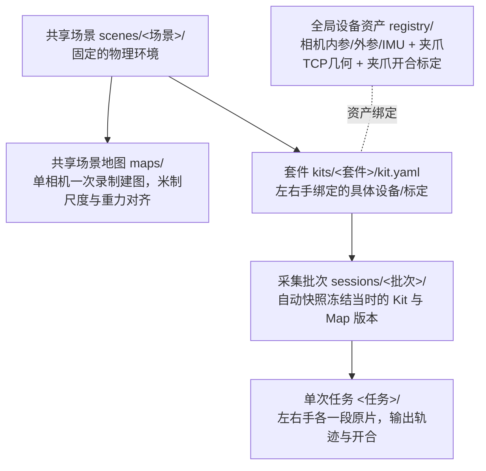

# UMI 相机标定与轨迹采集

从 Insta360 X3 原始 `.insv` 录像生成夹爪 TCP 位姿。日常流程是：

**登记设备 → 登记场景及其套件 → 建立采集批次 → 导入原片 → 离线建图与抽取 → 查看、验收与导出。**

首次操作请按 [双手采集操作手册](docs/操作手册.md) 执行，其中逐步列出上传文件、接收目录、处理命令和产出位置。

场景包含套件，套件包含采集批次，批次包含任务；场景地图由各套件复用，设备实测资产全局共享。每个套件只有一个 `kit.yaml`，批次自动保存当时的设备与测量快照。一套设备允许只有左手、只有右手或双手。任务支持人工核验的双手固定时间偏移；未配置时保留未经确认的零偏移假设。训练中间包由独立入口 `umi-dataset` 导出，见 [训练数据指南](docs/训练数据.md)。

## 架构与心智模型

系统解构为自上而下的四层物理实体，所有物理标定与几何参数均带哈希版本快照：



处理流水线分四阶段：**录制入库对齐 → 共享地图定位与 IMU 因子图融合 → 前镜头指尖 ArUco 视觉测距 → 训练中间包标准化导出 (`umi-dataset`)**。

## 1. 安装、验证与设备标定

从项目根目录执行：

```bash
bash install.sh
./test.sh       # 一键运行全部主测试、历史测试与前端测试
./umi-traj check
./umi-calib check

./umi-calib run recordings/calibration/IAQEB26097M4CP/20261022/front --tag-size-mm 24.0
# 阅读 umi_calib_out/report.txt 后手动登记
./umi-calib install recordings/calibration/IAQEB26097M4CP/20261022/front/umi_calib_out
```

A/B/C/D 分别放在 `front/A/` 到 `front/D/`，保留原始文件名。按实际替换序列号、日期和标定板尺寸。安装新标定保留旧版本，已有套件不会自动改用新标定。

[安装指南](docs/安装.md) · [标定指南](docs/标定/说明.md)

## 2. 一次登记，按批次采集

下面使用已有的左手设备演示；双手套件在 `kit` 命令中增加 `--right <完整序列号>`。

```bash
./umi-scene init scenes/shelf
./umi-scene kit scenes/shelf kit_001 --left IAQEB26097M4CP

./umi-scene session scenes/shelf --name 20261025_001 --kit kit_001

./umi-scene ingest /media/sd/this_session --session scenes/shelf/kits/kit_001/sessions/20261025_001
```

每个导入目录应对应本批次的采集活动。同一套设备跨多个场景录制时，需要先明确各场景对应哪些原片。系统无法仅凭相机和时间推断场景。

左右身份来自套件。双手任务缺一只手时保留待补齐，配对有歧义时保留原片待确认。双手套件录单手任务需明确传 `--arms left` 或 `--arms right`。[完整操作与配对规则](docs/场景.md)

## 3. 离线处理与查看

场景尚无地图时，用该场景的建图录像发布地图；批次可以提前建立，首次实际处理时固定所用地图版本。

```bash
./umi-scene build scenes/shelf --mapping /media/sd/VID_mapping.insv
./umi-scene run scenes/shelf/kits/kit_001/sessions/20261025_001
./umi-scene status scenes/shelf
./umi-view scenes/shelf
```

重复导入不会重复建任务，成功结果可以复用；失败重试保留已有成功结果。`run scenes --jobs 2` 可跨场景批处理，按机器资源设置并行数。默认 `shared_front` 使用共享前地图；`dual` 使用左右前地图和共享后地图，要求对应设备的实测后镜头标定。

配置了各手宽度标定的任务会从指尖标记估计夹爪开合，并随训练包保留有效性，见 [宽度接入](docs/训练数据.md#夹爪宽度标定与接入)。

任务结果入口为 `scenes/<场景>/kits/<套件>/sessions/<批次>/<任务>/results/`。先读 `report.txt`，各手 `traj_tcp.txt` 为固定场景系中的 TCP 位姿，双手任务另有 `bimanual.csv`。人工验收通过后，可用 `review`、`export` 导出合格任务，命令见 [场景指南](docs/场景.md)。

查看器默认地址 **http://127.0.0.1:9091**，支持轨迹、稀疏地图和前镜头视频。默认视频 720×720、保留鱼眼畸变。内部一致性指标不能代替独立精度测量；现有 [模拟商超示例](scenes/supermarket_demo/README.md) 使用历史实验室单相机录像。

`umi-traj <录像.insv>` 保留用于独立实验：按当前默认标定处理，每段独立建图，不提供跨任务共享坐标。

[文档导航](docs/README.md) · [设备与目录](docs/设备与目录.md) · [参数管理](config/README.md) · [代码维护](docs/dev/README.md)
