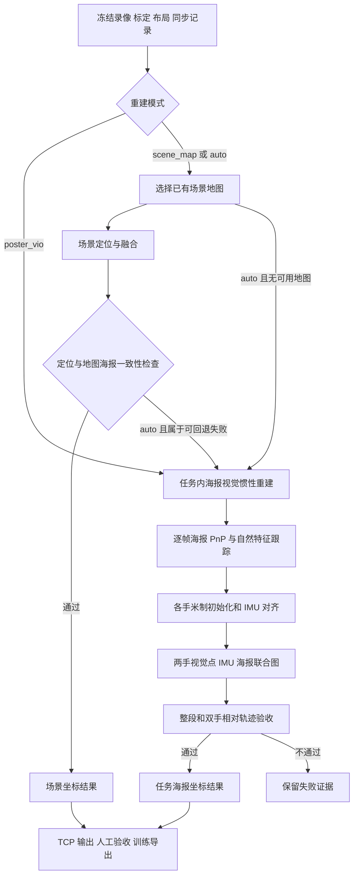

# 无场景地图的双手轨迹重建方案

> 历史记录。现行操作和配置见[文档导航](../../README.md)。

[代码维护](../README.md) · [环境标签与自适应融合](环境标签与自适应融合重构计划.md) · [场景处理](../../场景处理.md)

状态：`poster_independent` 与第一版任务级 `poster_vio` 已接入；复杂前端质量门槛和独立精度验收仍在完善。日期：2026-11-18。

## 当前实施范围

采用分阶段交付：首先复用已有独立引擎，让各手在本次录像中持续融合海报，再使用任务级联合图处理海报角点、IMU 和自然特征。当前合法模式为 `scene_map / poster_independent / poster_vio / auto`，由同一条场景流水线的任务级估计接口调度。当前配置与边界见[操作说明](../../场景处理.md#选择轨迹估计后端)。

两条独立轨迹通过一个整体变换对齐海报，能统一原点、朝向，适用于内部轨迹已经可靠的录像；整体变换不能修复随时间变化的漂移、尺度变化和跟踪重启。阶段性后端在独立优化图中持续加入海报角点因子，并保留分段尺度变量，之后转换输出坐标，不能简化成只做事后刚体对齐。

阶段性 `poster_independent` 仍依赖本录像视觉 SLAM 和惯性初始化成功；无地图 `poster_vio` 不读取旧场景地图，直接使用冻结海报、IMU 和双镜头自然特征。`poster_vio` 已增加整板鲁棒 PnP 初始化、共享海报位姿、每手 IMU 状态、海报角点因子、几何筛选、重关联、关键帧恢复和自然点留出；语义动态物体筛除、滑窗边缘化和独立精度验收仍未交付。高覆盖但有系统偏差的地图自动识别仍属于 `auto` 的后续诊断能力。

当前主要代码：`scene/models.py` 定义共享的 `TaskInputs` 与 `ArmExecutionResult`，两种后端直接使用该输入输出契约；`scene/pipeline/tasks/estimation.py` 定义任务级后端注册与自动路由；`backends/poster_independent.py` 组织各手独立重建和任务海报验收；`backends/independent_reconstruction.py` 复用独立重建引擎、冻结输入并转换板坐标。原 `poster.FUSION_METHODS` 继续只服务场景地图后端的 `staged/joint` 初始化，不与任务后端注册混用。

实验性 `poster_vio` 的具体实现边界见 [模块指南](../../../software/trajectory/poster_vio/README.md)。当前自然点来自 front/rear 原片各自的 1440 标定裁切，共用一次解码，使用前后向光流、视差/深度筛选和三角化；工作镜头使用冻结遮手图，环境镜头排除标签区域。两镜头分别使用各自内外参与时差，特征 ID 按手和镜头隔离，支持证据分别记录。持续补点采用按时间分配的轨迹保留预算；有限轮后验剔除和初始化前标签留出已接入。整板鲁棒初始化、KB4 几何筛选、同镜头 ORB 重关联、批量三角化、热启动重求解、自然点留出及关键帧/条件惯性恢复已接入；语义动态分割、滑窗边缘化与 GPU 加速仍未接入。全部曝光保留精确时刻；主图之外的输出节点由固定端点的局部惯性图优化恢复，不靠普通位姿插值或摊分端点误差；双手共享初始化后的海报坐标重力。`auto` 会在地图质量不足后或无地图时尝试本后端，失败再交给 `poster_independent`。

以下第 1–15 节描述完整目标与设计，未逐项标记的算法/性能能力不能据此视为已经交付；当前能力以上述范围和模块指南为准。

## 1. 目标与交付边界

完整 `poster_vio` 的目标：不读取预建场景地图的几何，用本次任务录像中的自然视觉特征、IMU 和固定海报的米制布局，联合估计左右手轨迹。它既可以被显式选择，也可以在场景地图缺失、不可用或任务定位质量失败后，作为整个双手任务的回退后端。

这里的“无场景地图”指不需要采集前建立的地图；本次求解仍会三角化自然特征点，形成任务内的稀疏局部结构。完整 `poster_vio` 的最终图直接优化相机/IMU 状态、视觉三维点和海报约束。双手训练轨迹是否合格由误差及验收证据决定，并不要求一定使用同一张图；完整 BA 用于进一步解决独立初始化依赖、局部形变等已确认问题。

交付目标是可验收的米制 TCP 轨迹和双手相对位姿，不能只凭优化收敛或像素 RMS 宣称准确。精度必须通过独立参考、已知长度运动或双手固定夹具实验确认；没有独立参考时继续记录 `actual_error: not_measured`。

第一版约束如下：

- 同一任务中两手看到的是同一块固定的刚性海报，标签布局与实际打印尺寸一致。
- 每只手均需要足够的直接海报观测，以完成米制初始化和约束恢复；不要求同时看到相同 ID。
- 使用各设备的 front/rear 内参、相对 IMU 外参、时间偏移，以及明确的相机到 TCP 变换。
- 自然视觉特征来自工作镜头和环境镜头；工作镜头应用遮手图，环境镜头同时贡献海报角点，并从自然特征中排除检测到的标签区域。
- 不加入左右手运动相同、相距恒定或速度相同的假设。两只手可以独立运动。
- 不在第一版解决移动海报、多块互不关联的海报、完全无标签的一手、跨任务世界坐标一致或标签长期不可见且视觉也失效的问题。

## 2. 现有能力与缺口

### 2.1 同一条流水线中的两层估计接口

现有场景流水线已抽出任务级估计接口，录像检查、资产冻结、时间同步、输入准备、TCP 转换、质量报告、人工验收和训练导出继续共用。`poster_vio` 通过该接口接收冻结录像和布局，统一返回任务海报坐标下的轨迹、坐标定义和质量证据。

现有 `scene/spatial/poster.py` 的 `FUSION_METHODS` 已提供一个可插拔接口，但它只选择海报联合图的初值：`staged` 返回地图 + IMU 基线，`joint` 返回地图视觉定位种子。单手 `fuse_poster()` 和双手 `refine_shared_poster_pose()` 共用该选择；两种方法的最终图结构、鲁棒剔除和验收相同，均使用场景地图先验。当前外层仍先计算地图 + IMU 基线，不能把 `joint` 理解为跳过地图基线验收或不依赖地图。

任务级接口位于更上层：当前选择 `scene_map`、`poster_independent` 或 `poster_vio`；`auto` 负责选择和失败回退，不是第三种数值估计后端。`poster_vio` 通过独立的标签初始化、自然视觉点和观测接口接入，不能只往 `FUSION_METHODS` 注册一个初值函数，也不能作为 `fusion.method` 的第三个值。

### 2.2 现有场景地图后端的内部选择

以下是彼此分工不同的维度，并非一组互斥后端：

| 维度 | 现有分支 | 作用和边界 |
|---|---|---|
| 地图布局 | `scene.layout: shared / per_arm / auto` | `shared` 对应共享工作镜头地图；`per_arm` 对应左右工作镜头地图和共享环境镜头地图；`auto` 只按建图目录结构判断布局 |
| 任务标签使用 | 关闭 / 诊断 / 融合 | 总开关关闭时不检测；开启总开关而关闭 `fusion.enabled` 时只诊断；开启融合后才加入海报因子 |
| 海报融合初值 | `environment_poster.task_constraint.method: staged / joint` | 只在启用海报融合时选择初值，两者都使用地图先验；诊断以基线为依据 |
| 任务使用手 | 单手 / 双手 | 单手独立求解；双手启用海报融合时通过共享板位姿组图，不要求看到相同 ID |
| 定位恢复 | 正向 / 反向补全 | 在同一冻结地图内恢复定位，仍属 `scene_map`，不属于后端切换 |
| 现有失败回退 | 完整单手任务的独立重建 | 仅特定场景融合质量失败可触发；双手不支持，启用 `joint` 标签融合的旧独立回退目前会拒绝 |
| 建图标签用途 | 关闭 / 尺度诊断 / 尺度修正 | `mapping.enabled` 和 `mapping.scale.enabled` 控制地图发布前的处理，不选择任务估计后端 |

现有海报融合观测不足时仍可能保留地图基线；这不等于已经切换为无地图估计。当前某只手完全缺少海报时可保留地图 + IMU 基线的行为，也不能照搬为无地图后端的可靠双手结果。

### 2.3 复用点和待补接口

| 现有实现 | 能复用什么 | 本方案需补什么 |
|---|---|---|
| `scene/pipeline/tasks/recording_preparation.py`、`tasks/results/arm_writer.py` | 共用录像准备、真实帧时间、测量与 TCP 输出 | 各估计后端共用，完整 BA 无需重复实现 |
| `scene/pipeline/tasks/backends/scene_reconstruction.py` | 固定地图定位缓存与每手场景融合 | 场景地图专用求解保持原接口 |
| `scene/pipeline/tasks/estimation.py`、`tasks/backends/scene_map.py` | 任务后端注册、整任务回退及场景内双手组图 | 新增完整 `poster_vio` 适配器和对应质量判定 |
| `scene/pipeline/tasks/backends/independent_reconstruction.py` | 单手本录像独立重建、资产冻结 | 不是标签初始化的双手视觉惯性 BA；不直接扩充成双手拼接 |
| `scene/spatial/poster.py` | KB4 标签因子、鲁棒核、时间节点、共享板观测 | 当前仍含场景地图位姿先验；新图不能携带这些先验 |
| `vision/poster/detection.py` | ArUco 检测、原始角点、缓存和真实 PTS | 板级鲁棒初始化、拒绝原因及观测选择记录 |
| `vision/poster/geometry.py` | KB4 投影/反投影、Jacobian、平面候选 | 当前 `estimate_board` 依赖已有相机轨迹；新增逐帧板 PnP 初始化 |
| `vision/poster/quality.py`、`factors.py` | 共享角点噪声、剔除预算、条件质量诊断及海报因子 | 新后端复用同一套几何规则与因子，不再复制实现 |
| `vision/slam.py` | 本录像 SLAM，可作可选种子 | 当前 Python 边界主要提供轨迹/图集，不提供最终 BA 所需的完整特征轨迹接口 |
| `trajectory/algorithms/fusion/poster.py` | 独立图中的海报角点约束 | 先依赖独立惯性基线成功，不能直接替代标签初始化 |
| `scene/result_io.py`、`dataset/source.py` | 结果校验、验收和训练输出 | 已支持 umi_poster_episode 任务海报坐标；后续复用该契约接入完整 BA |

借鉴 specialist 的 `vi_ba/single_camera.py`、`init.py`、`build.py` 和 `compose.py` 中“标签种子 → 视觉点三角化 → VI 对齐 → 多手组图”的结构。复用算法思想，保留 UMI 的检测字典、KB4 相机模型、帧裁切、设备资产和时间约定。specialist 的 AprilTag/MEI 因子、GPU 实现和 Rerun 存储格式不能直接当作 UMI 可用接口；移植代码前核对许可与来源，并记录在 NOTICE/PROVENANCE 中。

## 3. 用户入口与模式切换

### 3.1 配置示例和作用范围

批次级业务配置 `reconstruction.backend` 及 `tasks.<take>.reconstruction.backend` 覆盖已支持，当前取值见上方实施范围：

```yaml
kit: kit_001
recording:
  arms: [left, right]
map:
  layout: auto
  reference_arm: left
  selection:
    policy: latest_prior
environment_poster:
  layout_path: ../../hardware/calibration_targets/environment_poster.json
  detection:
    enabled: true
  task_constraint:
    enabled: true
    method: staged
reconstruction:
  backend: auto  # scene_map | poster_vio | auto
tasks:
  take_001:
    synchronization: audio_auto
```

| 模式 | 行为 |
|---|---|
| `scene_map`，默认 | 保持现有场景地图流程和现有单手局部回退行为，不新增双手自动回退 |
| `poster_vio` | 跳过地图选择、地图构建和场景定位，直接处理任务录像；没有 mapping 原片也能运行 |
| `auto` | 有 `mapping/` 原片时先构建或复用场景地图，再按 `scene_map → poster_vio → poster_independent` 尝试；无 mapping 原片且无地图时按 `poster_vio → poster_independent` 尝试 |

`auto` 在批次存在 `mapping/` 原片且没有绑定地图时，会先构建或复用场景地图；没有 mapping 原片时才直接进入 `poster_vio`。地图选择的缺失状态必须与原片、设备资产错误区分。已有 `map.selection.policy` 在海报后端不参与数值求解，不伪造地图版本。

`poster_vio` 要求 `tags.enabled`、`tags.fusion.enabled` 和有效布局，冲突配置在预检拒绝。`fusion.method: staged|joint` 只选择现有场景地图后端的海报融合初值；无地图后端始终使用本方案的视觉点、IMU、海报联合图，报告明确记录该初值方法不适用。当前单手独立回退对 `joint` 的限制不应传播到新后端。

当前观测、支持缺口、重力差以及 `initialization/keyframes/frontend/culling/holdout` 参数集中于 `config/algorithms/scene_parameters.yaml` 的 `poster_vio` 分组。参数由配置加载器和不可变模型统一加载；专家覆盖通过 `--expert-config`。日常 YAML 只选模式和资产，不暴露优化器、关键帧数量等实现细节。

### 3.2 配置分层与兼容规则

| 配置 | 层级 | 在 `poster_vio` 中的含义 |
|---|---|---|
| `reconstruction.backend` | 任务后端选择和回退策略 | 选择或自动进入海报视觉惯性后端 |
| `scene.layout` | 场景地图后端的地图组织 | 不选择镜头或图结构，不检查 mapping 目录；所需镜头由后端和设备资产决定 |
| `map.selection.policy`、地图版本/epoch | 场景地图后端的地图选择 | 不向最终图提供地图几何或坐标先验；自动路由时仅保留已尝试地图的证据 |
| `environment_poster.detection.enabled`、`layout` | 共享的检测开关和板几何资产 | 必需，继续复用同一份布局和原始检测 |
| `environment_poster.task_constraint.enabled` | 允许任务使用标签约束 | 必须开启；不能隐式把诊断开关变成融合授权 |
| `environment_poster.task_constraint.method` | 场景地图后端的初值选择 | 不适用，不能以其值改变无地图后端的算法 |
| `environment_poster.mapping.*` | 建图阶段的海报用途 | 本后端不建场景地图，因此不执行这些用途 |

`scene.layout: auto` 与 `reconstruction.backend: auto` 是两个独立含义：前者自动判断地图布局，后者自动选择任务估计后端。配置展示和报告必须使用完整字段名区分，不能合并成一个模糊的 `auto` 状态。

未填写 `reconstruction` 的旧配置继续使用现有场景流程，不自动启用新双手回退。新 `auto` 配置需在运行前验证海报后端所需资产与开关，不能等到场景定位失败后才发现回退配置不可用。任务覆盖优先于批次模式，所选模式和各分支开关都写入配置快照。

## 4. 整体数据流

### 4.1 统一流水线和后端层级

```text
录像检查 → 冻结标定和布局 → 时间同步 → 准备图像、IMU、标签输入
                                      ↓
                         任务级后端选择与回退策略
                         ├─ scene_map
                         │  ├─ 地图布局：shared / per_arm
                         │  ├─ 地图内定位：正向 / 反向恢复
                         │  ├─ 标签用途：关闭 / 诊断 / 融合
                         │  ├─ 融合初值：staged / joint
                         │  └─ 求解组织：单手 / 双手共享海报
                         └─ poster_vio
                            └─ 标签初始化 + 自然视觉点 + IMU
                                      ↓
统一任务轨迹和坐标定义 → TCP → 质量检查 → 结果发布 → 人工验收/训练导出
```

`auto` 当前按候选链调度：批次有 `mapping/` 原片时先构建或复用地图，再运行 `scene_map`；场景融合质量不足才继续 `poster_vio`，再失败才使用 `poster_independent`。没有 mapping 原片且没有地图时跳过 `scene_map`，从 `poster_vio` 开始。场景地图后端内部的布局、初值和定位恢复继续保留；输入、标定和引擎错误不会被当作质量失败吞掉。

### 4.2 后端选择和验收流程



任一只手触发回退，两只手都从同一份冻结输入重新求解。禁止保留一只手的旧场景轨迹，再将另一只手的无地图轨迹强行对齐发布。旧场景解仅保留在候选运行诊断中，不作为新后端的位姿、尺度或点坐标先验。

## 5. 时间和坐标约定

### 5.1 时间

保留 `camera/timing.py` 的符号：同机 `t_imu = t_video + cam_time_offset_ns / 1e9`。各手在自己的 IMU 时钟积分，跨设备偏移只在转换到任务时间轴时应用一次。

若以工作镜头视频时钟表示某手状态时间，则环境镜头观测时间为：

```text
t_local = t_rear_video + rear_offset - front_offset
t_episode = t_local + synchronization.offsets_s[arm]
```

不得根据“started later”等自然语言重新推断偏移符号；用现有同步模块的测试夹具验证。IMU、曝光和图像都要绑定实际时间戳，不按名义帧率生成时间轴。

静态海报可以把不同时刻的两手轨迹放进同一个空间坐标系，但不能确定两个设备的相对时间偏移。双手训练需要独立的音频/人工同步记录；`assumed_simultaneous` 且未确认的任务可运行诊断，不进入双手训练就绪状态。音频 ready 沿用现有视频与音频共同时钟的假设，不能等同于已经实测的 A/V 时延精度。

### 5.2 坐标

统一使用 `T_A_B` 表示 B 到 A。设本任务世界 W 就是海报 B 的布局坐标，固定 `T_W_B = I`，布局提供米制尺度。每个任务生成独立 `frame_id = poster:<run_id>`；同一张海报在录像间可以移动，因此 frame_id 不跨任务复用。

相机观测给出 `T_C_B`；相机相对 IMU 的外参为 `T_I_C`。初始化关系为：

```text
T_B_C = inverse(T_C_B)
T_B_I = T_B_C × inverse(T_I_C)
T_W_TCP = T_W_I × T_I_TCP
T_leftTCP_rightTCP(t) = inverse(T_W_leftTCP(t)) × T_W_rightTCP(t)
```

海报坐标的 z 轴不保证竖直。IMU 重力必须在这个坐标系中估计方向并约束模长，不能直接套用 `g = [0,0,-9.81]`。第一版固定板坐标、估计两手共享重力方向，按求解阶段条件化或联合优化；现有惯性组图函数如固定重力方向，需明确扩展接口。若以后输出重力对齐坐标，必须保存从板坐标到输出坐标的唯一变换，并统一应用于两手、视觉点和速度。

## 6. 标签检测和米制初始化

### 6.1 逐帧海报几何检查

原始检测保持不可变，几何选择另存索引与原因。沿用 UMI 的 ArUco `DICT_4X4_100`、黑边和布局，不替换成 specialist 的标签字典。

对每个候选帧：

1. 检查 ID 唯一性、尺寸、裁切、有限性和角点顺序。
2. 用 KB4 内参反投影成单位视线。只对适合平面 PnP 的前向视线生成归一化平面候选，不能把原始鱼眼像素当成无畸变针孔像素。
3. 用不同标签子集生成海报 PnP 假设，以完整标签四角点为一致性单元，对全部 ID 重投影评分。优先使用多个分散标签；单标签必须通过平面双解区分和跨帧验证。
4. 在原始 KB4 像素域鲁棒细化，检查可见深度/视线有效性、板面覆盖、候选歧义和条件数。不能仅因两个候选 RMS 接近就任意选一个。
5. 用短时间窗中的 IMU 旋转和视觉运动核对跳变；运动大本身不构成剔除理由。

鱼眼原始像素上的普通单应矩阵仅可辅助排查，不能作为严格板级几何判据。每次剔除记录 sample、源帧、ID、残差、原因及阶段。

### 6.2 每只手的轨迹种子

从各手最早的可靠观测窗口初始化，不要求第一帧就看到海报，也不要求两手同时看到海报。先得到多个时刻的 `T_B_I`，再结合视觉相对运动和 IMU 前向/后向传播覆盖其余关键帧。纯插值只用于初始化，不作为最终运动证据。

种子验收同时检查独立时刻数量、时间跨度、海报面积、视角、可见标签数和候选稳定性；不能把旧 `tag_minimum_frames: 3` 自动视为足够支撑全段 VIO。所有数值初值通过合成退化测试和实拍调参后确定。

海报已提供米制位置，IMU 对齐主要估计速度、重力方向和零偏；必要时用短窗批量拟合，不对噪声位置直接差分后当成可靠速度。可选本录像 ORB 轨迹只能作种子，并且仍须能在没有该种子时从标签初始化；否则任务局部 SLAM 失败会再次卡住回退路径。

## 7. 自然视觉前端与三维点

新增独立前端接口，输出 `FeatureTracks`，至少包含：手、镜头、轨迹 ID、实际观测时刻、源帧、原始裁切像素和质量字段；不把旧场景地图点 ID 当作可复用轨迹 ID。

第一版使用 CPU 可运行的特征点检测、稀疏光流跟踪及描述子重关联，保留关键帧选择、前后向光流检查、鱼眼视线极几何筛选和动态物体剔除。沿用工作镜头的夹爪/手部掩膜，并保证掩膜坐标和裁切一致。已有 ORB 引擎只有在能导出完整观测关联时才作为替代适配器；当前轨迹 CSV 不是最终视觉 BA 的输入替代品。

在标签/IMU 种子上三角化视觉点，检查视差、视线有效性、深度、跨帧重投影和跟踪长度；弱几何轨迹不入图。默认每只手维护自己的视觉点集合，不要求双手存在共同自然特征。共享静态海报足以提供共同空间参考。

可以限制每帧特征数、每轨迹观测数和总三维点数，但必须保留时间分布和几何覆盖。最终 BA 中视觉点是变量，禁止将“同一组像素产生的 VO 位姿先验”和“原始像素因子”当成两份独立信息重复加权。

## 8. 双手联合因子图

### 8.1 变量和因子

| 项目 | 内容 |
|---|---|
| 每手关键节点 | `X[a,k] = T_W_I`、`V[a,k]`、`B[a,k]` |
| 自然视觉点 | `P[a,j]`，必要时采用逆深度参数化 |
| 海报 | 共享布局米制角点，`T_W_B = I` 固定，消除坐标规范自由度 |
| 重力 | 共享方向和固定模长；可先估计后固定，联合阶段需支持相应 Jacobian |
| IMU 因子 | 同手相邻节点间预积分及零偏随机游走 |
| 自然视觉因子 | `π_KB4(T_C_I × inverse(X[a,k]) × P[a,j]) - u[a,j,k]` |
| 海报角点因子 | `π_KB4(T_C_I × inverse(X[a,k]) × p_B[id,corner]) - u_tag` |
| 初值/静止先验 | 合理速度、零偏先验；只有静止检测通过才加零速约束 |

两手不能共用 IMU 零偏变量。固定的共同海报同时约束两手，即使板位姿不是自由变量，也是在同一世界模型下求解；第一版不额外设置每个 ID 的独立位姿。

第一版固定已标定的内参、外参和时间偏移。现有带旋转 seat 变量的做法作为后续可选扩展，必须带强度有依据的先验、最大修正验收和开关；不能让外参自由度吸收地图失效、海报变形或错误 ID。

### 8.2 求解顺序

1. 各手产生标签位姿种子和自然视觉轨迹。
2. 各手短窗估计惯性初值，检查重力、零偏和时间覆盖。
3. 三角化视觉点，先保守优化可靠观测。
4. 在同一任务图中加入两手状态、视觉点、IMU 和全部可靠海报因子。
5. 以鲁棒损失求解，检查逐观测/逐轨迹残差，有限轮剔除后重新求解。
6. 完成最终质量检查，再恢复原视频帧率并计算 TCP 和双手相对轨迹。

最终图严禁读取旧 `map.osa`、场景 `placement`、旧地图尺度、旧场景三维点或地图位姿先验。初始化允许的“本录像视觉种子”必须单独标识来源和生命周期。

### 8.3 鲁棒性和性能

标签按完整四角点观测剔除，视觉按点轨迹与单次观测分别处理。统一返回剔除明细、比例、前后 RMS/median/P95、可观测性变化；不能只保存剔除后好看的指标。

已有 15% 剔除比例和 10 px 一类门槛只能作为待标定初值。新后端限制相对于原始候选的累计剔除预算和轮数，每轮都重查剩余时刻、板面覆盖和连通性；禁止递归剔除直至剩余数据恰好通过。大范围连续异常、多个候选长期不一致或海报静态模型冲突应拒绝，不能静默改为不用标签。

求解采用关键帧和稀疏消元，视觉点优先消元；关键帧根据时间、视差、旋转和海报观测选择。先建立 CPU/GTSAM 正确性基线，再根据 008/009 的点数、节点数、内存和耗时决定是否采用分窗或 GPU。分窗时需保留边缘化先验的来源和重复信息控制，不能先拼接再平滑冒充联合优化。

## 9. 节点、缺口和全帧率输出

每手状态节点为选中视觉关键帧时刻和有效标签观测时刻的有序并集，只合并纳秒舍入等价时刻。在新增节点处重新预积分，不把环境角点吸附到最近的工作镜头帧。

工作镜头原视频帧率输出通过 IMU 传播及端点约束的状态恢复得到；不得跨视觉断链、IMU 缺失或未通过验收的长缺口做普通线性补齐。关键帧之间插值只作为初始化或可视化，需要和最终训练轨迹的恢复路径分开标识。

每行记录约束来源：自然视觉、海报、IMU、静止，以及是否位于无外部观测支撑的传播区间。保留现有 `tracked` 的旧语义，新增字段表达海报覆盖和本任务自然视觉支持，不能将海报帧伪装为场景地图定位帧。

双手各保留真实时间轴；`bimanual.csv` 只在验收通过的共同时间区间内按任务时间采样，不外推任一只手，不独立对两条轨迹做居中或尺度归一化。

## 10. 回退状态机与地图失效判断

### 10.1 错误分类

| 原因 | `auto` 行为 |
|---|---|
| 没有地图、地图文件缺失或地图专属完整性验证失败 | 记录原因，使用干净的任务输入启动海报后端；损坏地图不再作为输入 |
| 地图版本声明无法满足、地图未通过自身质量检查 | 记录具体绑定/质量原因；不猜测替代版本，允许海报后端重建 |
| 定位覆盖不足、断链过长、固定地图融合质量失败 | 整个双手任务切换后端 |
| 地图轨迹与海报不一致 | 仅作为候选冲突，先检查标签、布局、标定；可独立启动海报后端诊断，不直接断言地图失效 |
| 错误相机、录像损坏、IMU 不完整、无效布局、明确标定错误 | 输入错误，失败；不靠回退绕过 |
| 同步未确认或失败 | 可保留独立诊断，但不能发布为双手训练就绪结果 |
| 海报移动/变形、两手锚定不可靠或视觉惯性不可观测 | 海报后端失败，保留证据 |
| 算法异常、进程崩溃、资源不足 | 执行失败；不能吞异常并标成地图质量问题 |

地图失效按观测证据判断，不按日期或地图年龄直接判断。仅在上述有限错误类型上进入回退；将地图解析和任务求解分开，使缺图不在初始化 `Episode` 时提前阻断。

### 10.2 发现看似成功但有偏差的地图

`auto` 模式需要地图与海报的独立一致性检查，否则地图高覆盖但整体错误时不会回退。检查固定地图轨迹和“该任务静态海报布局”能否用一个刚体板位姿解释观测，按帧、距离和视角分组报告，保留留出观测评估。

海报后端必须从标签/本录像视觉重新初始化，不能用被怀疑的场景轨迹作为隐藏先验。若其通过标签、自然视觉和惯性检查，而地图候选仍与独立几何显著冲突，选择任务海报坐标结果，记录 `map_poster_conflict`；不自动改写或删除原地图。

海报布局、相机标定和静态假设共享的系统误差可能同时欺骗两种解。两个候选一致不能证明绝对准确，冲突也不能仅凭某一方 RMS 更小就归因。遇到无法归因的冲突标为需人工复核，不能自动进入训练集。

## 11. 质量验收

分开记录求解完成、内部质量通过、人工接受、训练就绪四种状态。门槛分为强制数值条件和经过实拍标定的经验条件。

| 层级 | 必查项目 |
|---|---|
| 输入 | 原片身份、标定/布局哈希、IMU 覆盖、真实时间戳、同步来源 |
| 初始化 | 两手分别有可靠 PnP、候选歧义受控、板面几何和时刻覆盖足够 |
| 优化 | 状态/残差有限、有效视线、误差下降、图无未约束分量、零偏/重力合理 |
| 观测 | 标签和自然视觉 RMS/median/P95、归一化残差、剔除比例、留出误差 |
| 连续性 | 最长标签缺口、最长自然视觉缺口、两者同时缺失的时长及传播不确定性 |
| 双手 | 每只手均可靠锚定、共同时间区间、同步精度条件、相对位姿稳定性 |
| TCP | 使用本设备变换及安装状态，不因相机轨迹正常而忽略 TCP 误差 |

输出条件数/可观测性诊断及近似不确定性时，应标明所依赖的噪声模型和规范固定方式。鲁棒优化 Hessian 给出的协方差不等于真实精度；不可观测自由度不能通过任意强先验伪装成高置信度。

评估重点是相对运动：不同时间跨度的相对位姿误差、已知长度运动的尺度误差、同一时刻左右 TCP 相对变换误差，以及静止抖动。与独立参考比较只允许任务整体一个 SE(3) 对齐，不做左右手各自对齐或 Sim(3) 尺度拟合，否则会掩盖尺度及双手错位。

## 12. 结果、缓存和训练契约

已复用 `kind: umi_poster_episode`、`scene.scope: task_poster`、`map: null` 契约，原子发布到任务 `results/`。不写成单手 `umi_local_episode`，也不冒用场景地图坐标。

结果至少记录：

- `reconstruction.requested_mode`、`selected_backend`、各候选尝试和失败类别。
- 场景地图候选使用的地图布局、定位恢复、标签用途、`staged/joint` 初值及单手/双手组图策略；无地图结果不把这些分支字段冒充实际求解来源。
- 本任务 frame_id、板坐标定义、米制单位、重力方向、共同时间区间。
- `scene_map_priors_used: false` 和最终图各类因子数量；没有最终地图几何身份。
- 冻结的布局、每相机标定、TCP 变换、同步记录、原始观测和实际选择明细。
- 每手覆盖率、缺口、剔除前后指标，任务级双手验收和训练就绪原因。

缓存分层为录像准备、原始标签、视觉轨迹、标签种子、联合求解和发布。纯 `poster_vio` 数值求解缓存不绑定旧地图；`auto` 的路由记录绑定尝试过的地图身份和切换策略，防止复用掩盖新地图。标定、布局、时间策略、前端/求解器代码、门槛和随机种子均进入对应计算身份。

查看器需要能展示两手同一海报坐标、自然点和板角点叠加，但不叠加旧场景地图。发布继续采用单次运行目录、最终校验和原子指针切换，失败不替换已有成功结果。实验运行保留候选证据；自动清理必须识别新结果引用，不能在 A/B 对比前删掉对照运行。

训练导出扩展 `scene_reference`、结果读取、人工验收和数据集输入契约：允许同一任务中两手共同 `task_poster` frame_id 的相对/自身坐标动作；拒绝依赖跨任务固定场景绝对坐标的目标。模式、坐标策略和标定状态随数据集记录，不能静默混入依赖旧世界坐标的训练配置。最终仍要求指令、同步确认、TCP 定义和人工接受。

## 13. 代码组织与接口

建议新增 `software/trajectory/poster_vio/`，避免把视觉前端和大规模 BA 堆入 `scene/spatial/poster.py`：

```text
poster_vio/
  models.py          # 输入、FeatureTracks、种子、求解结果和结构化错误
  frontend.py        # 本录像自然特征检测、跟踪、重关联
  initialization.py  # 鲁棒逐帧板 PnP、两手米制种子、VI 对齐
  factors.py         # KB4 自然点和共享板因子
  graph.py           # 变量、规范、IMU、稀疏求解
  quality.py         # 可观测性、缺口、残差、双手条件
  reconstruction.py  # 后端编排，不负责发布
```

接口形态：`reconstruct_task(prepared_recordings, board, synchronization, parameters) -> TaskReconstruction`。输入包含冻结设备资产和真实时序，不包含 `map_dir`、`map_manifest` 或旧场景位姿；返回各手轨迹、共同坐标、质量报告和运行证据。

场景侧新增后端选择器，先决定需不需要地图，再进入相应后端。调整 batch/episode 输入校验、workflow 地图绑定、双手执行、结果发布、查看器和导出，不能只在 `except SceneFusionQualityError` 中再塞一个函数。

后端注册与现有 `FUSION_METHODS` 分开：前者的接口是任务输入到完整任务轨迹，后者的接口是 `PosterInputs` 到一组初始 IMU 位姿。共同输入准备、TCP 转换和发布不在两个后端各复制一份；各后端负责自己的数值质量检查，再由公共层检查双手坐标、时间范围、资产和训练就绪条件。不同后端的结果可共用数据结构，但不能共用仅适用于地图定位的质量门槛。

板级选择、残差统计和剔除预算应统一到共用视觉几何模块，供任务融合、建图尺度和新后端调用；第一步还应审计现有独立路径的早期 RMS 拒绝、共享路径的剔除与验收顺序、递归剔除预算和证据一致性，避免多个实现继续分叉。

## 14. 分阶段实施与验收

| 阶段 | 实现内容 | 完成标准 |
|---|---|---|
| P0 契约和基线 | 区分后端与初值接口、模式模型、错误分类、任务输入与地图解耦、固定 008/009 基线 | 仅诊断分流可运行；默认行为及地图内部各分支不变；无地图不会阻断纯后端预检 |
| P1 标签米制初始化 | 板级鲁棒 PnP、平面双解、重力/零偏初值、共享板坐标 | 合成两手任意外参/异步/不同 ID 可恢复；误识别和退化会明确拒绝 |
| P2 视觉前端与单手 BA | FeatureTracks、三角化、KB4 因子、单手 IMU 图 | 不读取场景地图；有标签缺口的受控录像通过；本录像 ORB 不作为必需前提 |
| P3 双手联合求解 | 两手状态、共享板、共同重力、全帧恢复、任务级验收 | 输出同一 frame_id 的双手 TCP；固定夹具相对位姿和独立参考通过 |
| P4 发布与显式入口 | `poster_vio` 模式、缓存、结果 schema、查看器、人工验收/导出 | 无 mapping 文件可端到端运行；失败不覆盖结果；训练流程认得新坐标范围 |
| P5 自动回退 | `auto`、独立一致性检查、整个任务重算和候选选择 | 缺图/坏图/低覆盖均触发；输入错误不触发；无混合坐标结果 |
| P6 实拍精度与性能 | 008/009、受控坏图、遮挡、独立真值、规模基准 | 门槛有证据，耗时/内存和误差报告完整后再推广默认策略 |

P1 的 PnP-only 和 P2 的单手结果是阶段诊断，不作为“准确双手轨迹”交付。先通过显式模式，再开放自动路由，最后决定是否更改默认值。

## 15. 测试矩阵和真实数据验证

### 15.1 合成数值测试

- 已知两手 SE(3)、任意 IMU 外参、非竖直海报、不同 ID 子集、不同起始时刻，检查坐标和时钟符号。
- 所有新 KB4 视觉点/海报/重力相关 Jacobian 与数值差分核对。
- 平面双解、远距小标签、近纯旋转、短观测窗、低视差、静止、单手完全无海报，验证退化检测。
- 单帧错误 ID、连续错误、大片海报移动、错误打印尺寸、时差/外参扰动，检查拒绝与归因边界。
- 标签短暂遮挡时视觉+IMU 可衔接；两种视觉同时长期失效时不输出虚假可靠轨迹。
- 有效标签删除、重排输入或更换无关旧地图不应改变无地图后端的几何依赖。

### 15.2 工作流与回归

- 无地图、损坏图集、旧地图、高覆盖但不一致地图、单手/双手、显式/自动路由。
- 场景地图内部各分支兼容：`shared/per_arm`、标签关闭/诊断/融合、`staged/joint`、单手/双手及正反向定位恢复；重点交叉组合执行端到端测试，其余由接口与数值回归覆盖。
- 区分两个 `auto` 字段；验证任务模式覆盖批次、旧配置默认行为、旧单手回退边界，以及新 `auto` 选择任务级回退的优先级。
- 注入禁止读取 map.osa 和禁止添加地图位姿先验的断言，验证最终后端真正独立。
- 两手结果原子发布、失败保留旧成功结果、缓存失效、布局和标定冻结、结果来源校验。
- 同步未确认、指令缺失、坐标策略不匹配时，训练导出按原因拒绝。
- 现有场景、建图、独立单手回退、查看器及数据导出回归通过。

### 15.3 008 和 009 的实验

1. 冻结输入原片、当前标定、布局、同步记录和旧运行目录，关闭实验对照的自动清理。记录海报布局仍为 `pdf_design` 的事实。
2. 相同输入分别运行：场景地图基线、场景地图加海报、纯 `poster_vio`。新旧地图必须作为单独实验因素，不与算法变化混在一次比较中。
3. 在隔离副本中删除/替换地图引用，检查自动回退，不修改原地图资产。
4. 按时间段留出标签观测，比较留出误差、视觉残差、IMU 残差、相对运动、双手相对位姿、耗时和内存。
5. 补拍静止、已知长度位移、双手固定相对夹具、短时海报遮挡和海报移动反例。有条件时加入独立动捕；仅两种算法轨迹相近不算真实精度证明。

008 旧运行曾使用未确认的 `assumed_simultaneous`。正式双手误差比较前先核验当前同步状态，并补充成品海报尺寸及 TCP 安装测量，否则系统误差会混入算法评价。

## 16. 最终完成条件

用户无需建图录像和预建场景地图，即可对具有足够静态海报观测的任务生成同一任务坐标系下的双手米制 TCP 轨迹。自动模式能在明确地图失败时整任务切换，最终图无旧地图先验；不可靠任务被明确拒绝，所有选择可追溯。

显式模式、自动回退、鲁棒几何、独立精度实验、结果查看与训练导出必须同时完成，才算交付。长期不可见、标定错误、时间错位或海报移动不会因为新增后端而自动消失，验收必须能识别这些情况。
