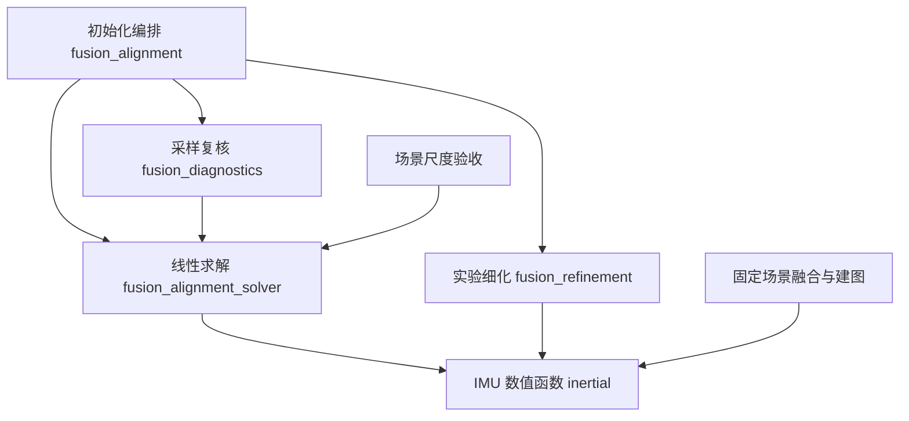

# 全项目架构扫描与重构

扫描日期：2026-11-11。结论基于当前工作区，包含此前未提交的功能改动；本次没有恢复到 Git HEAD，也没有改写原片、标定资产或历史处理结果。

## 扫描范围与方法

扫描开始时，自有运行代码包括 154 个 Python 文件、7 个前端 MJS 文件、6 个 C++ 源文件、1 个头文件和 2 个模块安装脚本。另检查根目录命令入口、配置、模块说明及测试组织。`.deps` 第三方安装、采集数据、生成结果和硬件模型不参与源码重构。

Python 使用 AST 统计模块/函数规模、分析导入关系（包含函数内部导入）、筛选未引用符号及模糊局部命名，再用全仓库引用确认候选。针对轨迹、场景、标定、原片解码、视觉执行、夹爪测量、查看器和训练导出阅读其入口与关键契约。前端、C++ 和 shell 检查职责与入口组织，本次没有修改或重新编译原生引擎。

静态候选不等于死代码。例如 `imu_reader.parse_gyro()` 通过别名 `gyro_parser` 调用，必须保留；`frame_processing` 对检测器的反向导入仅在 `TYPE_CHECKING` 下使用，不构成运行时循环。这里的扫描不是对全部第三方代码或所有录像的穷尽验证。

## 已完成的重构

| 问题及证据 | 本次处理 | 行为约束 |
|---|---|---|
| `fusion_alignment` 同时执行预积分、稀疏方程求解、段筛选与诊断；与 `fusion_diagnostics`、`fusion_refinement` 相互导入 | 提取 `inertial.py` 和 `fusion_alignment_solver.py`；筛选编排分成跟踪段切分、独立复核、可靠段联合估计 | 求解顺序、矩阵列布局、门限、诊断字段保持原值；消费者直接导入实际职责模块 |
| 初始陀螺仪零偏规则分别存在于独立初始化、场景融合和建图帮助函数中 | 共用 `inertial.estimate_gyro_bias()`，删除绑定 `PreparedRecording` 的旧帮助函数 | 保留低角速度筛选、样本数量严格大于门限以及前 N 个样本截断规则 |
| 局部回退使用了名为 `T_scene_imu` 的字段；两套无关结果均叫 `FusionResult` | 位姿使用 `scene.models.FusedTrajectory.T_reference_imu`，TCP 使用 `ArmTrajectory.T_reference_tcp`；文件路径使用 `trajectory.models.FusionArtifacts` | 文件中的 frame_id、场景/局部状态、CSV/JSON 键和训练包 `T_scene_tcp` 协议不变 |
| 全帧恢复把位姿、速度、零偏塞入匿名三元组，且混合段尺度统计 | 引入 `RecoveredState`；分离 `_recover_states()` 与 `_describe_segments()` | 保留节点状态、帧比例补偿、段输出列序和诊断数值 |
| 场景任务编排中嵌入宽度和标签测距的参数组装与拒绝处理 | 提取 `pipeline/measurements.py`，返回 `ArmMeasurements` | 场景与局部回退共用验收；失败仍保留诊断并阻止发布 |
| `calibration.pipeline.runtime` 为运行检查反向导入 `solve.basalt`，后者又依赖 runtime | 动态加载器命令归 runtime 所有；求解适配器直接调用 | 同一 Basalt 路径、库路径、参数和进程策略 |
| `camera.x3.factory.model_parameters()` 没有调用者，仅转发 `asdict()` | 删除函数及其专用导入；清理确认未使用的解包变量 | 工厂模型、投影和反投影不变 |
| 对齐、恢复、场景融合、TUM 读写中的短名掩盖物理量或索引 | 使用 frame_index、chain_index、delta_position、gravity_norm、position_bias_jacobian 等领域名称，补充入口类型 | GTSAM 的 X/V/B 等有明确数学语义的符号保留；已发布诊断字段不跟随内部变量改名 |
| 算法拆分后，建图缓存的显式源码依赖可能遗漏新实现 | 将两个新数值模块加入 `map_cache.PLACEMENT_SOURCES` 并扩展回归 | 修改数值实现会使地图身份失效；不绕过原有来源追溯 |

不包含 `TYPE_CHECKING` 的导入图中，相互依赖组由 3 组减为 1 组。核心入口规模变化如下，行数包含注释：

| 函数 | 重构前 | 重构后 |
|---|---:|---:|
| `align_lenses()` | 151 | 51 |
| `run_episode()` | 191 | 156 |
| `recover_trajectory()` | 73 | 41 |

重构后的主要数值依赖关系：

## 其他模块的检查结论

| 区域 | 结论与后续重构重点 |
|---|---|
| `scene/management/inputs.py` | 511 行，仍同时承担场景、套件、批次、任务解析和输入身份。可继续按配置领域分离；当前存在历史清单读取和实际批次配置两条输入路径，不能只按文件长度切割。 |
| `calibration/workflow.py` | 400 行；A/B 预取、C 检测、阶段恢复、候选发布和最终验收已经有阶段模块，但局部闭包与共享 Future 状态仍集中于 `run()`。后续重点是明确一次运行的执行资源所有权。 |
| `trajectory/algorithms/fusion_graph.py` | `optimize_trajectory()` 197 行，构图职责仍较集中。进一步拆分应以惯性因子、视觉因子、连续性因子为边界，保留因子插入顺序并继续做完整数值对照。 |
| `camera/x3` | 容器读取默认延迟加载 IMU 解析器，IMU 解析又使用容器接口；这是剩余的运行时导入环。可将纯 IMU 包解码分离，但需同时维护 `parse_trailer()` 的默认解码契约。本次未改动此行为。 |
| `vision` / 原生 ORB | Python 准备、建图、定位、进程验收已集中；C++ 是引擎适配入口，未发现有证据可直接删除的入口。完整帧数、退出码和图集验收属于行为约束。 |
| `gripper_width` | 图像裁剪、角点检测、采样恢复、几何解算、验收已有边界；本次收敛场景调用层。ROI、补检上限、有效比例及最长缺失门限不变。 |
| `viewer` | 数据目录、场景/局部结果读取、地图、媒体缓存及前端控制分开。前端 app 仍统筹播放状态，但媒体请求已有独立取消/替换逻辑；本次不改浏览器交互。 |
| `dataset` | 只读依赖场景已验收结果，采样与原子导出独立。保留训练数组名称和当前局部结果拒绝规则。 |
| `config` / `parameters` / `provenance` | 参数模型、读取校验和内容身份职责明确；源码身份是可复用结果契约，本次同步补齐拆分模块。 |
| 命令入口和安装 | `umi-scene`、`umi-calib`、`umi-view` 负责环境和应用入口，不在 shell 内复制业务算法；安装脚本和引擎来源继续保留现有组织。 |

这些是剩余结构债务，不表示本次已经重写所有模块，也不表示已发现对应的数值错误。

## 保留的历史输入契约

`trajectory/calibration/assets.py` 的旧标定包校验、`scene/result_io.py` 的旧任务结果读取、`trajectory/reporting/results.py` 的旧目录查找与迁移、`scene/management/migration.py` 的历史布局迁移均有明确调用路径和回归覆盖。直接删除会改变可读取的标定、录像结果或任务范围，因此本次保留。

同理，ORB 的历史 Shutdown 退出码策略需要完整帧索引、姿态及结束统计同时通过才接受；它不是无条件吞掉异常的补丁。移除此策略属于执行兼容策略变更，不混入结构重构。

## 验证与边界

重构前完整基线为 680 项 Python 测试及查看器前端测试通过。最终 `OPENBLAS_NUM_THREADS=1 ./test.sh --all` 的 **680 项 Python 测试通过（142.904 秒）**，查看器前端测试、`umi-calib check`、`umi-scene check` 均通过；`git diff --check` 通过。

使用重构前的源码快照与当前源码分别运行真实 GTSAM，比较四种固定观测案例：默认配置、节点步长 3 且关闭静止约束、启用初始化细化、切分地图段。每例完整时间轴、位姿、速度、陀螺仪零偏、加速度计零偏均逐元素一致，最大绝对差均为 **0**；段输出和全部质量诊断也一致，仅排除墙钟耗时字段。已有固定观测 golden 回归继续使用原参考值。

验证材料保存在本机 `/tmp/umi-architecture-baseline.log`、`/tmp/umi-architecture-final.log`、`/tmp/umi-refactor-numeric-equivalence.json`；本次代码与测试相对于工作区起点的独立补丁为 `/tmp/umi-refactoring-only.patch`。这些临时材料不是运行依赖。

本次没有重跑真实 INSV 的完整 SLAM，也没有新增独立真值精度测量。源码哈希改变后，既有规则可能要求重算地图或任务缓存；不会将旧结果伪装成由新源码生成。

## 完整重构后代码

- [初始化编排](../../software/trajectory/algorithms/fusion_alignment.py)、[线性对齐求解](../../software/trajectory/algorithms/fusion_alignment_solver.py)、[惯性数值函数](../../software/trajectory/algorithms/inertial.py)
- [全帧状态恢复](../../software/trajectory/algorithms/fusion_recovery.py)、[场景融合](../../software/scene/spatial/fusion.py)、[公共位姿读写](../../software/pose_io.py)
- [场景阶段模型](../../software/scene/models.py)、[独立重建模型](../../software/trajectory/models.py)、[夹爪测量阶段](../../software/scene/pipeline/measurements.py)、[场景编排](../../software/scene/workflow.py)

代码已直接写入项目，所有消费者同步迁移，没有为已移动的实现添加旧名称转发函数。
