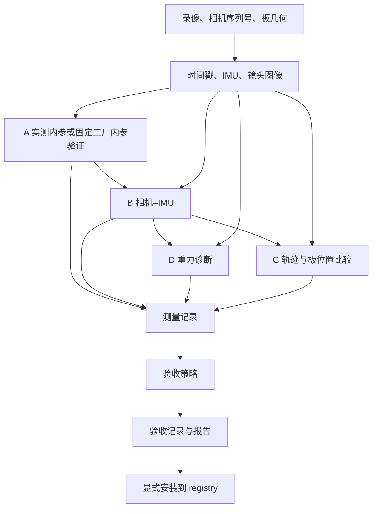

# 标定架构与验证

标定的主线是：**录像与身份 → 观测 → 参数求解 → 独立验证 → 验收 → 显式登记**。工作镜头与环境镜头共用生命周期；相机参数、验证证据、验收决定和设备当前默认值分别管理。

本文描述当前实现。操作入口见[标定指南](../02-相机与夹爪标定.md)，模块索引见[标定代码指南](../../umi/workflows/calibration/README.md)，数值配置见[参数说明](../../config/README.md)。

当前设备状态以 `umi-calib devices` 和 registry 为准。

## 1. A/B/C/D 各自回答什么

| 录像 | 使用的观测 | 产物或问题 | 代码入口 |
|---|---|---|---|
| A | 标定板角点；factory 另读 B 工厂 MEI | 实测 KB4 求解，或固定工厂 KB4 独立验证；两者都测覆盖 | `solve.basalt.estimate_intrinsics()` / `solve.factory_intrinsics.generate()`、`validate_images()` |
| B | 板角点、IMU、所选固定内参初始化 | 相机–IMU 外参、零偏、时间差；拟合与运动激励 | `solve.basalt.estimate_camera_imu()` |
| D | 多朝向静止 IMU、候选参数 | 校准后重力残差、静止窗口数和朝向覆盖 | `validation.gravity.validate_gravity()` |
| C | 独立录像、候选参数 | 轨迹与板 PnP 相机位置是否一致 | `validation.trajectory.trajectory_check()` |

实测模式 A/B 参与求解；factory 模式 A 只验证固定工厂内参，B 仍实测。两种模式的 C/D 都检查候选参数。执行顺序为准备 A/B/C/D、A、B、D、C；D/C 不反向修改参数。

标定描述相机机身。标定通过只说明这些录像上的测量满足配置门限，不能替代工作区地图验收、夹爪 TCP 测量或任务精度评估。C 当前比较位置与尺度，没有独立的姿态角验收。



## 2. 当前目录与依赖方向

```text
umi/apps/calib.py             参数解析、命令装配（umi-calib）
umi/workflows/calibration/
├── workflow.py               run / verify / recheck，共享生命周期
├── models.py                 请求、领域结果、状态、步骤 ID
├── acceptance.py             纯验收策略
├── reports.py                展示运行记录
├── result_io.py              编解码、证据校验、原子保存和发布
├── devices.py                安装、启用状态、设备命令，调用 registry
├── inventory.py              front/rear 当前参数与套件绑定的只读状态查询
├── rear_workflow.py          环境镜头 C 的轨迹生成器（复用场景录像准备、建图与固定地图融合）
├── pipeline/
│   ├── inputs.py             录像、身份、板配置、输入校验
│   ├── recordings.py         INSV → 观测数据与准备缓存
│   ├── board_detection.py    读图、并行板检测、原始角点缓存
│   ├── steps.py              步骤恢复、依赖失效、计时、中断
│   └── runtime.py            路径、进程、锁、资源、依赖预检
├── solve/
│   ├── basalt.py             A/B 求解、bag、初始化、命令、日志、缓存
│   └── factory_intrinsics.py 固定工厂 KB4 生成、转换约束和独立 A 验证
├── validation/
│   ├── gravity.py            D 工具调用、来源和有效性校验
│   ├── factory_comparison.py C 工厂光学与留出标签诊断
│   └── trajectory.py         工作镜头轨迹、共用 C 比较和各轮重建诊断
├── algorithms/board_pnp.py   KB4、板位姿、覆盖统计
└── tools/                    EuRoC → bag 转换、IMU 物理一致性检查
umi/estimation/trajectory_metrics.py   时间匹配、SE(3)/Sim(3) 比较
setup/calibration/            安装脚本、Basalt 预编译包与补丁
```

依赖按责任组织：

- `umi/apps/calib.py` 将命令转为请求，调用 `workflow` 或 `devices`。
- `workflow` 明确串联准备、求解、测量、验收和收尾；步骤不隐式启动其他步骤。
- 求解与验证只接收所需参数组和 `ExecutionOptions`；后者携带路径、CPU、工作线程数与本轮计时。
- `steps` 保存步骤输入指纹、产物哈希和执行状态，负责记录失败步骤；求解器保留原始异常及日志。
- `acceptance` 只读测量与门限；`reports` 只渲染记录。二者都不调用求解器或 registry。
- `result_io.load_result()` 校验后返回记录，不恢复执行器、不生成工作文件、不查询设备默认值。
- `devices` 在登记边界核对结果并调用 registry。设备启用状态是带查询时间的快照。

## 3. 数值和时间约定

INSV 4K60 的工作镜头取右半、环境镜头取左半，标定区域为 1440×1440。灰度像素直接来自 Y 平面。准备数据的时间含 1 秒平移，板参考转回视频时钟时减去该平移；IMU 提取和相机–IMU 时间差符号使用共享相机模块的约定。

Basalt 使用 KB4、bag 输入和配置中的噪声先验。B 以所选内参的完整 JSON 初始化，使用 `--fixed-scale-opt-offset`：固定 IMU 尺度，第二阶段开放相机时间差；输出后校验内参未变。实测 A/B 的 Basalt 工作目录与求解器内部角点缓存分开；这与 A/C 的独立板检测缓存是两套数据。Basalt 拟合使用 mean 重投影误差作提醒、RMS 仅展示；factory A 不运行 Basalt，以独立留出 RMS 作提醒。

C 的轨迹生成器返回视频时钟上的相机位置。板 PnP 在同一候选内参下生成参考位置；两组样本在默认 1000 ns 容差内一对一匹配，不插值、不通过数组下标猜时间。SE(3) 对齐后的 ATE 衡量位置误差；Sim(3) 同时估计全局尺度，报告板/轨迹尺度比和对齐残差。C 的板参考也依赖候选内参，因此不是完全独立于相机模型的外部真值。

工作镜头 C 同时保存各轮的融合前视觉诊断。不同地图各自做 Sim(3) 对齐，单目任意尺度不作为物理尺度偏差；板误差不参与内部重试的选优。记录包含每轮是否采用、视觉形状误差、视觉–IMU 初始化位置残差、融合尺度变化和拒绝原因。子进程在 C 验收前保留地图、定位和融合输入，由标定外层统一决定清理。

D 每次计算使用独立目录，以 REPORT_ONLY 模式调用工具。适配器验证退出码、状态、参数、相机参数哈希、IMU 哈希和输入路径，再交给验收策略。工具自身的阈值模式只属于独立工具接口，不参与主流程的验收决定。

## 4. 状态与验收

| 状态 | 保存位置 | 值 |
|---|---|---|
| 执行状态 | `execution.status` | running / complete / failed / interrupted |
| C 测量有效性 | C 测量的 `validity` | valid / insufficient / invalid |
| 验收决定 | `evaluation.decision` | accepted / accepted_with_warnings / rejected / incomplete |
| 启用快照 | `activation` | active / inactive / unavailable |

`Step` 使用稳定英文 ID；中文步骤名、PASS/FAIL 只用于展示。执行完成可以同时验收拒绝；验收通过也不表示已安装。

必需步骤失败、中断或证据无效时为 `incomplete`。完整测量超过拒绝门限时为 `rejected`。二者都不自动安装。`umi-calib install --allow-rejected` 只能覆盖完整结果的质量拒绝，不能覆盖身份不符、缺少证据或参数被修改。

C 默认至少需要 30 个有效共同样本。非有限点会被过滤并计数；尺度非有限、非正或运动数值退化不能形成有效比较。板参考运动范围小于默认 0.15 m 时无法完整验收。默认 ATE 拒绝门限为 30 mm，尺度偏差超过 3% 提醒、超过 10% 拒绝。实际门限以本次配置记录为准。

factory A 至少需要 6 个有效留出帧及非空、有限的误差证据，否则为 `incomplete`，不能安装；RMS 超过 2 px 仅提醒。转换误差与原片一致性另有硬约束，详见第 14 节。

D 默认最大重力残差超过 0.3 m/s² 给提醒，静止窗口不足也给诊断提醒。工具失败、无输出、坏 JSON、来源或参数不符属于执行错误，不能当作普通提醒。

工作镜头 A/B 与样例参数的差异用于健全性检查。可选 `--compare-sample` 额外生成样例 C 对照，成功或失败都不改变候选验收。轨迹引擎的样例选择值为 `factory`，该协议值只在调用边界使用。

## 5. 记录与参数的权威位置

```text
calibration_result/
├── calibration.json          最终相机参数
├── manifest.json             设备/镜头、输入来源、参数哈希
├── report.txt                人类可读报告
└── run/
    ├── record.json           测量、检查点、验收与启用快照
    ├── logs/                 子进程日志与异常
    └── work/                 可再生工作数据
```

运行记录、资产清单各自使用 schema 3；YAML 配置 schema 单独管理。

| `record.json` 分区 | 内容 |
|---|---|
| `subject` | 相机序列号、镜头、参数路径与哈希 |
| `inputs` | 录像身份、板几何、样例参考 |
| `computation` | 生效配置；`code_revision` 另记 git 提交号，仅供追溯 |
| `measurements` | 按 Step 保存的原始测量、数据哈希、输入指纹 |
| `execution` | 状态、检查点、计时、失败步骤及原因 |
| `evaluation` | 当前检查项、决定、策略、证据指纹与时间 |
| `evaluation_history` | 完整的先前验收记录 |
| `activation` | 最近一次设备启用状态查询 |

A 保存原始初始化 JSON 快照；B 的最终参数以顶层 `calibration.json` 为准，其测量记录只保存求解器拟合指标；板覆盖指标由 A 测量保存。D 保存完整工具证据；C 保存未舍入指标。检查点引用测量，不重复存一份领域对象。报告从这些记录生成，展示值不作为重新验收的输入。

## 6. 恢复、重验与安装

| 操作 | 行为 |
|---|---|
| `run <front或rear目录>` | 完整求解与验收 |
| `verify` | 读取选定标定，只执行 C；不要求 Basalt 或 rosbags |
| 重跑原命令 | 输入匹配时校验指纹和产物，自动续跑或复用完整结果 |
| `--recompute` | 从头求解并保存到新版本目录 |
| `recheck` | 仅重新应用验收配置，保留先前验收记录 |
| `install` | 自动识别 front/rear，校验完整证据及身份后更新该镜头、该来源的当前参数 |

依赖失效规则是显式的：A 准备影响 A，A 影响 B，B 影响 D/C；C 准备影响候选和样例 C，D 准备只影响 D。同一版本内只计算无有效检查点的阶段。输入或计算配置变化会创建新版本。只改验收门限时可用 `umi-calib recheck`。

工作目录清理后，完整测量仍可恢复。待重算步骤按需准备输入；成功且可用时默认清理工作目录，失败、不完整或中断时保留。报告在清理前发布，中断保存状态后继续传播信号。

同一结果系列的版本选择由系列锁保护。run、recheck 和 install 共用各版本旁的结果锁。安装持有结果锁后再进入 registry 锁，并核对操作类型、设备与镜头、参数和清单、证据指纹及完成状态。

当前运行记录只接受支持的 schema 和测量版本；不支持的运行结果必须使用新目录重跑。已登记的设备资产按 registry 的格式协议读取，运行开始时复制当前参数到结果快照。安装自动更新对应镜头、来源的当前参数；运行结果保存自己的参数快照，不依赖被替代的登记目录。

环境镜头共享 A/B/D、步骤管理、验收、报告和记录，只注入 scene 的视觉/融合轨迹生成器。通过后发布 `rear_calibration.json`，以登记接口需要的字段携带参数及证据指纹。

## 7. 执行与加速

- A/C 各有独立板角点缓存；改相机或 IMU 参数可复用角点，PnP 按本次参数重算。缓存命中不准备图像，同轮已准备的数据不重复检查。需要保留工作文件时给 `umi-calib run` 加 `--keep-work`。同一输入可重复执行原命令继续。
- 首次或未完成 A/B 的运行，在至少 8 个可用核心、2 个检测线程时，于低优先级后台线程提前检测 C；后台预算为可用核心的四分之一、上限 8，受 `--workers` 限制。至少 16 个可用核心、`--workers` 至少 4 且 A 需要重算时，A 的角点检测与 B 的 bag 转换也提前到同一条后台队列。后台不写运行记录；失败或中断取消排队任务、回收子进程后才释放输出锁。
- 转 bag 在有限预读窗口内并行解码 PNG（至多 4 个线程），主线程按时间顺序压缩写入；取样、像素、时间偏移与 ROS 消息格式不变。
- `execution.details` 记录转 bag、Basalt、板检测、PnP、轨迹引擎与诊断耗时，不参与测量证据。

## 8. 轨迹引擎相关约定

- C 使用的 ORB-SLAM3 默认启用离线同步与稳定排序补丁：逐帧完成局部建图和闭环，按稳定 ID 处理平分与优化输入，同一输入的建图与定位逐位可复现。离线最小关键帧间隔为 `ceil(0.2 × fps)` 帧；该间隔是在现有录像上选定的，不能视为所有动作的最优值。`execution.json` 记录同步模式、选帧间隔与实际最小帧数。
- 前向 KB4 补丁默认启用：球面逆投影取消像素半径截断，只接收与光轴夹角 ≤ 85° 的射线（约 170° 视野，不支持完整 > 180°）。运行时用 `--capabilities` 检查实际二进制具备 `forward_v1/85°`；重编引擎后需重建地图，旧图集不会自动失效。
- 内部重建对每个有位置约束的分段检查尺度变化，`max(最终/初始, 初始/最终)` 超过 `retry.maximum_scale_change_ratio`（默认 2）或缺少证据时整轮重试且不能选中；全部被拒绝则失败。该检查与覆盖率条件、最终 C 的 ATE/尺度验收（30 mm / 10%）一起使用，不能单独证明地图几何正确。

## 9. 实测/工厂内参来源

`config/user.yaml` 的 `features.factory_intrinsics.enabled` 控制工厂内参偏好，前后镜头均支持。工厂模式仍要求 A/B/C/D：A 不运行 Basalt 内参求解，从 B 原片对应镜头的工厂 MEI 生成 KB4 并保留独立图像留出验证，再以该内参重新求解 B。

`umi/devices/calibration_source.py` 负责来源、B 输入光学参数哈希和原片一致性；正式结果声明 `intrinsics_source`、`extrinsics_source=measured_with_selected_intrinsics`，记录所用 B 工厂参数、镜头编号、裁切/有效视野以及 A/B/C/D 原片哈希。B 求解后逐值核对内参未变，工厂外参只作元数据保留。

适用范围为 X3 v3、3840×1920 原片、1440 裁切与 ≤ 85° 前向射线；1920 全镜头只做诊断。转换检查默认 RMS ≤ 1 px、P99 ≤ 2 px（129×129 错位采样网格，前向范围内），这是转换忠实度门槛，不是实拍精度保证；A/B/C/D 相对 B 的最大射线差默认 ≤ 0.1°，任务原片也核对此条件。A 取最多 24 帧，以可见标签的三分之二估计板位姿、剩余标签评估固定 KB4；至少 6 帧并有有限误差证据才可完整验收，留出 RMS 超过 2 px 只提醒，缺证据为 INCOMPLETE、不可安装。

套件用 `intrinsics.front/rear` 分别选择来源；CLI 的统一来源覆盖批次与套件选择。登记目录按镜头、来源各保留当前安装；front 或 rear measured 缺少对应来源时报错，rear factory 无正式当前参数时按记录的工厂推导路径处理，损坏的当前选择不能兜底。

## 10. 环境海报与标定的职责

标定始终用 AprilGrid；环境 ArUco 海报只用于任务约束，任务像素残差不是相机标定 PASS，也不替代独立 C。共享场景、逐段引擎与单手回退的海报融合不反写机身标定。

设备测量由 registry 按序列号、镜头、来源和内容维护；kit 分别选择前后镜头来源；场景引用海报板内几何；每次运行冻结实际测量和布局。`umi/workflows/calibration/inventory.py` 提供只读状态查询：`umi-calib devices` 查询 front/rear 各来源的当前参数；`--kit` 检查套件的准确绑定，`--require-rear` 要求 rear，`--json` 返回结构化结果。查询只检查资产，不代表组合实拍验收。

C 配置隔离：`load_trajectory_validation()` 固定 `handheld` 并关闭任务海报融合，rear C 另关闭场景海报融合、建图与尺度修正。逐段引擎的 `--mode dual --rear-calibration measured` 单独冻结环境镜头测量、传递时差；逐段 `dual` 未显式绑定 rear 时尝试从 INSV 工厂数据与 front B 推导。

## 11. 验证范围与待解决问题

自动化入口为 `./test.sh --all`，覆盖真实 D 工具、时间匹配、非有限值和退化、尺度边界、像素裁切、B 初始化、恢复与中断、只读结果、安装身份和锁；流程测试替代昂贵求解器，环境镜头包含真实数值融合测试。这些测试不能替代真实录像回归。C 的板参考同样依赖候选内参，不是完全独立的外部真值。

待解决：

1. 补齐环境镜头真实 A/B/C/D 整套实测；当前标定原片只有工作镜头数据，环境镜头工厂版本未经实拍验收。
2. 多录像检验尺度变化保护的误拒绝与漏检，以及 0.2 秒关键帧间隔在不同动作下的适用性。
3. 组合外参与时差的真实数据诊断；海报成品测量的证据格式。
