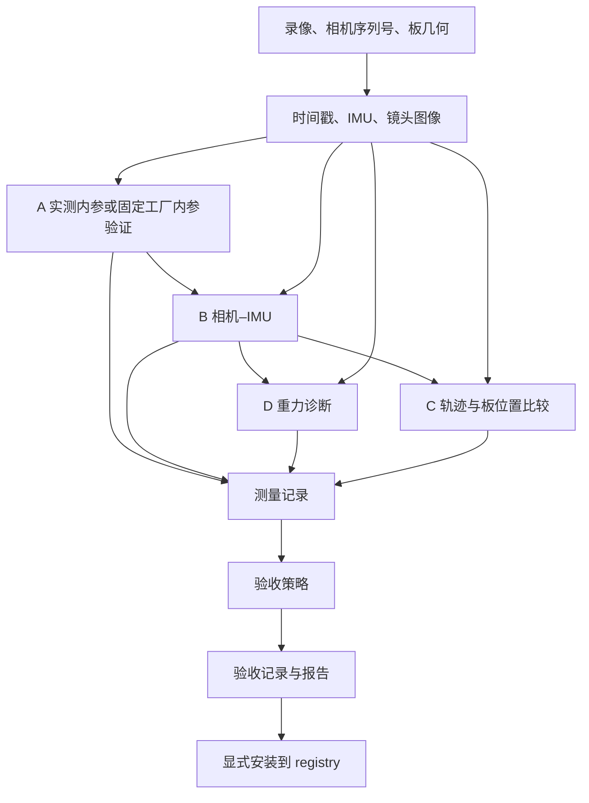

# 标定架构与验证

标定的主线是：**录像与身份 → 观测 → 参数求解 → 独立验证 → 验收 → 显式登记**。工作镜头与环境镜头共用生命周期；相机参数、验证证据、验收决定和设备当前默认值分别管理。

本文描述当前实现。操作入口见[标定指南](../标定.md)，模块索引见[标定代码指南](../../software/calibration/README.md)，数值配置见[参数说明](../../config/README.md)。

带日期的实验、优化与验证记录描述当时版本，保留其参数、结论和原始路径；其中 /tmp 证据属于临时产物，可能被清理。历史候选的“未安装”等状态也仅对应记录当时，不代表设备当前选择；当前设备状态以 `umi-calib devices` 和 registry 为准。

当前实测/工厂来源开关、默认前向 KB4 及最新验收口径见[第 14 节](#14-实测出厂内参来源开关2026-11-10)；第 11–13 节中的默认引擎和诊断限制属于各轮实验当时的状态。

## 1. A/B/C/D 各自回答什么

| 录像 | 使用的观测 | 产物或问题 | 代码入口 |
|---|---|---|---|
| A | 标定板角点；factory 另读 B 工厂 MEI | 实测 KB4 求解，或固定工厂 KB4 独立验证；两者都测覆盖 | `solve.basalt.estimate_intrinsics()` / `solve.factory.generate()`、`validate_images()` |
| B | 板角点、IMU、所选固定内参初始化 | 相机–IMU 外参、零偏、时间差；拟合与运动激励 | `solve.basalt.estimate_camera_imu()` |
| D | 多朝向静止 IMU、候选参数 | 校准后重力残差、静止窗口数和朝向覆盖 | `validation.gravity.validate_gravity()` |
| C | 独立录像、候选参数 | 轨迹与板 PnP 相机位置是否一致 | `validation.trajectory.trajectory_check()` |

实测模式 A/B 参与求解；factory 模式 A 只验证固定工厂内参，B 仍实测。两种模式的 C/D 都检查候选参数。执行顺序为准备 A/B/C/D、A、B、D、C；D/C 不反向修改参数。

标定描述相机机身。标定通过只说明这些录像上的测量满足配置门限，不能替代工作区地图验收、夹爪 TCP 测量或任务精度评估。C 当前比较位置与尺度，没有独立的姿态角验收。



## 2. 当前目录与依赖方向

```text
software/calibration/
├── __init__.py  __main__.py  README.md
├── cli.py                    参数解析、命令装配
├── workflow.py               run / verify / recheck，共享生命周期
├── models.py                 请求、领域结果、状态、步骤 ID
├── acceptance.py             纯验收策略
├── reports.py                展示运行记录
├── result_io.py              编解码、证据校验、原子保存和发布
├── devices.py                安装、启用状态、设备命令，调用 registry
├── pipeline/
│   ├── inputs.py             录像、身份、板配置、输入校验
│   ├── recordings.py         INSV → 观测数据与准备缓存
│   ├── board_detection.py    读图、并行板检测、原始角点缓存
│   ├── steps.py              步骤恢复、依赖失效、计时、中断
│   └── runtime.py            路径、进程、锁、资源、依赖预检
├── solve/
│   ├── basalt.py             A/B 求解、bag、初始化、命令、日志、缓存
│   └── factory.py            固定工厂 KB4 生成、转换约束和独立 A 验证
├── validation/
│   ├── gravity.py            D 工具调用、来源和有效性校验
│   ├── factory.py            C 工厂光学与留出标签诊断
│   ├── trajectory.py         工作镜头轨迹后端与共用 C 比较
│   └── trajectory_diagnostics.py  各轮视觉、初始化和融合诊断
├── algorithms/
│   ├── aprilgrid_detect.py   单帧检测、上采样与角点坐标还原
│   ├── board_pnp.py          KB4、板位姿、覆盖统计
│   ├── factory_kb4.py        工厂 MEI → KB4 拟合与独立数值诊断
│   └── trajectory_metrics.py 时间匹配、SE(3)/Sim(3) 比较
├── tools/                    独立工具入口
└── setup/                    安装、补丁与来源
```

子包包含各自的 `__init__.py`。环境镜头轨迹生成器位于 [`scene/spatial/rear_calibration.py`](../../software/scene/spatial/rear_calibration.py)。

依赖按责任组织：

- `cli` 将命令转为请求，调用 `workflow` 或 `devices`。
- `workflow` 明确串联准备、求解、测量、验收和收尾；步骤不隐式启动其他步骤。
- 求解与验证只接收所需参数组和 `ExecutionOptions`；后者携带路径、CPU、工作线程数与本轮计时。
- `steps` 保存步骤输入指纹、产物哈希和执行状态，负责记录失败步骤；求解器保留原始异常及日志。
- `acceptance` 只读测量与门限；`reports` 只渲染记录。二者都不调用求解器或 registry。
- `result_io.load_result()` 校验后返回记录，不恢复执行器、不生成工作文件、不查询设备默认值。
- `devices` 在登记边界核对结果并调用 registry。设备启用状态是带查询时间的快照。

## 3. 数值和时间约定

INSV 4K60 的工作镜头取右半、环境镜头取左半，标定区域为 1440×1440。灰度像素直接来自 Y 平面。准备数据的时间含 1 秒平移，板参考转回视频时钟时减去该平移；IMU 提取和相机–IMU 时间差符号使用共享相机模块的约定。

Basalt 使用 KB4、bag 输入和配置中的噪声先验。B 以所选内参的完整 JSON 初始化，使用 `--fixed-scale-opt-offset`：固定 IMU 尺度，第二阶段开放相机时间差；输出后校验内参未变。实测 A/B 的 Basalt 工作目录与求解器内部角点缓存分开；这与 A/C 的独立板检测缓存是两套数据。Basalt 拟合使用 mean 重投影误差作提醒、RMS 仅展示；factory A 不运行 Basalt，以独立留出 RMS 作提醒。

C 的轨迹生成器返回视频时钟上的相机位置。板 PnP 在同一候选内参下生成参考位置；两组样本在默认 1000 ns 容差内一对一匹配，不插值、不通过数组下标猜时间。SE(3) 对齐后的 ATE 衡量位置误差；Sim(3) 同时估计全局尺度，报告板/轨迹尺度比和对齐残差。C 的板参考也依赖候选内参，因此不是完全独立于相机模型的外部真值。

工作镜头 C 同时保存各轮的融合前视觉诊断。不同地图各自做 Sim(3) 对齐，单目任意尺度不作为物理尺度偏差；板误差不参与内部重试的选优。记录包含每轮是否采用、视觉形状误差、视觉–IMU 初始化位置残差、融合尺度变化和拒绝原因。子进程在 C 验收前保留地图、定位和融合输入，由标定外层统一决定清理。

D 每次计算使用独立目录，以 REPORT_ONLY 模式调用工具。适配器验证退出码、状态、参数、相机参数哈希、IMU 哈希和输入路径，再交给验收策略。工具自身的阈值模式只属于独立工具接口，不参与主流程的验收决定。

## 4. 状态与验收

| 状态 | 保存位置 | 值 |
|---|---|---|
| 执行状态 | `execution.status` | running / complete / failed / interrupted |
| C 测量有效性 | C 测量的 `validity` | valid / insufficient / invalid |
| 验收决定 | `evaluation.decision` | accepted / accepted_with_warnings / rejected / incomplete |
| 启用快照 | `activation` | active / inactive / unavailable |

`Step` 使用稳定英文 ID；中文步骤名、PASS/FAIL 只用于展示。执行完成可以同时验收拒绝；验收通过也不表示已安装。

必需步骤失败、中断或证据无效时为 `incomplete`。完整测量超过拒绝门限时为 `rejected`。二者都不自动安装。`install --force` 只能覆盖完整结果的质量拒绝，不能覆盖身份不符、缺少证据或参数被修改。

C 默认至少需要 30 个有效共同样本。非有限点会被过滤并计数；尺度非有限、非正或运动数值退化不能形成有效比较。板参考运动范围小于默认 0.15 m 时无法完整验收。默认 ATE 拒绝门限为 30 mm，尺度偏差超过 3% 提醒、超过 10% 拒绝。实际门限以本次配置记录为准。

factory A 至少需要 6 个有效留出帧及非空、有限的误差证据，否则为 `incomplete`，不能安装；RMS 超过 2 px 仅提醒。转换误差与原片一致性另有硬约束，详见第 14 节。

D 默认最大重力残差超过 0.3 m/s² 给提醒，静止窗口不足也给诊断提醒。工具失败、无输出、坏 JSON、来源或参数不符属于执行错误，不能当作普通提醒。

工作镜头 A/B 与样例参数的差异用于健全性检查。可选 `--compare-sample` 额外生成样例 C 对照，成功或失败都不改变候选验收。轨迹引擎的样例选择值为 `factory`，该协议值只在调用边界使用。

## 5. 记录与参数的权威位置

```text
calibration_result/
├── calibration.json          最终相机参数
├── manifest.json             设备/镜头、输入来源、参数哈希
├── report.txt                人类可读报告
└── run/
    ├── record.json           测量、检查点、验收与启用快照
    ├── logs/                 子进程日志与异常
    └── work/                 可再生工作数据
```

运行记录、资产清单各自使用 schema 3；YAML 配置 schema 单独管理。

| `record.json` 分区 | 内容 |
|---|---|
| `subject` | 相机序列号、镜头、参数路径与哈希 |
| `inputs` | 录像身份、板几何、样例参考 |
| `computation` | 生效配置、代码和引擎来源 |
| `measurements` | 按 Step 保存的原始测量、数据哈希、输入指纹 |
| `execution` | 状态、检查点、计时、失败步骤及原因 |
| `evaluation` | 当前检查项、决定、策略、证据指纹与时间 |
| `evaluation_history` | 完整的先前验收记录 |
| `activation` | 最近一次设备启用状态查询 |

A 保存原始初始化 JSON 快照；B 的最终参数以顶层 `calibration.json` 为准，其测量记录只保存求解器拟合指标；板覆盖指标由 A 测量保存。D 保存完整工具证据；C 保存未舍入指标。检查点引用测量，不重复存一份领域对象。报告从这些记录生成，展示值不作为重新验收的输入。

## 6. 恢复、重验与安装

| 操作 | 行为 |
|---|---|
| `run <front或rear目录>` | 完整求解与验收 |
| `verify` | 读取选定标定，只执行 C；不要求 Basalt 或 rosbags |
| `--resume` | 校验指纹和产物后复用，必要时重算 |
| `recheck` | 仅重新应用验收配置，保留先前验收记录 |
| `install` / `install-rear` | 校验完整证据及身份后登记设备版本 |
| `activate-calibration` | 显式切换设备默认版本 |

依赖失效规则是显式的：A 准备影响 A，A 影响 B，B 影响 D/C；C 准备影响候选和样例 C，D 准备只影响 D。只改 C 抽帧不重算 A/B，只改 D 窗口不重算 A/B/C。只改验收门限可 `recheck`，算法配置改变需要重新计算。

工作目录清理后，完整测量仍可恢复。待重算步骤按需准备输入；成功且可用时默认清理工作目录，失败、不完整或中断时保留。报告在清理前发布，中断保存状态后继续传播信号。

run/recheck/install 共用输出旁的锁。安装持有结果锁后再进入 registry 锁，重新核对操作类型、设备/镜头、参数与清单、证据指纹和完成状态。`--force` 与 `--resume` 互斥，身份预检先于覆盖输出。

当前运行记录只接受支持的 schema 和测量版本；不支持的运行结果必须使用新目录重跑。已登记的设备资产按 registry 的格式协议读取，既有批次继续引用固定版本。`upgrade-device` 可将登记资产转换并保存为新版本，启用需要单独操作。

环境镜头共享 A/B/D、步骤管理、验收、报告和记录，只注入 scene 的视觉/融合轨迹生成器。通过后发布 `rear_calibration.json`，以登记接口需要的字段携带参数及证据指纹。

## 7. 验证证据与待解决问题

自动化入口为 `./test.sh --all`。测试覆盖真实 D 工具、时间匹配、非有限值和退化、尺度边界、像素裁切、B 初始化、恢复与中断、只读结果、安装身份和锁。流程测试替代昂贵求解器；环境镜头包含真实数值融合测试。这些测试不能替代真实录像回归。

2026-11-08 C 诊断与尺度保护的全套验证通过：425 项 unittest、5 项夹爪 pytest、1 项前端测试及标定/场景 CLI 自检。日志为 `/tmp/umi-c-optimization-verification.log`。测试包含双向尺度边界、无效数值、跨地图独立尺度、异常轮重试、全部异常时拒绝发布和失败 C 的诊断保留。

2026-11-08 的真实工作镜头回归使用 `recordings/calibration/IAQEB2609JPAR3/20261102/front`，结果在 `/tmp/umi-calibration-refactor-front-20261108`。候选未安装，首轮拒绝记录与独立复跑证据分别保留。

| 检查 | 观测结果 |
|---|---|
| A 数据准备一致性 | 2,836 张 PNG、相机时间 CSV、IMU CSV 共 2,838 个文件与基线逐一哈希相同 |
| 固定观测重放 | 相同参数、角点和轨迹下，PnP 参考及 n/ATE/P95/Sim(3)/尺度/范围的实现间差值为 0 |
| A/B 两次求解 | 相同准备数据与 Basalt 二进制，CPU 组分别 0–15、16–31；fx 差 0.10854 px、平移差 0.03968 mm、旋转差 0.002864°、时间差 144 ns |
| D | 239 个合格静止窗口、6 个朝向，最大残差 0.0544017 m/s² |
| C 首轮 | 2,009 个轨迹样本匹配 1,927 个板位姿；ATE 232.6993 mm、尺度 0.0994821，验收拒绝 |
| C 独立复跑 | 基线适配器 ATE 3.4293 mm、尺度 1.0572541；当前适配器 ATE 3.4200 mm、尺度 1.0575846，均带尺度提醒 |
| recheck | 首轮证据重新验收仍拒绝，未重算、未安装 |

A/B 比较只有两次观测，不定义统计容差；辅助脚本的 ffmpeg/轨迹 Python 元数据与完整入口不同，A/B 本身未调用它们。不能据此声称所有环境完全一致。

### C 运行波动的已知边界

三次 C 的 `run_fingerprint` 相同，融合有效参数也相同。指纹用于识别声明输入、代码和配置，不记录每个随机状态、线程调度或中间地图，不能保证数值复现。

对融合前的纯视觉轨迹进行 Sim(3) 比较，首轮残差为 **49.66 mm**，两个成功复跑分别为 **1.19 mm、1.13 mm**。因此错误几何在融合前已经出现，单一尺度变化无法解释。最早确认的异常边界为 ORB 建图/定位输出；尚未区分建图与定位中的具体原因，也没有证据将原因确定为某一个随机种子或线程。

三次都报告单地图、全部定位样本有位置，当时按地图数量和覆盖率检查未触发重试。首轮融合相对尺度标准差约 0.169，仍在 0.2 门限内；重力检查也未拒绝，最终融合尺度进一步偏离。标定 C 的板参考验收正确拒绝了它。

当前内部轨迹重建增加尺度变化保护：逐个有位置约束的分段计算 `max(最终尺度/初始化尺度, 初始化尺度/最终尺度)`，超过 `retry.maximum_scale_change_ratio`（默认 2）或缺少有效证据时，整轮重试且该轮不能选中。所有轮次均被拒绝则失败，不发布“最不差”的异常轮。该指标不跨地图比较任意尺度，不改变融合数值，也不替代最终 C 的 ATE/尺度验收。2 倍是粗粒度保护，尚需多录像验证误拒绝和漏检情况。

使用保留的单分段摘要回放，该检查会拒绝首轮的 3.27054 倍变化，另两轮为 1.06980、1.09262 倍。该回放使用摘要中舍入过的数值，只验证已知样本上的判定；原文件未改写。证据在 `/tmp/umi-c-optimization-20261108/archived-replay.json`。

分层重复实验进一步验证了边界：

- 固定新运行第一轮的正常视觉输入，两次融合重放与原始融合 TUM 数值完全相同。
- 固定该轮正常地图、视频与相机设置，两次重新定位的时刻和位姿数值与原轮相同，融合前板参考 Sim(3) 误差均为 1.13867 mm。复跑使用另一组 CPU，地图等输入哈希未变。
- 固定历史异常视觉输入，使用同一原片重新提取的 IMU、相同候选参数和相同融合有效参数，两次融合重放均再现异常尺度，变化倍率 3.27054，均被新检查拒绝。与已发布 IMU 位置的最大差约 0.000814 mm，处于原位置文本舍入量级。

上述结果支持优先排查视觉建图，但不能证明历史首轮具体由哪处建图或定位代码触发；历史异常地图未保留，固定正常地图的重复实验不能替代异常地图复现。分层证据在 `/tmp/umi-c-optimization-20261108/fixed_stages/comparison.json` 和 `fixed_bad_visual/comparison.json`。尺度保护只拦截大幅变化，不能证明被接受的地图几何正确。

本轮新增三次完整 C 运行，共进行了四轮内部重建：

| 完整运行 | 内部重建轮数 | 选中轮最终 ATE | 板/轨迹尺度 | 选中轮融合前视觉 Sim(3) 误差 |
|---|---:|---:|---:|---:|
| 1 | 1 | 3.4172 mm | 1.05751 | 1.13867 mm |
| 2 | 2 | 3.4201 mm | 1.05749 | 1.14074 mm |
| 3 | 1 | 3.4642 mm | 1.05832 | 1.15489 mm |

运行 2 的第一轮视觉误差为 **51.3875 mm**，融合位置约束覆盖率仅 **50.72%**，由已有覆盖率条件触发重试；它的尺度变化只有 1.01825 倍，不是新增尺度保护拦下的。这一反例说明尺度保护必须与其他检查及最终板参考验收一起使用。三个最终结果均仍有约 5.7–5.8% 的尺度偏差，按原验收规则给提醒；三次完成不能宣称后端稳定性已解决。

这次保留了新异常地图。固定它做两次定位，时刻和位姿数值均与该异常轮完全相同，板参考误差也均为 51.3875 mm。正常与异常建图所用视频文件、相机配置的哈希相同；各固定地图实验的输入哈希未变。异常与这次生成的地图绑定，排查重点进一步指向地图生成及其与定位的交互；尚不能确定具体初始化、优化或线程触发点。证据为 `/tmp/umi-c-optimization-20261108/fixed_bad_map/comparison.json`。

三次完整运行使用相同数值配置和引擎；第三次运行前将重试代码的 `usable` 字段读取从可选默认改为必需，代码指纹因此不同，不将这组三次称作完全相同源码实验。求解器参数未变。所有运行、被跳过的轮次和实验脚本保存在 `/tmp/umi-c-optimization-20261108/`，汇总为 `summary.json`，各运行有 `report.txt`。原始结果和设备登记均未改写。

仍需完成：

1. 定位并修复 ORB 建图/定位的异常运行，用重复实验验证稳定性；多录像检验尺度保护的误拒绝与漏检情况。
2. 补齐环境镜头真实 A/B/C/D 整套实测；当前仓库中的标定原片只有工作镜头数据。

证据索引（`/tmp` 为本机临时位置，不是持久归档）：

- `/tmp/umi-calibration-preparation-parity.json`：准备文件哈希比较。
- `/tmp/umi-calibration-fixed-replay.json`：固定观测数值比较。
- `/tmp/umi-calibration-repeat-comparison.json`：A/B 参数与环境比较。
- `/tmp/umi-calibration-backend-repeat-comparison.json`：三次 C 的指纹与误差。
- `/tmp/umi-c-localization-diagnosis.json`：融合前轨迹与融合诊断比较。

## 8. 执行加速与实测边界

本轮按「细分计时 → 提前检测 C → 复用角点与准备数据」实施，抽帧、检测上采样、求解参数和验收门限未改。

- `execution.details` 记录本轮转 bag、Basalt、板检测、PnP、轨迹引擎与诊断耗时；不参与测量证据指纹。C 检测总时长和主流程等待它的时长分开记录。
- 首次或未完成 A/B 的运行，可提前在低优先级后台线程中检测 C。至少 8 个可用核心、2 个检测线程才启用；后台预算为可用核心的四分之一，上限 8，并受 `--workers` 限制。工作线程数在 `--cores` 生效后计算。
- A/C 各有独立板角点缓存；改相机或 IMU 参数可复用角点，PnP 按本次参数重算。B 的额外参考检测在后续优化中移除，详见下节。缓存命中不准备图像，同轮已准备的数据不重复检查。成功后需要继续调参时，使用 `--keep-work` 保留缓存，再用 `--resume` 恢复。
- 后台不写运行记录。主流程等待结果并归属到 C 步骤；A/B 失败或中断会取消未开始的检测帧、等待线程退出，随后释放输出锁。仅重跑 C 和 `verify` 保持同步检测，使用正常线程预算。

### 2026-11-08 本机单次对照

以下是提前检测 C 引入时的对照，包含当时的 B 参考检测；后续的数据转换优化与 B 检测移除见第 9 节。

输入是已有的同一套 A/B/C 图像，固定 CPU 0–15、正常检测 16 个线程、后台 C 检测 4 个线程。两次都从没有 bag、求解产物与角点缓存的新目录开始，串行版本先运行，并行版本随后运行；没有清空操作系统文件缓存。这是单次局部链路对照，**不包含录像准备、D 和 C 轨迹引擎，不代表整个标定流程提速 14.5%**。

| 项目 | 串行 | 提前检测 C |
|---|---:|---:|
| A 转 bag | 70.566 s | 72.281 s |
| A Basalt | 80.075 s | 85.022 s |
| A 独立板检测 | 23.890 s | 28.304 s |
| B 转 bag | 88.785 s | 90.529 s |
| B Basalt | 110.806 s | 114.042 s |
| B 独立板检测 | 10.496 s | 10.210 s |
| C 独立板检测 | 84.832 s | 268.568 s（与 A/B 重叠） |
| 到达 C 时等待检测 | 84.832 s | <0.001 s |
| A/B 覆盖 PnP + C 参考 PnP | 2.253 s | 2.387 s |
| 整段实测墙钟时间 | **473.509 s** | **404.637 s** |

净减少 **68.872 s，14.5%**。后台低并发使 C 检测本身变慢，且 A/B 部分阶段略有变慢，但 C 检测完全被 A/B 覆盖，整体仍有净收益。此结果支持保留受限并行，不能推导所有机器与录像都有同样收益。

一致性核对：

- A/B 输入 bag 的 SHA-256 分别完全相同；独立板检测缓存中的 A/B/C 帧号、标签、角点、图像尺寸和时间数组逐项完全相同。两次 C 板参考均有 1,927 个有效位姿。
- Basalt 自身不逐位复现：A 求解使用的角点数为 387,250 / 387,670，mean 重投影为 0.849334 / 0.849366 px；B 角点数均为 440,084，mean 为 1.046880 / 1.046850 px。焦距与主点最大差异 0.007663 px，相机时间差相差 5 ns。不能把独立检测缓存的一致性扩大为 Basalt 数值完全相同。
- 热缓存读取 A/B/C 分别为 0.014 / 0.004 / 0.031 s，且用会直接报错的数据准备函数验证了缓存命中不访问图像。这一收益需要保留 work，成功后默认清理的运行不具备热缓存。
- 本轮没有重新执行完整 C 轨迹验收，也未安装这些基准参数。

全量回归：428 个 unittest、5 个夹爪测试、1 个前端测试和 CLI 自检通过。新增验证覆盖后台重叠、样例角点共享、失败取消收尾、IMU 参数变化时缓存复用；另验证逐帧取消不会发布部分角点缓存。

实测还确认 A/B 转 bag 合计约 159 秒，是下一项值得单独剖析的开销；PnP 合计约 2 秒，本轮没有为它增加并发。基准脚本与原始计时在本机临时路径：

- `/tmp/umi-calibration-speed-measure.py`、`/tmp/umi-calibration-speed-measure-parallel.py`。
- `/tmp/umi-calibration-speed-serial-result/timings.json`、`/tmp/umi-calibration-speed-parallel-result/timings.json`。
- `/tmp/umi-calibration-speed-comparison.json`：耗时、缓存一致性和求解指标汇总。
- `/tmp/umi-speed-full-tests.log`、`/tmp/umi-speed-cache-tests.log`：回归记录。

## 9. 转 bag 加速与 B 参考检测移除

2026-11-08 对 A 段转 bag 做剖析：读 PNG 累计约 43.3 秒，LZ4 压缩约 15.2 秒。改为在有限预读窗口内并行解码 PNG，主线程仍按时间顺序序列化、压缩并写入 bag。标定入口最多使用 4 个解码线程，受现有 `--workers` 预算限制；预读队列最多为线程数的两倍，避免随录像长度积累解码图像。图像取样、灰度/16 位像素、时间偏移、IMU 内容、ROS 消息和 LZ4 格式保持原语义。

B 求解后额外执行的独立板检测/PnP 只用于展示可见帧比例与板距离，不参与验收决定，现已移除。同步删除 B 的 `coverage` 测量、`CameraImuResult.board_metrics` 和 `board.camera_imu_step` 配置。B 仍使用 Basalt 自身的角点与重投影数据，保留运动激励及参数合理性检查；A 的视野覆盖检查、C 板参考和 D 重力诊断继续执行。旧结果中的额外 B 字段仍可读取，但不再作为当前参考展示项；自定义配置需删除 `board.camera_imu_step`。

### 同输入转换对照

使用同一套已准备图像，固定 CPU 0–15，按 A 旧版 → A 新版 → B 旧版 → B 新版依次执行，输出到新的临时 bag；没有清空系统文件缓存。计时包含进程启动、转换、bag 哈希与清单生成，不包含图像准备、求解和 C 轨迹重建。

| 转换 | 原版 | 4 线程预读 | 减少 |
|---|---:|---:|---:|
| A：2,836 图像、95,514 IMU 样本 | 70.452 s | 27.730 s | 42.722 s |
| B：3,657 图像、123,061 IMU 样本 | 88.434 s | 35.386 s | 53.048 s |
| 合计 | **158.886 s** | **63.116 s** | **95.770 s（60.3%）** |

两段新旧 bag 的 SHA-256 分别完全相同，文件大小和样本数也一致。这是单次转换基准，不是整套标定耗时保证；移除 B 参考检测还省去该检测/PnP 工作，但本轮没有将它与转换收益相加宣称为端到端实测。

对用户最新完整结果做只读验收比较：仅移除 `camera_imu.observations` 这一 INFO 项，其余检查逐项完全相同，前后均为 `accepted_with_warnings`。没有重跑求解器、轨迹引擎或安装参数。

430 个 unittest、5 个夹爪测试、1 个前端测试及 CLI 自检通过。新增两项 bag 回归覆盖乱序输入、图像类型、时间偏移、IMU、不同线程数的逐字节一致性，以及图像缺失时传播错误和关闭部分 bag；现有流程测试确认只做 A/C 独立检测。

本机临时证据：

- `/tmp/umi-bag-profile.pstats`：串行转换剖析。
- `/tmp/umi-bag-speed-benchmark.py`：新旧转换对照脚本。
- `/tmp/umi-bag-speed-measured-82ikowr4/summary.json`：全量 A/B 转换耗时、哈希、计数。
- `/tmp/umi-bag-speed-measured-82ikowr4/acceptance-parity.json`：真实结果的只读验收比较。
- `/tmp/umi-bag-speed-full-tests.log`：全量回归记录。

## 10. 提前检测 A、准备 B 求解数据

2026-11-08 将两项不依赖 A 求解结果的工作提前：A 的原始角点检测，以及 B 的 bag 转换。至少有 16 个可用核心、`--workers` 预算至少为 4，且 A 确实需要重算时启用。两项任务共用一条后台队列，先检测 A，再转换 B，与既有 C 检测并行；不把所有任务同时铺开。A 检测使用低优先级、至多四分之一可用核心、上限 8 个线程；B 转换仍至多使用 4 个解码线程。

主流程持有步骤状态和运行记录。A 求解后等待角点并计算覆盖；B 求解前取得预先准备的 bag，仍使用本次 A 的完整参数初始化。复用 A 时不启动新队列。失败或中断取消排队任务，正在转换的子进程收到终止信号并被回收，线程退出后才释放输出锁。没有改变取帧、检测倍率、求解器参数或验收门限。

### 同输入调度对照

使用同一套已准备的 A/B/C 图像，固定 CPU 0–63、普通线程预算 24、后台 C 检测 8 线程。旧调度先运行，新调度随后运行；分别使用新的输出目录，未清空操作系统文件缓存。真实运行 A/B 转换与 Basalt 求解、A/C 独立检测和 D 诊断，跳过录像解码与 C 轨迹引擎。下表比较 A/B 阶段耗时，不把启动时的环境检查和输入哈希耗时计入收益。

| 环节 | 旧调度 | 新调度 |
|---|---:|---:|
| A 内参标定 | 108.941 s | 90.637 s |
| B 相机–IMU 标定 | 119.756 s | 94.511 s |
| A/B 合计 | **228.697 s** | **185.148 s** |
| C 后台板检测 | 160.637 s | 171.680 s |
| C 阶段等待板检测 | 0 s | 0 s |

A/B 净减少 **43.549 s（19.0%）**。新调度下 A 检测本身耗时 51.221 s，但 A 求解后等待检测为 0；B 转换耗时 45.403 s，B 阶段仅等待其中 5.987 s。并发竞争使部分子步骤变慢，但减少的串行等待仍带来净收益。这是本机单次局部对照，不能推导其他机器或整个标定流程都有 19% 收益。

两段 bag 的 SHA-256 完全一致，A/C 独立检测缓存中的全部数组也逐项相同。Basalt 两次求解的内部角点数和输出参数并非逐字节一致：最终 fx 相差约 0.062 px，相机–IMU 平移相差约 0.0147 mm，时间偏移相差 37 ns；A 覆盖统计相同。数据一致不能替代对新参数的 C 验证。

随后对新调度生成的同一份参数单独运行真实 C 轨迹引擎与板参考比较：ATE **3.429 mm**，尺度比 **1.05770**，有效板位姿 **1,927** 帧，参考移动范围 **0.3715 m**。C 判定为 `accepted_with_warnings`，提醒来自约 5.77% 的尺度偏差；未修改验收门限。这次 C 验证不计入上表调度基准，也没有安装参数。候选参数 SHA-256 为 `0b2641fe335187025230d7a5bad0f597c5bc24588a6c680d6214ae02030409a3`。

434 个 unittest、5 个夹爪测试、1 个前端测试及 CLI 自检通过。新增测试覆盖 A 检测/B 转换与求解重叠、B 只转换一次、完成结果恢复不重算、失败时取消排队任务、后台 B 失败归属，以及真实子进程的取消与回收；环境镜头测试替身同步适配独立的数据准备接口。

本机临时证据：

- `/tmp/umi-scheduling-benchmark.py`：局部链路对照脚本。
- `/tmp/umi-scheduling-comparison.json`：阶段耗时、bag 哈希、角点数组一致性。
- `/tmp/umi-scheduling-baseline.log`、`/tmp/umi-scheduling-optimized.log`：新旧调度时序。
- `/tmp/umi-scheduling-c-validation/`：新调度参数的独立 C 验证数据；未安装到设备档案。
- `/tmp/umi-scheduling-full-tests-final.log`：完整回归与 CLI 自检记录。

## 11. 工厂 KB4 的 ORB 前向视野实验

工厂 MEI → KB4 数值拟合通过，不代表原有 ORB 能正确使用全部像素。原 fork 将畸变后的归一化半径截到 π/2；半径不是视线角度，部分仍在前方的射线也会被改错。初始化另有 OpenCV fisheye 反投影，三角化及可见性判断仍依赖正深度。

`software/trajectory/setup/orbslam3/orbslam3_kb4_forward.patch` 是显式选择的实验补丁，应用于已有 OpenCV/地图选择补丁之后：

- 使用 `kb4_bearing.h` 的球面逆投影，取消像素半径截断，并检查导数及像素往返误差。
- ORB 接口仍返回 `(x/z, y/z, 1)`，仅接收与光轴夹角不超过 85° 的射线；单目入口同步过滤特征、描述子和标签角点。
- 两视图及标签初始化使用同一反投影，已矫正的标签角点显式使用零畸变参数。
- 每帧记录提取/保留特征数。范围约为 170°，不能称为完整支持大于 180°，也未验证双目/其他传感器入口。

本轮实验当时的构建脚本默认不启用该补丁。实验使用独立依赖目录，在项目 conda 编译环境中设置 `UMI_ORB_KB4_FORWARD=1`，再运行 `build_orbslam3.sh <独立依赖目录>`，并以 `ORB3_DIR=<独立依赖目录>/src/ORB_SLAM3` 指向实验引擎。当前构建已默认启用前向修复（见第 14 节）；显式关闭变量不会还原已打补丁的源码，测试旧几何需独立干净目录。不要用原有 atlas 做修复前后比较，应重新建图。

构建会运行 `umi_kb4_check`，验证实际链接的 ORB 相机往返投影、视野外拒绝及三角化尺度。独立数值回归可运行：

```bash
c++ -std=c++14 -DNDEBUG -I software/trajectory/setup/orbslam3 tests/cpp/test_kb4_bearing.cpp -o /tmp/test_kb4_bearing
/tmp/test_kb4_bearing
```

2026-11-10 的真实对照使用 IAQEB2609JPAR3 工作镜头，固定同一套 B/C/D 输入、板几何与求解配置。工厂分支使用 B 录像工厂 MEI 拟合的 KB4，实测分支使用已有 A 内参；两组重新求解 B，再检查 D 和重建 C。C 同时报告各自内参生成的板参考及统一的实测 A 板参考：前者可能掩盖共同模型偏差，后者可能偏向实测参数，均非外部真值。两组使用相同角度上限，但实际有效像素范围随内参变化。

实验脚本、输入及引擎哈希、B/D/C 原始结果位于 `/tmp/umi-factory-end-to-end/`；实验引擎位于 `/tmp/umi-orb-kb4-validation/`。临时目录可能被清理。此次实验不安装标定、不替换默认引擎、不改变 `umi-calib run` 的正式 A/B/C/D 参数来源；自动工厂拟合仍是诊断项。

完整对照结果已另存到 `umi_calib_out/factory-kb4-forward-20261110/`，包含 `summary.json`、两组参数、原始指标、C 相机轨迹、脚本、日志和编译源码快照。结果目录受 Git 忽略规则管理。

| 单次实测指标 | 工厂 MEI 拟合 KB4 | 实测 A 的 KB4 |
|---|---:|---:|
| B 重投影 RMS（px） | 1.5254 | 1.1910 |
| D 最大重力模长残差（m/s²，诊断项） | 0.0343 | 0.0544 |
| C 地图位置约束覆盖 | 100% | 100% |
| C 统一实测 A 板参考 ATE，SE(3) 对齐（mm） | 2.8382 | 3.3876 |
| C 统一参考尺度比，板参考 / 轨迹 | 1.04098 | 1.05640 |
| C 各自板参考尺度比 | 0.97359 | 1.05640 |

C 共 2,009 帧，统一参考比较 1,927 帧、参考移动范围约 0.371 m；工厂自身参考有 1,916 帧。两组 B 均未修改输入内参，估计的相机–IMU 平移相差约 12.45 mm。85° 上限在 1440 方形图像的规则采样网格上分别保留约 90.62% / 94.50% 的像素。两组完整链路均跑通，但工厂分支 B 残差更大，且参考模型改变会影响尺度结论；不能用这一段短距离录像宣称工厂参数更优或已经可以替代 A。未执行设备安装或正式验收通过声明。

18 项工厂几何/流程 Python 测试通过；独立 C++ 数值测试验证 0–140° 球面逆投影和非法参数拒绝，实际 ORB 相机测试验证前向往返投影、域外拒绝及三角化。球面辅助函数的数学范围与 ORB 实验入口的 85° 范围是两件事。

## 12. 工厂 KB4 扩展验证

本轮沿用上一节相同哈希的前向域实验引擎，覆盖 JPAR3、M4CP 两台相机，各自工厂/实测两组参数、每组三次 C 完整运行。JPAR3 的首轮采用上一节保存的结果，其余运行分别新建 atlas；每次完整运行仍允许原配置的最多三次内部尝试，内部低覆盖和失败均需保留。重复运行只能衡量同一录像上的波动，不等于多段独立录制。

M4CP 从原标定记录中恢复 A 的完整初始参数快照，两分支仅改变内参，然后分别重新求解 B 和检查 D；不混用实测 B 外参与工厂内参。每台相机另从整段 C 均匀选取 120 个可检测帧，对实测 KB4、工厂 MEI、工厂拟合 KB4 使用相同的留出标签进行像素误差比较。三段 2026-11-09 的 JPAR3 短视频用于重建/跟踪检查，没有可验证的度量参考，不计算位置精度。

完整结果和实验脚本位于 `umi_calib_out/factory-expanded-20261110/`。`protocol.json` 记录运行口径，`inventory.json` 记录原片哈希、序列号、固件及工厂参数哈希；`summary.json`、`report.txt`、`comparison.png` 汇总全部结果。每次 C 的 `C.json` 保留尝试列表和最终参考比较，`diagnostics.json` 与 `residuals_common_reference.csv` 用于分段误差及视觉轨迹形状检查。JPAR3 板参考使用 OpenCV 4.12、M4CP 使用 4.13，同一相机内两组及重复运行使用同一批检测；两台相机之间不能声称依赖版本完全一致。轨迹子进程和 ORB 二进制保持相同。

报告区分重建成功、最终地图位置约束覆盖、与板参考比较的精度：可计算的 `status=ok/validity=valid` 不是精度验收通过。当前 C 的 ATE/尺度限值仍为 30 mm / 10%，没有为实验放宽；实验不安装标定、不替换默认引擎。

### 完成结果

下表为同一相机统一实测 A 板参考下的 SE(3) ATE（mm），每个数值对应一次完整 C 运行，保留异常运行：

| 相机 | 参数来源 | 第一次 | 第二次 | 第三次 |
|---|---|---:|---:|---:|
| JPAR3 | 工厂拟合 | 2.838 | 2.906 | 2.866 |
| JPAR3 | 实测 A | 3.388 | 3.381 | 3.430 |
| M4CP | 工厂拟合 | 35.966 | 4.690 | 4.678 |
| M4CP | 实测 A | 5.435 | 5.410 | 78.679 |

全部最终 C 输出都有 100% 地图位置约束覆盖，但 M4CP 两组各有一次不满足现行 C 的 ATE/尺度限值。JPAR3 工厂分支第二次完整运行中，首次内部尝试的位置约束只覆盖约 51%；视觉定位仍为全部帧，融合因前半段尺度估计不稳定降为旋转约束，第二次内部尝试才达到完整覆盖。不能用最终覆盖率代替精度及重复性证据。

120 帧留出标签 RMS（实测 KB4 / 原始工厂 MEI / 工厂拟合 KB4）：JPAR3 为 1.047 / 1.325 / 1.334 px，M4CP 为 0.963 / 1.582 / 1.583 px。转换新增的误差较小，但两台相机的实测模型均更贴近这些图像观测。半径超过名义镜头半宽 75% 的留出角点只有 JPAR3 的 7 个、M4CP 的 0 个，不能证明最外圈精度。

三段新增短视频：041 两组均在三次尝试后以 `NO_USABLE_LENS` 融合失败；042 两组成功；043 工厂分支成功、实测分支三次尝试后融合失败。它们没有度量真值，只说明该次运行是否可重建，不能据此排序标定精度。

### 建图可复现性排查

M4CP 工厂组第一次与第二次的镜头 MP4、IMU、帧时间戳、相机 YAML 和参数 JSON 哈希完全一致，逐帧提取/保留的特征数量也相同；均在第 238 帧以 193 个点初始化，但位姿从第 239 帧分叉，最终分别保留 120 / 55 个关键帧，第三次为 57 个。实测组正常与异常运行同样输入一致，在第 326 帧以 172 个点初始化，第 327 帧分叉，最终分别有 56 / 89 个关键帧。

差异在融合前已经存在：工厂两张地图的纯视觉轨迹经 Sim(3) 对齐后，形状误差分别约为 35.976 / 3.116 mm；实测异常运行的视觉形状误差约为 58.118 mm。固定这两张工厂地图，各另做两次只定位重放，逐帧 CSV 数值在原定位及两次重放之间完全一致，地图文件哈希未变。受控结果保存在 `fixed_map_replay/`，输入一致性及代码证据汇总于 `code_investigation.json`。

现有代码的明确排查方向：`System.cc` 并行启动局部建图和闭环；`Tracking::NeedNewKeyFrame()` 的决策依赖局部建图是否空闲，并可调用 `InterruptBA()`；单目驱动按处理速度连续输入帧，没有逐帧等待局部建图完成。线程调度及优化中断时机因此可能改变关键帧选择和后续优化。两视图初始化已经调用 `SeedRandOnce(0)`，不能未经验证就归因于每次使用不同的随机种子。

这些证据把大幅波动定位到建图阶段，但尚未证明具体根因。未做原引擎/实验补丁的受控对照，也未排除浮点运算顺序、内存或其他实现问题；本轮并行负载可能改变线程调度。下一步应做同步建图及 BA 中断记录对照，而不是以这组不稳定结果断定工厂内参错误，或简单增加重试挑选最好结果。

## 13. 离线建图同步修复

`orbslam3_offline_sync.patch` 给纯视觉单目增加逐帧同步模式：跟踪完当前帧后，处理完局部建图队列，再处理闭环队列，随后才输入下一帧；闭环触发的全局 BA 也在当前调用中完成。由此消除该模式下 `AcceptKeyFrames()` 和 `InterruptBA()` 对后台线程调度的依赖。离线 `mMinFrames` 改为 `ceil(0.2 × Camera.fps)`，30 fps 时为 6 帧；选帧仍须满足原有匹配条件，最大间隔判据、BA 迭代数和质量验收阈值保持原值。不能假设它与异步引擎产生同一张地图。

`x3_mono_slam` 默认请求同步模式并把 OpenCV 线程数固定为 1；底层诊断选项 `--async_mapping` 保留原线程调度，`--offline_keyframe_interval` 可对照 0–1 秒间隔。同步入口仅支持无 viewer 的 `MONOCULAR`，不扩展到 ORB 内部的惯性或双目模式；项目的视觉建图加离线 IMU 融合流程仍然适用。库构造函数的同步参数默认关闭，以保持其他上游示例的调用方式。

暂停、恢复、整图重置、当前图重置和退出均处理了无后台线程的情况；关闭闭环检测时仍消费并索引关键帧，避免队列无限积累。工作线程移到全部交叉指针初始化后才启动；退出时等待工作线程和当前全局 BA 完成后才保存 atlas；跟踪成功标志显式初始化为 `false`。这些边界修复不代表已经证明每一项都是上一节异常的原因。

构建脚本对已安装源码也应用同步补丁并更新驱动；与可选的 KB4 前向域补丁独立，二者应用顺序均经过检查。`umi_offline_check` 使用独立的合成相机配置运行实际链接引擎，检查模式拒绝、两种单目入口、暂停/恢复、重置和重复退出；必须输出完成标记，不能只依据 ORB 的退出码判断通过。运行时 `execution.json` 记录同步模式、选帧间隔及实际最小帧数，旧引擎缺少标记时为 `null`。

本轮真实验证资料位于 `umi_calib_out/orb-offline-sync-20261110/`：每次新建地图，复用上一轮冻结的内参、B、板检测和统一参考，保留输入与引擎哈希。`validate.py` 执行完整 C 链路，`summarize.py` 比较误差、覆盖率以及建图/定位 CSV；不能将同一录像上的重复性等同于外部真值精度或跨硬件逐位一致。

仅同步线程并不够：M4CP 工厂组前 600 帧两次独立建图仍从第 239 帧分叉。地图点代表描述子的平分选择按 `map<KeyFrame*, ...>` 的指针地址顺序决定；共视权重平分、地图遍历、观测加入优化器的次序也依赖地址。`orbslam3_stable_order.patch` 将这些计算顺序改为稳定 ID，并将跟踪器追加局部关键帧时的迭代改为固定初始数量的索引遍历，避免 `vector` 扩容使迭代器失效。删除最后一项观测时也避免解引用空容器。

`umi_stable_check` 对实际 ORB 容器构造地址顺序与 ID 顺序相反的输入：旧库因共视平分依赖地址而失败，修复库通过，并保留权重优先于 ID 的规则。加入稳定排序后，同一前 600 帧的两次独立建图 CSV 哈希完全一致；这项短段回归保存在 `stable_prefix_reproducibility.json`，不替代整段验证。仅同步版本未完成的长段试验保留为中止记录，同步加稳定排序的中间版本结果另存于 `stable/`，最终选帧修复的结果位于 `cadence/`。

稳定排序后的首轮仍暴露出选帧问题：保持 `mMinFrames=0` 时，M4CP 工厂组的三次首次尝试虽逐帧一致，融合却只有 51.08% 位置约束覆盖；实测组三次误差稳定为 11.013 mm。前者后续重试已中止，并将完整首次尝试保存在 `stable/factory_first_attempts.json`，不算验收通过。0.1 秒间隔也出现 51.08% 覆盖，0.2 / 0.5 秒则恢复完整覆盖；0.5 秒单次统一参考误差为 4.708 mm。最终选用 0.2 秒并在两台相机验证，避免仅同步线程后局部建图始终空闲造成过密插帧。对照结果说明这一段录像对选帧策略敏感，不能把 0.2 秒视为所有动作的最优参数。

最终 0.2 秒前向 KB4 实验结果位于 `cadence/`。以下为统一实测 A 板参考下的 SE(3) ATE，单位 mm；每次完整运行均新建地图，没有复用首次结果：

| 相机 | 参数来源 | 第一次 | 第二次 | 第三次 |
|---|---|---:|---:|---:|
| M4CP | 工厂拟合 | 4.763 | 4.763 | 4.763 |
| M4CP | 实测 A | 5.389 | 5.389 | 5.389 |
| JPAR3 | 工厂拟合 | 2.847 | — | — |
| JPAR3 | 实测 A | 3.404 | — | — |

八次运行均在首次尝试完成，位置约束覆盖率 100%。M4CP 各组三次建图 CSV、固定地图定位 CSV、导出位置文件分别有完全相同的哈希；JPAR3 每组只有一次，不能据此宣称重复性。M4CP 工厂自身板参考 ATE 为 4.085 mm、尺度比 0.99023；实测组尺度比 1.07540。JPAR3 工厂自身参考尺度比 0.97361、实测组 1.05681。均未触发 30 mm / 10% 失败界限，但两台实测组仍超过 3% 尺度提醒线。板参考不是外部真值，这些结果不构成工厂参数替代 A 的批准。

本轮当时的默认引擎也应用 `orbslam3_tag_init.patch`：已校正的标签角点传给 PnP 时显式使用零畸变，避免读取未初始化的 `cv::Mat1f(5,1)`。该修复独立于前向 KB4 几何，构建时先应用它，再选择是否启用实验几何补丁。当时默认环境重编译同步、稳定排序、0.2 秒选帧及标签初始化修复，仍保留原有 KB4 几何；后续默认几何变化见第 14 节。原二进制保存在本轮资料的 `default_before/`，中间版本另存 `default_before_cadence/`。

最终安装二进制另外执行两次 M4CP 实测参数完整 C 回归：均为 6.000 mm ATE、尺度比 1.08500、100% 位置约束覆盖，首次尝试完成；建图、定位与导出位置文件的哈希分别一致。该默认几何结果与上表的前向域实验结果应分开比较，8.50% 尺度偏差仍应提醒，不能因为重复性通过而忽略它。两次结果及最终二进制/补丁哈希保存在 `cadence/results/default/` 和 `cadence/engine_identity.json`。

验证还包括 19 项 Python 重建流程测试、真实链接的生命周期与稳定顺序检查、600 帧关闭闭环的运行，以及在真实 atlas 上执行同步全局 BA 并检查正常恢复与有限位姿。编译完成标记、引擎哈希、未通过的中间试验和运行日志均保留，未放宽验收阈值、未安装新的相机标定。


## 14. 实测/出厂内参来源开关（2026-11-10）

`umi-calib run <front或rear目录>`、`umi-scene build/run` 增加 `--intrinsics-source measured|factory`。工作镜头与环境镜头均支持；工厂模式仍要求 A/B/C/D，A 跳过 Basalt 内参求解，保留独立图像留出验证，从 B 原片的对应镜头生成 KB4 后重新求解 B。环境镜头沿用已登记工作镜头档案作为现有后端的显式依赖，具体版本写入计算身份，不借用工作镜头内参作为环境镜头结果。

内参来源独立于历史资产选择中的 `source=factory`（实验室样例）：`camera/calibration_source.py` 负责新来源、B 输入光学参数哈希和原片一致性；正式结果在 manifest provenance 中声明 `intrinsics_source`、`extrinsics_source=measured_with_selected_intrinsics`，记录所用 B 工厂参数、镜头编号、裁切/有效视野以及 A/B/C/D 原片哈希。B 求解后逐值哈希检查内参未变，前后镜头的工厂外参始终仅作元数据保留。

正式范围为 X3 v3、3840×1920 原片、1440 裁切与 ≤85° 前向射线。构建脚本现在默认启用前向域补丁，驱动提供 `--capabilities`，运行时检查真实二进制的 `forward_v1/85°` 能力；实测与工厂采用同一引擎。1920 全镜头仍只诊断。引擎身份改变会使旧图不能直接复用，需要重建。

新转换检查默认 RMS ≤1 px、P99 ≤2 px；基于 129×129 错位采样网格在前向范围评估。两台相机四个镜头的 B 工厂转换 RMS 为 0.371–0.582 px、P99 为 0.712–1.243 px。初设 0.5/1 px 在真实工作镜头上拒绝了合法候选，因此在正式开放前将初始工程门槛确定为 1/2 px；这是转换忠实度门槛，不是实拍精度保证。A/B/C/D 相对 B 的最大射线差默认 ≤0.1°，任务原片也核对此条件，不会逐视频重新拟合并替换冻结参数。

A 取最多 24 帧，以可见标签的三分之二估计板位姿，剩余标签评估固定工厂 KB4；至少 6 帧并有有限、非空的误差证据才可完整验收。按用户明确选择，A 留出 RMS 超过 2 px 只给 WARN，缺证据为 INCOMPLETE、不可安装。A 提醒线和最低证据帧数可 recheck；转换与原片一致性约束属于候选生成配置，改变后需要重新计算。B/C/D 原有验收门槛未放宽。

套件新增 `calibrations.measured/factory.{front,rear}`，旧的单版本写法继续可读。CLI 覆盖 batch.yaml 的来源选择，再解析到完整版本。批次源切换会清除不匹配的地图绑定，将旧、新记录按内容哈希保存在 `.umi/snapshots/`；地图和任务结果有独立版本。地图复用身份包含来源、完整参数和引擎，固定地图也检查来源/同设备参数匹配。登记目录保持不可变，设备索引仅在双来源共存时增加来源版本指针。缺对应来源不会回退到其他来源或样例。

本轮真实工作镜头验证使用 M4CP 四段原片，结果位于 `umi_calib_out/intrinsics-source-20261110/M4CP/front-factory/`。确实跳过 A 内参求解，重新执行 B，得到约 7.686 ms 时间偏移；C 相机自身板参考 ATE 为 4.085 mm、尺度比 0.99023。A 留出 24 帧/1152 角点，RMS 为 2.445 px。完整运行最初按开发中的 A 硬阈值判 FAIL，随后按用户确认的提醒语义通过标准 recheck 得到 PASS（有提醒）：A 重投影提醒及 D 朝向数 4 的提醒均保留。未启用此结果、未改实际套件版本。该参考并非外部真值。

环境镜头覆盖了来源分派、固定内参生成、A 验证与 B/C/D 编排测试，现有 C 后端继续有合成运动的米制验证；本地只有工作镜头标定原片，没有环境镜头专用 A/B/C/D，因此不能声称环境镜头工厂版本已经通过实拍验收。真实原片元数据的两个镜头 factory dry-run 均成功且不创建输出。后续必须录制环境镜头数据并通过相同验收后才能登记使用。

最终回归：主环境 540 项测试全部通过，标定环境独立执行的 bag 读写 2 项通过，共 542 项；Python 编译、Shell 语法和 diff 空白检查通过。最终再次 recheck 真实 M4CP 结果得到 PASS（有提醒）；环境镜头 factory dry-run 正确声明 rear 镜头及自动对照，未创建输出目录。


## 15. 环境海报接入后的标定与资产职责（2026-11-11）

共享场景、独立轨迹及单手回退已接入海报，标定生命周期沿用现有 front/rear 两条 A/B/C/D 路径，不通过任务海报联合优化反写机身标定。`run <rear目录>`、`install-rear` 和来源/设备身份校验已有实现；双镜头操作说明与只读状态查询已补齐，真实组合验收仍待实施。

设备测量由 registry 按序列号、镜头、来源和内容维护；kit 固定各手采用的版本；scene 引用海报板内几何；每次运行冻结实际测量和布局。rear 版本为安装返回的 `rear_<hash>`，没有独立全局默认指针，`activate-calibration` 不自动激活 rear。仅有工作镜头状态为 active，不能推出环境海报功能已可用。

当前仍用 AprilGrid 标定相机。环境 ArUco 海报的 PDF 设计几何、成品测量、任务约束和真实精度证据是不同层级；任务像素残差不是相机标定 PASS，也不替代独立 C。若今后要用这张海报求相机标定，需单独扩展检测器与板模型并重新验证，不是把 `--tag-size-mm` 改成 100。

`software/calibration/inventory.py` 提供统一只读状态查询：`devices/status` 检查 front/rear 所有版本，隔离单个版本的哈希、身份和来源错误；`--kit` 沿用现有套件来源解析，检查准确绑定，`--require-rear` 明确要求 rear，`--json` 返回结构化结果。没有 rear 默认指针；套件检查不自动跟随 front 默认，也不把两个镜头的独立验收解释为组合实测验收。设备状态统一由 inventory 生成；无生产调用的旧 `registry.list_devices()` 已移除，终端显示归入 reports。

C 配置隔离已实施并加入回归：`load_trajectory_validation()` 固定 `handheld` 并关闭任务海报融合，rear C 另关闭场景海报融合/建图/尺度修正。状态查询、共享与独立流程共用 `camera.calibration_source.read_rear()` 的身份/来源/验收检查；旧单版本套件未显式写来源时，从所选 front 推导 rear 的预期来源。原片工厂参数核验仍仅在实际运行时执行；查询仍只检查资产，不声称实拍验证。

独立正式 rear 不再依赖海报：`--mode dual --rear-calibration rear_<hash>` 单独冻结镜头测量、传递时差并参与缓存身份；公开 dual 缺 rear 时拒绝。待完成的配套仍有组合外参/时差的真实数据诊断、海报成品测量证据格式。现有输入和快照检查不等于这些项目已完成。具体现状表见[环境标签计划](环境标签与自适应融合重构计划.md#标定流程与资产管理配套2026-11-11)。
