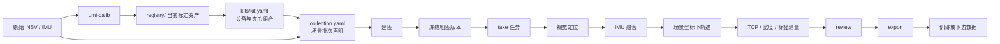

# 业务心智模型

这页只回答三个问题：系统里有哪些业务对象、它们如何流动、用户应该修改哪些文件。
具体参数和算法细节分别见[日常使用](安装与日常使用.md)、[标定](标定.md)、[场景处理](场景处理.md)和[统一参数配置](../config/README.md)。

## 一句话

UMI 的业务链是：

> **相机标定资产 → 套件 → 场景批次 → 共享地图 → 任务轨迹 → 人工验收 → 导出数据**

三个入口分别位于这条链的不同位置：

| 入口 | 负责什么 | 不负责什么 |
|---|---|---|
| `umi-calib` | 把一台相机和一个镜头变成可使用的标定资产，并登记到 `registry/` | 不处理场景任务，不替代 TCP 安装几何 |
| `umi-scene` | 读取套件和批次，建图、定位、融合、测量、验收和导出 | 不重新定义相机标定，不自动替人工验收 |
| `umi-view` | 查看视频、地图、姿态、轨迹和报告 | 不重新计算轨迹，不改变验收状态 |

## 从设备到结果



### Organizer 交接边界

当原片来自 `insv_organizer` 时，四层模型仍然不变：Organizer 只完成“原片归档和人工确认”，把文件放入同一批次的 `mapping/<epoch>/`、`take_*/left|right/`，并写两个用户侧文件：

- `collection.yaml`：首次提交时生成的草稿；它是可编辑的声明。之后的提交只往 `tasks` 追加新的 take（含每个 take 实际使用的手），不改动已有内容。
- `import_manifest.json`：带 SHA-256 的交接清单，记录地图 epoch、任务和原片引用；地图与任务的 `sequence` 都是录制开始的 Unix 秒，处在同一条时间轴上。Organizer 增量提交时只会追加条目，UMI 也只追加进 `map_epochs.yaml`，已登记条目被修改或删除时拒绝并要求人工核对。

UMI 读取交接清单后，才在 `.pipeline/` 中生成 `map_epochs.yaml`、`manifest.yaml` 和任务快照。`.pipeline/`、地图版本、运行结果和验收状态都属于 UMI 内部状态，Organizer 不读取也不修改。这样重新整理原片不会把两个程序的内部状态混在一起。

一次 `umi-scene run` 不是“直接把视频变成 CSV”。它先固定本次使用的设备资产和输入身份，再决定地图，之后每个 `take` 在地图中定位，最后才发布任务结果。输入、标定、地图或算法身份变化时，旧结果不能静默复用。

## 四类业务对象

### 1. 标定资产

`umi-calib` 处理 A/B/C/D，产生工作镜头或环境镜头的完整参数包，包括内参、相机–IMU 外参、时间偏移和验收证据。通过 `umi-calib install` 后，当前资产进入 `registry/`。

`registry/` 是设备级事实；它不描述某个场景，也不包含夹爪安装变化。相机重新安装或夹爪变化，需要更新套件里的几何资产并重新运行相关批次。

### 2. 套件

`kits/<kit>/kit.yaml` 把设备资产组合成一次可用安装：

- 左右手分别使用哪个相机；
- 工作镜头 `front` 和环境镜头 `rear` 选择 `measured` 或 `factory`；
- TCP、遮手图、夹爪标签尺寸和宽度标定文件。

套件是跨场景复用的安装配置。它不保存某次任务的指令、地图或运行状态。

### 3. 场景批次

`scenes/<scene>/<batch>/collection.yaml` 是用户侧唯一的批次声明，负责：

- 使用哪个套件；
- 本批次使用哪些手；
- 建图布局和参考手；
- 环境标签策略；
- 每个 `take` 的指令、同步方式和地图选择。

建图原片放在批次的 `mapping/`，任务原片放在 `take_*/left/` 和 `take_*/right/`。`collection.yaml` 是输入意图；`.pipeline/` 是程序生成的快照、状态、缓存和地图，不是第二份配置入口。

### 4. 任务结果

每个 `take` 经过预检、定位、融合和测量后产生 `results/`。结果包括：

- `episode.json`：本次输入、地图、设备、同步、测量和质量证据；
- 每只手的 `trajectory.csv` 和 `front.mp4`；
- 双手任务的 `bimanual.csv`；
- `report.txt`：供人工阅读的摘要。

计算成功只表示流水线产出了结果。只有 `umi-scene review --accept` 后，结果才是可导出的有效结果。

## 两种轨迹语义

项目里有两条相关但不同的轨迹路径：

| 路径 | 坐标来源 | 主要用途 |
|---|---|---|
| 共享场景轨迹 | 先建立米制共享地图，再把每个任务定位到地图 | 多任务、多手使用同一场景坐标 |
| 独立逐段轨迹 | 每段录像自己建图、估计尺度并融合 IMU | 标定 C 段、独立诊断和单段处理 |

共享场景得到的是场景坐标下的轨迹；独立逐段结果有自己的局部世界系，不能自动和其他任务或其他地图版本拼接。不同地图 epoch 之间也不默认共享原点、方向或尺度坐标。

## 坐标和镜头术语

- **工作镜头 `front`**：安装后主要观察夹爪和操作区域的镜头。
- **环境镜头 `rear`**：观察环境海报或辅助环境约束的镜头。
- **地图坐标**：建图得到的空间参考；每个已发布地图版本有自己的 `frame_id`。
- **场景坐标**：任务结果使用的米制参考，通常由冻结地图提供。
- **TCP 坐标**：根据套件中的 `gripper.tcp` 从相机位姿换算出的夹爪尖端位姿。

代码和旧文件中的 `front/rear` 保持现有接口名称；阅读业务文档时分别理解为工作镜头和环境镜头。

## 哪些文件可以改

| 目的 | 修改位置 | 修改后通常发生什么 |
|---|---|---|
| 改设备、镜头来源或夹爪文件 | `kits/<kit>/kit.yaml` | 下一次运行重新解析并核对地图/结果身份 |
| 改场景、任务、使用手或地图选择 | 批次 `collection.yaml` | 任务配置或地图绑定变化，相关结果需要重算/重验收 |
| 改全局用户开关 | `config/user.yaml` | 影响后续运行的来源、同步或并发策略 |
| 改算法实验参数 | `--expert-config` 指定的 YAML | 只影响本次运行，不改批次事实 |
| 改默认算法或机器预算 | `config/algorithms/`、`config/operations/` | 影响以后使用默认配置的运行 |
| 查看运行状态 | `umi-scene status`、`umi-view` | 只读，不改输入 |

不要手动编辑以下生成文件来改变业务事实：

```text
<batch>/.pipeline/manifest.yaml
<batch>/.pipeline/tasks/<task>/episode.yaml
<batch>/.pipeline/tasks/<task>/state.json
<task>/results/
```

需要改变事实时，改 `collection.yaml`、`kit.yaml` 或对应公共配置，然后重新运行。快照、结果和缓存的边界见[SSOT 与权威来源](SSOT与权威来源.md)。

## 一次完整操作应该怎么想

```text
1. 标定相机并 install
2. 用 kit.yaml 描述当前设备和夹爪安装
3. 用 collection.yaml 描述本批次和任务
4. umi-scene run：预检 → 建图/复用地图 → 任务定位 → IMU 融合 → 发布结果
5. umi-view 对照视频、地图、轨迹和报告
6. umi-scene review --accept
7. umi-scene export
```

遇到问题时，先判断它属于哪一层：

- **设备层**：标定资产、相机序列号、镜头来源、TCP 几何；看[标定](标定.md)和[设备与坐标](设备与坐标.md)。
- **批次层**：原片配对、地图版本、任务声明、环境标签；看[场景处理](场景处理.md)。
- **算法层**：视觉定位、IMU 融合、尺度或重试；看[算法原理](算法原理.md)和模块 README。
- **结果层**：结果是否有效、是否验收、如何导出；看[结果查看与验收](结果查看与验收.md)和[训练数据](训练数据.md)。

当前用户输入只采用 `kit.yaml`、`collection.yaml`、`config/user.yaml` 和明确的专家配置。旧的 `scene.yaml`、`batch.yaml`、`task.yaml` 拆分入口不属于当前操作流程；开发历史和迁移记录请看[代码维护](dev/README.md)及其历史档案。

文档中提到“历史结果可查看”时，指已经生成结果的只读查看或审计能力，不表示旧配置、旧目录或旧快照仍可作为新运行的输入。
