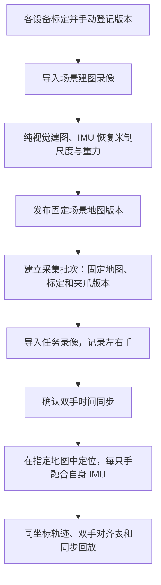

# 一个场景、多批次、多任务、双手共享坐标

`umi-scene` 先建立固定场景地图，再让不同采集批次下的任务复用。每只手融合自身 IMU；同一个地图版本下的轨迹共享米制坐标，配对任务还共享时间轴。

[文档导航](README.md) · [目录与设备版本](设备与目录.md) · [代码阅读入口](../software/scene/README.md) · [商超组织示例](../scenes/supermarket_demo/README.md)

输入为 X3「360 视频、4K60」原始 INSV、规则帧时序，以及各设备已手动启用的实测标定。

## 工作顺序



建图只由 `build` 显式执行。任务始终使用批次清单指定的地图版本；`maps/current.json` 变化不会把旧批次切到新地图。不同地图版本的坐标不能直接拼接。

场景坐标以米为单位、Z 朝上，水平朝向由参考地图确定。建图验收检查尺度、重力和地图放置的内部一致性；真实精度仍需独立真值验证。

## 选择地图模式

| 模式 | 地图组织 | 条件 |
|---|---|---|
| `shared_front`（默认） | 参考手前镜头建一张共享地图，任务前镜头查询它 | 各任务镜头能看见已建图环境 |
| `dual` | 左前、右前地图，加一张共享后地图 | 两台相机都有前后镜头实测标定；后镜头可见共同环境 |

两种模式都使用 ORB-SLAM3 `MONOCULAR`。IMU 在米制对齐和后续融合阶段使用。每个地图角色固定一个通过验收的子地图，不混入未对齐子地图。

`dual` 的左右前地图绑定建图设备。更换设备或互换左右手时，要重新建立并验收对应地图版本。`shared_front` 可让其他已标定设备查询同一地图，但必须通过定位覆盖和融合检查。

旧入口 `umi-traj --mode dual` 表示一台相机的前后镜头独立处理，不表达双手采集。

## 建立场景与采集批次

从项目根目录运行，SD 卡路径替换为实际原片：

```bash
# 自动读取序列号并导入建图原片；不删除 SD 卡文件。
./umi-scene init scenes/supermarket_shelf \
  --mapping-session 20261025_001 \
  --mapping-left /media/sd_left/VID_mapping.insv

./umi-scene build scenes/supermarket_shelf

# 默认沿用场景建图设备的固定标定与几何版本。
./umi-scene session scenes/supermarket_shelf --name 20261025_001

# 登记任务时自动导入原片；单手自动使用自身视频时间原点。
./umi-scene episode scenes/supermarket_shelf/sessions/20261025_001 \
  --name take_001 --left /media/sd_left/VID_task.insv

./umi-scene run scenes/supermarket_shelf/sessions/20261025_001
./umi-view scenes/supermarket_shelf
```

建图录像需覆盖任务区域，包含多方向平移、加速度变化与转动。静止或全程匀速可能无法区分尺度、重力和加速度零偏，此时应重新录制有效运动。

新一天或更换设备组合时建立新批次：

```bash
./umi-scene session scenes/supermarket_shelf --name 20261026_001 \
  --device LEFT_SERIAL --device RIGHT_SERIAL
```

`--device` 可重复，明确从全局档案选择当前默认资产；省略时沿用场景固定设备配置。同一设备可以出现在多个场景和批次；任务名只需在批次内唯一。

`session --map-version <已发布版本>` 可选择历史地图；省略时选择当前发布版本。创建后，完整版本号和清单 SHA256 写入 `session.yaml`，后续运行核对它们。

## 双手任务与时间同步

```bash
./umi-scene episode scenes/supermarket_shelf/sessions/20261025_001 \
  --name take_002 \
  --left /media/sd_left/VID_left.insv \
  --right /media/sd_right/VID_right.insv
```

左右手必须来自不同序列号的设备，并已登记到此批次。未指定的右手偏移为 `null`，不能直接处理。时间约定是：

```text
t_episode = t_video + offset_s
```

以左视频为原点，右视频晚开始 0.135 秒，右偏移为 `+0.135`。实测后填写：

```bash
./umi-scene sync scenes/supermarket_shelf/sessions/20261025_001/episodes/take_002 \
  --right-offset-s 0.135

./umi-scene run scenes/supermarket_shelf/sessions/20261025_001/episodes/take_002
```

也可在 `episode` 时指定 `--right-offset-s`。只有确实同步时才填写 0。

音频同步使用 `sync --audio`，还需提供两台相机各自实测的 `--left-audio-to-video-s`、`--right-audio-to-video-s`，定义为“视频时间 = 解码音频时间 + audio_to_video_s”。其他型号、模式的延迟不能直接套用。静音、相关性不足或多峰时拒绝估计。当前只支持固定时间偏移，不校正长录像时钟漂移。

跨设备同步与每台相机内部的相机–IMU 时间偏移分别管理。

## 双镜头场景与后镜头标定

每台相机先完成前镜头标定，再补录后镜头 A/B/C/D：A、B、C 均让后镜头看标定板，D 是同一机身 IMU 的六朝向静止检查。

```bash
./umi-scene calibrate-rear recordings/calibration/LEFT_SERIAL/20261025/rear --tag-size-mm 24.0
./umi-scene calibrate-rear recordings/calibration/RIGHT_SERIAL/20261025/rear --tag-size-mm 24.0

./umi-scene init scenes/supermarket_dual --mode dual \
  --mapping-session 20261025_001 \
  --mapping-left /media/sd_left/VID_mapping.insv \
  --mapping-right /media/sd_right/VID_mapping.insv \
  --rear-left recordings/calibration/LEFT_SERIAL/20261025/rear/umi_calib_rear_out/rear_calibration.json \
  --rear-right recordings/calibration/RIGHT_SERIAL/20261025/rear/umi_calib_rear_out/rear_calibration.json

./umi-scene build scenes/supermarket_dual
./umi-scene session scenes/supermarket_dual --name 20261025_001
```

初始化导入并登记后镜头版本，场景固定引用该版本。也可先用 `umi-calib install-rear` 登记，再在批次中通过 `--rear SERIAL=VERSION` 明确选择。缺少后镜头实测标定时拒绝运行，不回退到样例。

后镜头求解复用 A/B/D，C 使用后镜头地图与 IMU 求轨迹，再与独立标定板位置作不拟合尺度的刚体对齐验收。通过后才生成后镜头测量文件，不替换前镜头默认标定。重新求解应使用新输出目录。

## 清单如何衔接

`scene.yaml` 固定建图录像与设备版本；`session.yaml` 固定本批次地图和设备资产；`episode.yaml` 指定实际左右手录像、原片 SHA256 和同步。所有相对路径均相对于所在清单，不依赖启动目录。

```yaml
# session.yaml 的关键内容
schema_version: 1
scene: ../../scene.yaml

map:
  version: <已发布地图版本>
  manifest_sha256: <地图清单的完整SHA256>

devices:
  LEFT_SERIAL:
    calibration: <前镜头版本>
    gripper: handheld_v1
    gripper_version: <几何版本>
```

已有批次不会追随设备默认值和最新地图。修改某个批次的清单是显式切换配置，会产生新的运行结果；通常建议建立新批次，保留采集时的配置。

## 结果与查看

成功任务的 `results` 指向一个完整运行版本：

```text
scenes/<场景>/sessions/<批次>/episodes/<任务>/
├── episode.yaml
├── results -> runs/<运行版本>/
└── runs/<运行版本>/
    ├── episode.json              场景、批次、地图版本、时间与输入快照
    ├── report.txt
    ├── bimanual.csv              双手共同时间上的 TCP 位姿（双手时）
    ├── left/                     traj_tcp.txt、front.mp4、report.txt、details/
    └── right/                    单手只生成实际存在的手
```

轨迹时间列为 `t_episode`，位姿在固定场景坐标系中。`bimanual.csv` 在共同有效区间内对另一只手插值，不外推。查看器在同一三维画面显示两只手及同步视频；列表以“场景/批次/任务”区分同名任务。

`build --force`、`run --force` 产生新版本，只有成功才切换当前指针。旧成功版本和失败日志保留；成功后默认清理可重建的 `work/`。

## 预检与精度边界

```bash
./umi-scene build scenes/supermarket_shelf --dry-run
./umi-scene run scenes/supermarket_shelf/sessions/20261025_001 --dry-run
./umi-scene inspect scenes/supermarket_shelf
```

预检只读，不启动算法。任务拒绝原片哈希变化、设备身份不符、未确认同步、资产篡改和地图版本不匹配。参数集中在 [config/scene.yaml](../config/scene.yaml)，其他算法参数见 [参数管理](../config/README.md)。

同一版本共享坐标不等于真实双手精度已经验证。正式采集前应检查固定位置重复录像、双手已知间距与共同同步事件。模拟商超示例复用同一段实验录像建图和回放，仅验证流程；真实双手与后镜头精度仍需实拍验收。
