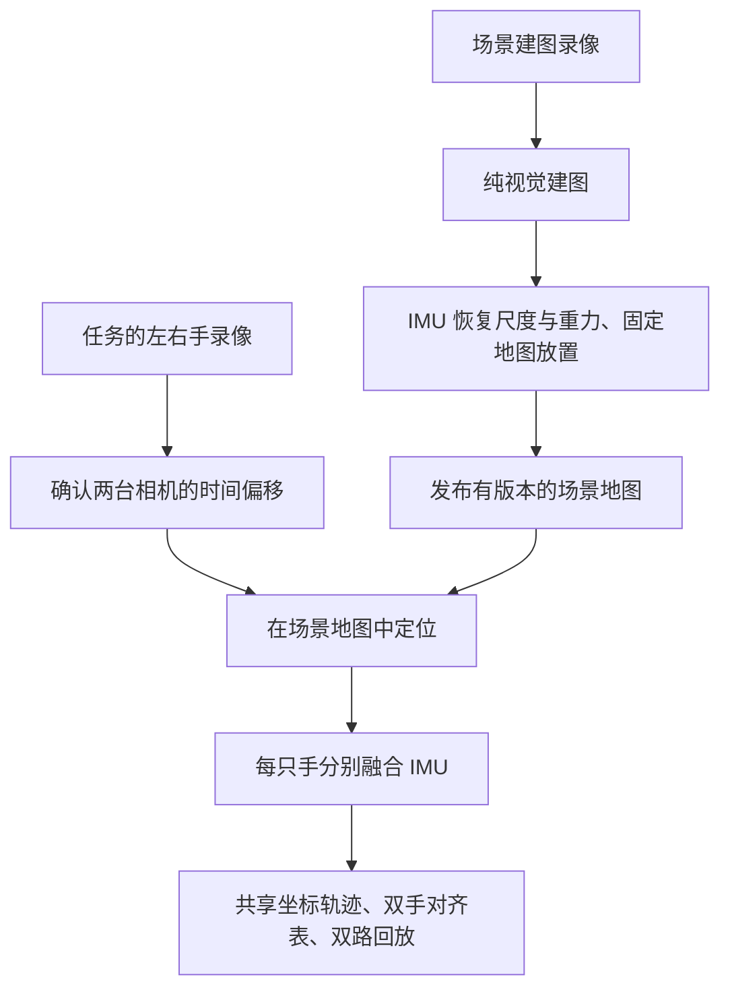

# 一个场景、多段任务、双手共享坐标

`umi-scene` 为一个工作场景建立固定地图，再让多段任务复用。左右手分别融合自己的 IMU，轨迹使用同一个米制坐标系和任务时间轴。原始录像继续按相机序列号保存，场景和任务清单只引用它们。

输入要求为 X3「360 视频、4K60」原始 INSV、规则帧时序，以及已手动启用的前镜头标定。

[文档导航](README.md) · [设备与目录](设备与目录.md) · [代码阅读入口](../software/scene/README.md)

## 先理解两层流程



建图由 `build` 显式执行。`run` 只使用已发布地图，不会因某段任务定位失败而自动重建或改变场景原点。每段输出记录地图版本和 `frame_id`；同一场景的新地图版本代表新的坐标定义，不能直接拼接新旧版本的坐标。

场景系以米为单位、Z 朝上，水平朝向由参考地图决定。建图通过尺度、重力和地图放置的一致性验收后才发布。验收残差是内部指标，真实精度仍需要标定板、已知距离或其他独立真值验证。

## 选择地图模式

| 模式 | 地图组织 | 适用条件 |
|---|---|---|
| `shared_front`（默认） | 从参考手前镜头建一张共享地图，所有任务的前镜头都查询它 | 单相机多任务验证；或左右前镜头都能看见同一片已建图环境 |
| `dual` | 左前、右前地图，加一张共享后地图 | 两台相机都有前后镜头实测标定；后镜头能看见共同环境 |

两种模式都使用 ORB-SLAM3 `MONOCULAR`。`dual` 中同一相机的前后地图通过实测外参放入共享后地图的米制坐标系。每个地图角色选用一张通过尺度与重力验收的子地图，并固定其索引；任务不会混入未对齐子地图的坐标。

旧命令 `umi-traj --mode dual` 表示单段录像的双镜头处理；`umi-scene` 的 `episode.yaml` 才表达左右手任务。旧流程继续按每段录像独立处理，见 [轨迹抽取](轨迹/使用.md)。

## 先用单相机打通场景

以下命令均从项目根目录运行。录像路径替换为实际路径；相机需要先完成前镜头 A/B/C/D 标定并手动启用。

```bash
# 原片保留在 recordings/<序列号>/，场景清单只保存引用。
./umi-scene init scenes/lab_table \
  --mapping-left recordings/IAQEB26097M4CP/tasks/20261023/mapping.insv

# 第一次建立地图；再次 build 会检查输入，未变时复用。
./umi-scene build scenes/lab_table

# 同一个场景可以登记多段任务。
./umi-scene episode scenes/lab_table --name task_001 \
  --left recordings/IAQEB26097M4CP/tasks/20261023/task_001.insv

./umi-scene run scenes/lab_table/episodes/task_001
./umi-view scenes/lab_table
```

建图录像需要清晰、覆盖任务区域，并带多方向平移、加速度变化和转动。静止或全程匀速可能无法区分尺度、重力和加速度计零偏；此时建图会拒绝发布，不能只调松阈值就视为可靠。

单手任务自动使用该段视频自身的时间原点。可登记更多任务，再用 `./umi-scene run scenes/lab_table` 顺序处理所有已登记任务。

## 登记双手任务并同步时间

左右手必须是两台不同序列号的相机；在 `shared_front` 模式下，两只手都需要能在共享前地图中定位。

```bash
./umi-scene episode scenes/lab_table --name task_002 \
  --left recordings/LEFT_SERIAL/tasks/task_002.insv \
  --right recordings/RIGHT_SERIAL/tasks/task_002.insv
```

未填写的右手偏移会保留为 `null`，`run` 会要求先同步。时间约定统一为：

```text
t_episode = t_video + offset_s
```

以左视频为原点时，右视频晚开始 0.135 秒，右偏移就是 `+0.135`。下面的数值只是示例，应换成实测偏移：

```bash
./umi-scene sync scenes/lab_table/episodes/task_002 --right-offset-s 0.135
./umi-scene run scenes/lab_table/episodes/task_002
```

也可在 `episode` 时显式传入 `--right-offset-s`。只有确实同步时才填写 0，程序不假定两台相机同时开始录像。

音频同步使用 `sync --audio`，还必须提供各自实测的 `--left-audio-to-video-s`、`--right-audio-to-video-s`。它们定义为“视频时间 = 解码音频时间 + audio_to_video_s”，应包含解码音频起点与对应录制模式的音视频延迟。X5 或其他模式的延迟表不能直接当作 X3 4K60 的测量结果。

程序根据共同音频计算两路偏移，再应用两台相机的音视频延迟；静音、相关性低或重复声音导致多峰时会拒绝估计。结果保存相关性、峰值比、测量值和录像身份。当前使用固定时间偏移模型，不校正长录像的时钟漂移。

**两台相机之间的时间同步**与**每台相机内部的相机–IMU 时间偏移**分别管理，不能互相替代。

## 前后镜头与共享后地图

每台相机先保持现有前镜头标定，再补录一套后镜头 A/B/C/D。A、B、C 都让后镜头看标定板；D 仍是同一机身 IMU 的六朝向静止检查。不要把原来的前镜头录像误当成后镜头标定素材。

```bash
# 使用已有标定环境；若尚未安装，先 ./umi-calib check。
./umi-scene calibrate-rear recordings/LEFT_SERIAL/calib_rear_20261025 --tag-size-mm 24.0
./umi-scene calibrate-rear recordings/RIGHT_SERIAL/calib_rear_20261025 --tag-size-mm 24.0
```

此命令复用 A 内参、B 相机–IMU、D 重力检查；C 使用后镜头地图与 IMU 求轨迹，再对照独立标定板位置做刚体对齐的误差验收。通过后才生成 `umi_calib_rear_out/rear_calibration.json`，写入实际序列号、镜头身份和验收证据。它不替换前镜头默认标定，也不自动启用场景。已有输出目录会保留，重新标定用 `--out` 指定新目录。

随后建立双镜头场景：

```bash
./umi-scene init scenes/lab_dual --mode dual \
  --mapping-left recordings/LEFT_SERIAL/tasks/mapping.insv \
  --mapping-right recordings/RIGHT_SERIAL/tasks/mapping.insv \
  --rear-left recordings/LEFT_SERIAL/calib_rear_20261025/umi_calib_rear_out/rear_calibration.json \
  --rear-right recordings/RIGHT_SERIAL/calib_rear_20261025/umi_calib_rear_out/rear_calibration.json

./umi-scene build scenes/lab_dual
```

默认左手后镜头建立共享后地图，可用 `--reference-arm right` 改选右手。建图后，任务登记、时间同步、运行和查看沿用上面的步骤。

后镜头必须使用序列号匹配且通过验收的实测文件；场景路径不接受 `rear_sample.json` 或工程样例覆盖。已建图相机换用新的镜头标定后，需要显式重建场景版本。

## 目录与结果

```text
scenes/lab_table/
├── scene.yaml                      地图模式、参考手、建图录像、参数文件
├── maps/
│   ├── current.json                当前已发布版本
│   └── versions/<版本>/
│       ├── manifest.json          地图索引、固定变换、测量与资产哈希
│       ├── maps/                  完整 ORB 图集
│       ├── devices/               固定的相机测量与夹爪资产副本
│       ├── map.json               场景地图展示数据
│       └── report.txt
└── episodes/task_001/
    ├── episode.yaml               左右手录像引用与时间同步
    ├── results -> runs/<版本>/     当前成功结果的原子发布指针
    └── runs/<版本>/
        ├── episode.json           场景/地图/时间版本、共同有效时间
        ├── report.txt
        ├── bimanual.csv           双手共同时间上的 TCP 位姿（双手时）
        ├── left/                  traj_tcp.txt、front.mp4、report.txt、details/
        └── right/                 同上；单手任务只生成实际存在的手
```

`traj_tcp.txt`、相机和 IMU 轨迹都在固定场景系中，时间列为 `t_episode`。视频仍保留本地时间，`video_time_offset_s` 记录两者关系。`bimanual.csv` 使用共同有效区间内的主手帧时间，对另一只手做位置和姿态插值，不向录像区间外外推。

查看器识别整个任务，在一个三维场景中显示两只手和两路前镜头视频。左手为绿色、右手为橙色；回放使用两路共同有效时间。地图展示直接使用算法固定的场景变换，不再针对每段轨迹拟合展示对齐。

`build --force` 或 `run --force` 生成新版本，旧成功版本仍保留。失败版本保留错误日志；只有全部步骤成功才切换入口。成功后默认清理可再生成的 `work/`，`--keep-work` 可保留；完整场景地图始终保留。

## 参数、预检与排错

场景参数集中在 [`config/scene.yaml`](../config/scene.yaml)，带单位与用途注释。`scene.yaml` 的 `parameters` 可引用覆盖文件，`trajectory_config` 可引用视频、ORB、IMU 噪声和零速参数覆盖。相对路径均相对于所在清单，不依赖启动目录。

```bash
./umi-scene build scenes/lab_table --dry-run
./umi-scene run scenes/lab_table --dry-run
./umi-scene inspect scenes/lab_table
```

预检只读，不创建输出或启动算法。更改地图模式、尺寸、ORB 或尺度/放置参数时，先显式 `build`；任务融合噪声与同步参数改变时重新运行任务。结果指纹包含地图、设备测量、同步、代码与引擎身份。

| 现象 | 检查内容 |
|---|---|
| 尺度/重力不可观测 | 建图录像有无多方向平移、加速度变化及旋转，是否只有静止或匀速 |
| 前后地图放置不一致 | 两镜头内参、外参、时间偏移、共同有效定位和原始画面是否正确 |
| 任务定位覆盖低、无视觉区间过长 | 是否仍在同一场景，画面是否被挡住，是否看到了已建图区域 |
| 左右手时间不重叠 | `offsets_s` 的数值和正负号、录像是否属于同一次任务 |
| 地图/测量哈希变化 | 核对资产，显式重建；不要修改已发布版本中的单个文件 |

共享坐标不等于已验证双手精度。上线采集前，应用固定位置的重复录像、双手已知间距和同步事件做真实双机验收。当前测试范围记录在 [变更历史](dev/PROVENANCE.md)。
