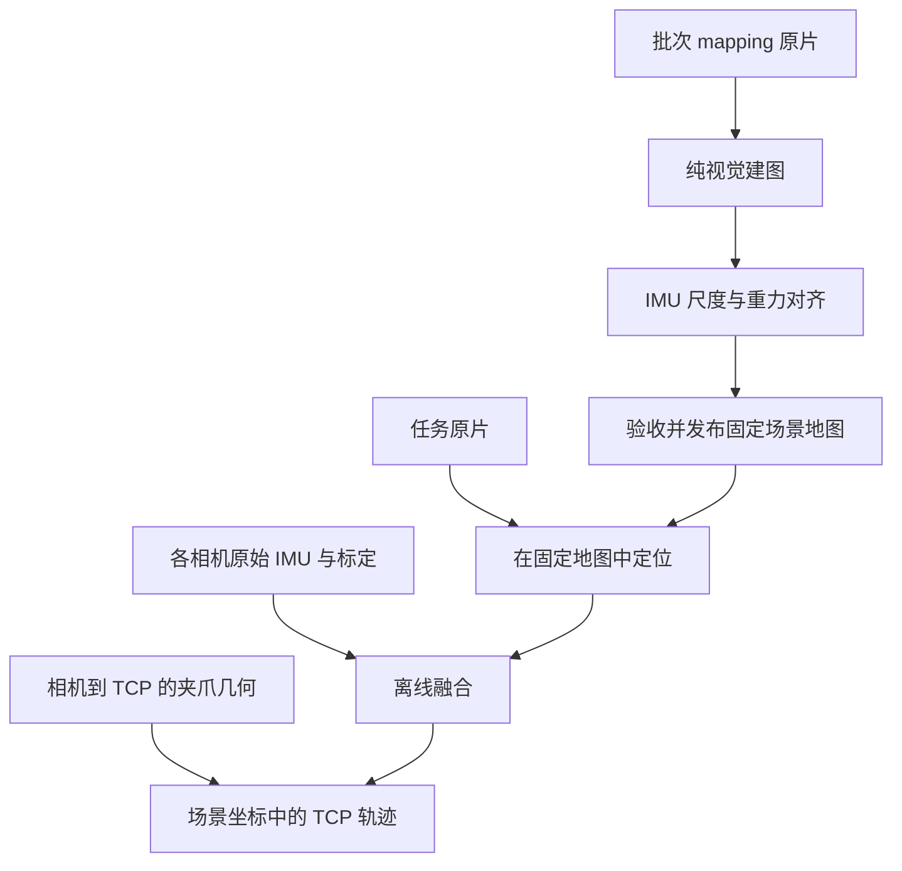
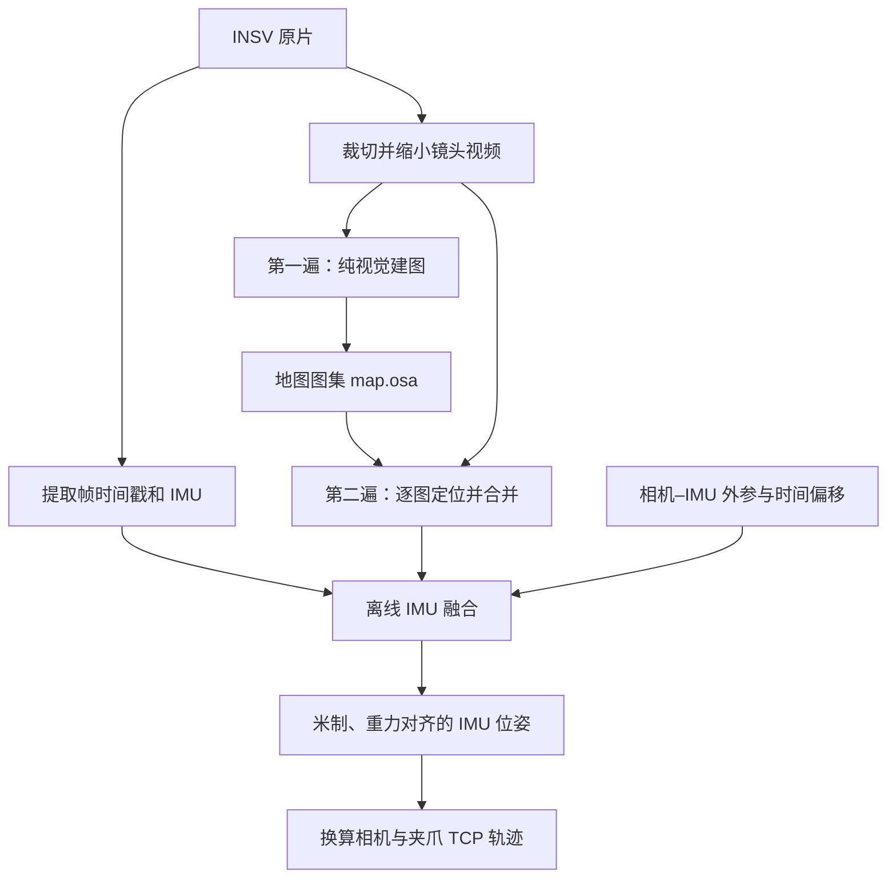

# 算法原理与验证边界

本文说明日常共享场景流程与标定 C 验证所用的内部逐段引擎。录制和操作见[日常指南](安装与日常使用.md)，参数见[配置说明](../config/README.md)。

## 共享场景处理

一次批次先建立固定的米制地图，再让各任务在该地图中定位并融合各自 IMU。相机标定提供机身内参、相机–IMU 外参和时间关系；夹爪几何用于把相机位姿换算成 TCP 位姿。

`shared_front` 使用一张共享工作镜头地图，支持左手、右手或双手任务。`dual` 使用左右工作镜头地图和共享环境镜头地图，需要各设备对应来源的完整环境镜头标定及双路建图原片。内参可选实测 KB4 或工厂 MEI 拟合 KB4，相机–IMU 外参和时间差都须实测；选择的是整套标定版本，地图须匹配参数与引擎。任务定位阶段使用已发布地图，不为每次操作重新建图。

### 共享地图的尺度与发布条件

地图米制化复用轨迹后端的运动段筛选：先按跟踪中断、视觉与陀螺仪旋转不一致切段，长段失败时进一步细分；仅用通过验收的可靠段共同估计一个尺度、重力方向和加速度计零偏。各段速度独立，但同一张地图不会分配多个尺度或放置。可靠段尺度或重力方向冲突、运动退化或残差过大时，仍拒绝发布。

可靠段通过后，还会把这一个固定尺度、重力和零偏用于复核其余可检查段的惯性位置方程；不再为这些段另拟合尺度。任一段的 RMS 超过 `maximum_alignment_rms_m` 就拒绝整张地图。这样不会把“后半段可定标”误当成“整张地图可共用尺度”。诊断中的 `fixed_map_validation` 记录逐段结果；地图不能通过此检查时，独立轨迹后端仍可能以分段尺度和惯性衔接输出录像轨迹，两者不等价。

分段与求解参数读取 `config/trajectory.yaml` 的 `fusion`；共享地图的尺度不确定度、重力、可观测性与残差门槛读取 `config/scene_parameters.yaml`。默认门槛保持尺度相对不确定度不超过 20%、自由重力与 9.81 的差不超过 0.5 m/s²。可靠段与共同尺度的相对偏差也不得超过尺度门槛，重力向量差不得超过重力门槛。

失败的每个候选子地图在 `.umi/maps/versions/<版本>/work/try_<次数>/<地图角色>/localize/m<索引>/metric_alignment.json` 中保留各运动段尺度、不确定度、重力和共同拟合结果。成功版本在 `manifest.json` 的 `maps.<地图角色>.placement.evidence.alignment` 中保存相同诊断；这些是内部一致性指标，实际位置精度仍需独立验证。

### 地图身份与任务坐标

地图清单固定建图录像、设备测量、参数、算法与资产哈希。任务结果引用具体地图版本；同一版本内左右手共享场景坐标，不同版本不能默认直接比较绝对位置。地图修改或输入身份变化会重新接受复用检查。

任务先在固定地图中定位，再融合本机 IMU；成功结果保存所用地图和输入身份。地图与结果布局分别见[设备参考](设备与坐标.md)、[结果说明](结果查看与验收.md)。

固定地图定位默认先正向处理，有缺失时再反向处理同一镜头视频。反向连续跟踪段须与正向结果在原地图坐标内通过位置和旋转一致性检查，才可补入缺失帧；不重新对齐坐标，也不平均或替换已有正向位姿。反向引擎使用递增的内部视觉时钟，输出恢复原始帧号和时间；IMU 始终按原始正向时间轴融合。该补全只用于已有米制地图的任务，建图尺度求解继续使用正向观测。

## 内部逐段轨迹引擎

标定 C 验证和开发测试使用内部逐段引擎，对每段录像分别建图、定位并定标。其世界系原点与水平朝向按段建立，与批次固定地图的任务处理有不同的坐标边界。以下过程描述该引擎，代码入口见[轨迹模块指南](../software/trajectory/README.md)。

### 从原片到轨迹

一段 X3「360 4K60」原片包含两个并排的鱼眼画面（约 59.94 fps），以及约 1000 Hz 的陀螺仪和加速度计测量。以下图示描述内部逐段引擎的重建流程。

程序先读取容器时间戳和片尾 IMU，检查模式、数据完整性及丢帧情况；这一步不解码图像。随后根据 `video:` 生成镜头视频：默认使用单镜头已标定的 1440×1440 区域，每两帧取一帧，输出 **720×720、约 29.97 fps**。可配置该标定区域内的裁切、取帧步长、输出尺寸、缩放算法、编码和音轨；内参与遮手图同步变换，时间戳与融合帧率同步调整，画面保留鱼眼畸变。

每个镜头的视频只准备一次。建图、定位以及各轮重试共用这份视频；查看器另外缓存的压缩预览不参与算法计算。视频选项与约束见[视频处理参数](../config/README.md#视频处理参数)，其余算法参数见[参数管理](../config/README.md)。

### 第一遍：纯视觉建图

ORB-SLAM3 使用 `MONOCULAR` 模式，输入镜头视频和相机内参，工作镜头额外使用遮手图。**此时不向引擎传入 IMU。** IMU 虽已提取，尚未参与运动估计。

建图内部大致依次做：

1. **找特征并匹配**：从图像中提取 ORB 特征，寻找不同帧中属于同一环境位置的点。
2. **初始化地图**：用两帧的相对运动和视差恢复第一批三维点；普通两视图初始化失败时，尝试标签辅助初始化。标签不必持续可见。
3. **跟踪并扩展**：用已有地图点估计当前相机位姿，选取有价值的画面作为关键帧，再三角化出新地图点。
4. **优化地图**：剔除不稳定点、合并重复点，联合调整关键帧位姿和三维点；重访旧区域时尝试回环校正。

地图保存的是稀疏三维点、关键帧、特征描述子及观测关系。初始化参考帧建立该子地图的坐标系，单目初始化还会归一化深度，**地图单位不能直接当作米，地图轴也不保证竖直**。

持续跟踪失败后，引擎可能重置地图或另建子地图，所以 `map.osa` 是可包含多张子地图的图集。建图时工作镜头手指区域被遮黑，减少把随相机移动的手指当成静态环境的风险。

### 第二遍：在已有地图中定位

程序加载图集，对每张子地图分别重放同一镜头视频，开启 `localization_only`。此时地图固定，不再插入新关键帧；定位不使用建图时的遮手图。

每张子地图得到一份逐帧位姿。合并时，只要当前来源仍有有效定位就继续使用；失效后，切换到有效来源中关键帧数最多的地图，同时记录每帧的地图编号。地图切换和跟踪中断会成为后续融合的分段边界。

“两遍”指建图和定位两个视觉阶段；一旦有多张子地图，定位阶段会重放多次。重建质量可疑时，还可能重新执行整轮建图、定位和融合，规则见 [终端进度与重试](../software/trajectory/README.md#执行顺序)。

### 离线 IMU 融合：从地图位姿到米制运动

融合输入是逐帧视觉位姿、原始 IMU，以及标定得到的相机–IMU 外参和时间偏移。此时不再读取图像或重新提取特征，也不回头优化 ORB 地图中的三维点。

视觉提供相对环境的位置和朝向，但尺度不确定、可能丢失或跳变；IMU 提供高频角速度和加速度，但单独积分会漂移。独立融合模块 `algorithms/fusion.py` 用 GTSAM 因子图联合求解，让两类观测相互约束：

1. **估计尺度和重力**：按连续跟踪段进行视觉–惯性对齐，估计地图单位对应多少米、重力方向及加速度计零偏。运动需要有足够平移与加速度变化，全程只转手腕难以可靠恢复尺度。
2. **检查并隔离坏段**：检查尺度是否为正、可用观测对是否足够，以及尺度波动和重力是否合理。长段失败时单独检查，必要时递归拆分，减少坏片段对其他段的影响。
3. **联合优化轨迹**：可靠段提供位置与朝向约束；未通过尺度检查的段仅保留朝向约束。同一地图中尺度一致的跟踪段可共用到世界系的变换。共同优化位姿、速度、IMU 零偏及各段到世界系的尺度、旋转和平移。
4. **约束静止并衔接缺失**：默认在检测到静止时加入零速约束；视觉缺失时由 IMU 提供运动衔接约束。长时间缺少视觉仍可能漂移，第一遍建图也无法靠这里的 IMU 融合避免跟踪失败。

尺度与重力检查的默认条件包括至少 3 对观测、相对尺度标准差不超过 20%、重力大小在 9.81 ± 0.5 m/s² 内；实际以本次有效配置为准，见 [`trajectory.yaml`](../config/trajectory.yaml) 的 `fusion` 和 `zupt`。

融合先得到 **IMU 的世界位姿**，再通过相机–IMU 标定换算相机位姿，通过相机–TCP 的 CAD 几何换算夹爪位姿。世界系以米为单位、Z 轴朝上；原点和水平朝向由每段的参考跟踪段与优化约束确定，不同录像没有统一的绝对坐标。

查看器中的地图叠加则另行拟合展示变换；这一步不参与轨迹求解，展示拟合残差也不是实际轨迹误差。文件和坐标约定见 [结果说明](结果查看与验收.md)。

## 来源与算法关系

本项目借鉴 [KIWI 论文](https://arxiv.org/abs/2609.22809)的分阶段思路。**KIWI 已公开研究参考实现；内部逐段轨迹引擎的 `algorithms/fusion.py` 是独立实现。** 共享场景流程的数值对齐与融合则适配官方公开参考实现，来源与修改见 [场景模块 NOTICE](../software/scene/NOTICE.md)。本项目引擎的导入来源见 [来源与变更历史](dev/PROVENANCE.md)。

以下对照官方公开参考实现 0.1.0（提交 `22860a3`）：

| 环节 | KIWI 官方参考实现 | 内部逐段轨迹引擎 |
|---|---|---|
| 总体流程 | 纯视觉建图、地图定位、离线 IMU 融合 | 采用相同的阶段划分 |
| 地图组织 | 每个批次建图，批次内多段录像复用 | 每段录像独立建图 |
| 镜头与坐标 | 左右手各一张工作镜头地图，共用环境镜头地图，放入统一场景系 | 默认仅工作镜头；双镜头模式也按本段录像独立处理 |
| 融合程序 | `kiwi/state/fusion.py`，融合工作镜头与环境镜头定位与原始 IMU | `algorithms/fusion.py`（文件入口为 `fusion_cli.py`），含跟踪段拆分、尺度检查和分段放置 |

官方流程依据：[场景建图与状态估计](https://github.com/TToTMooN/KIWI_software/blob/22860a30dc1c2e9e5f9a2e55c4955a4fba84646e/docs/estimation.md#scene-mapping-and-state)、[GTSAM 融合实现](https://github.com/TToTMooN/KIWI_software/blob/22860a30dc1c2e9e5f9a2e55c4955a4fba84646e/kiwi/state/fusion.py)。官方的 ORB 视觉建图本身不使用 IMU，但整个 `scene build` 还包含建图后的 IMU 尺度与重力对齐。

ORB-SLAM3 自带的**视觉惯性模式**是另一条流程：在初始化后让视觉特征与 IMU 持续参与跟踪和地图联合优化。本项目使用它的纯视觉模式，再交给独立融合程序，因此不能把本项目流程称为 ORB-SLAM3 标准视觉惯性流程。参见 [ORB-SLAM3 论文](https://arxiv.org/abs/2007.11898)。

内部逐段引擎 `python -m software.trajectory` 的 `--mode handheld` 默认只用工作镜头，`--mode dual` 同时使用环境镜头样例几何，不能当作本设备已完成双镜头标定，该路径拒绝显式来源切换。日常场景通过 scene.yaml 的 `mode` 选择共享工作镜头地图或本设备已验收的双镜头流程，不能将内部引擎的 `--mode` 参数传给 umi-scene。这些是本项目的录制与处理选择，不能据此概括 KIWI 官方的双手方案。

## 验证范围

内部逐段引擎的板参考评估、机械臂参考评估、依赖版本和安装包重跑数据集中保存在[历史验证记录](dev/archive/轨迹引擎验证记录.md)。板参考依赖相机模型、板尺寸和平整度，不能当作完全独立的外部真值；相机误差也不等于 TCP 实物精度。

共享场景流程的现有模拟商超样例使用历史实验室单相机录像，已处理 1041 帧、约 34.7 秒。自动化测试覆盖套件配置、跨场景、单/双手、补片、失败重试和验收导出；尚无真实双机新采数据的完整物理回归或独立真值支撑的绝对精度结论。后续变更的验证范围见[变更历史](dev/PROVENANCE.md)。

## 已知限制

- **两份标定各管各的。** 相机标定（内参、镜头与机内 IMU 的关系、时间差）属于那一台相机，拆装不影响它；换了另一台相机要重新标定（`./umi-calib`，见 [`标定.md`](标定.md)），否则没有精度保证。相机–夹爪几何只在夹爪尖合拢时相对镜头光心的位置变了（换夹爪、换安装件、改相机安装位置或角度）时才需要重做。
- **只支持 X3「360 4K60」录制模式。** 标定就是在这个模式、这个裁剪区域上做的。
- **持续剧烈转动会丢跟踪**（每秒半圈以上、持续数秒）：中间丢一段能靠 IMU 和"回到同一张图"衔接（068、069 都是这样救回来的）；
  如果开头扫图那段就丢，整段可能失败。
- **内部逐段引擎每段单独建立世界坐标系**，不同段不能直接比绝对坐标；共享场景中使用同一地图版本的任务处于同一场景坐标系，不同地图版本之间仍不能默认直接比较。
- **相机丢帧的录像**默认不处理（内部逐段引擎的 `--allow-irregular` 可强行处理，未经验证）。目前所有测试录像都没有丢帧。
- **场景流程已接入视觉夹爪宽度和训练中间包导出**，需对应安装的宽度标定及必要的核验，见 [训练数据](训练数据.md)。LeRobot 格式适配、模型训练和机械臂部署仍不由本仓库完成。
