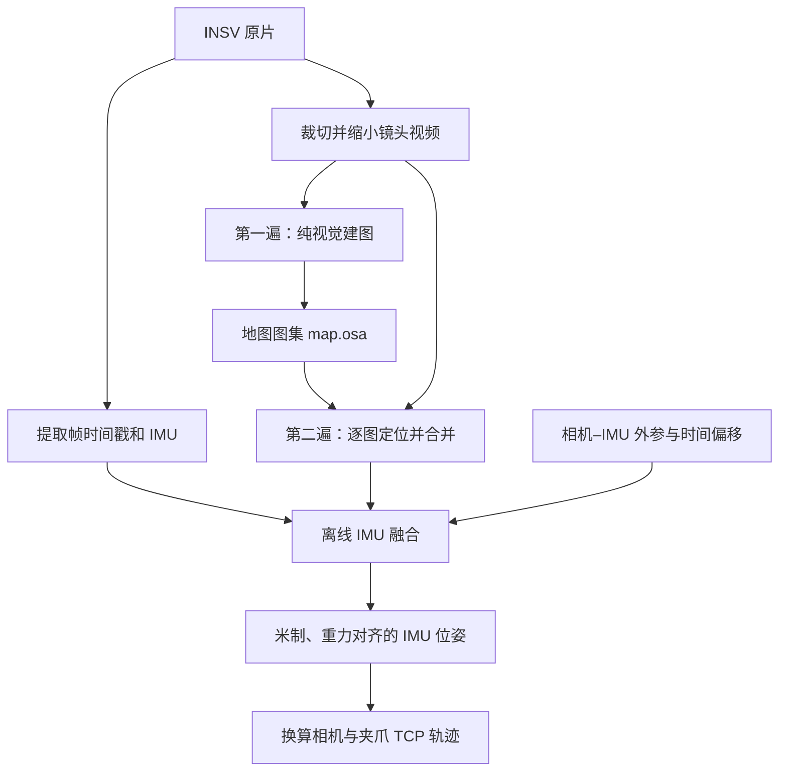

# 轨迹：计算流程、方法来源与精度证据

先读第 1 节理解建图、定位和 IMU 融合；第 2–3 节是已有验证记录，第 4 节说明局限。
录制与命令分别见 [任务录制](录制.md)、[轨迹抽取](使用.md)，代码入口见 [轨迹代码指南](../../software/trajectory/README.md)。

本页的计算流程默认指 `umi-traj` 单段处理。新增的 `umi-scene` 支持场景地图复用、多段任务和双手共享坐标，流程与命令见 [场景与双手任务](../场景.md)。

---

## 1. 怎么算的

**本项目先用视觉建立地图，再重放视频定位，最后离线融合 IMU，生成米制轨迹。** 每段任务独立执行这一流程，标定提供相机参数，不提供工作区地图。

### 1.1 从原片到轨迹

一段 X3「360 4K60」原片包含两个并排的鱼眼画面（约 59.94 fps），以及约 1000 Hz 的陀螺仪和加速度计测量。

程序先读取容器时间戳和片尾 IMU，检查模式、数据完整性及丢帧情况；这一步不解码图像。随后从原片中裁出单镜头的 1440×1440 区域，每隔一帧取一帧，默认缩小为 **720×720、约 29.97 fps** 的镜头视频。相机内参和遮手图随尺寸缩放，画面保留鱼眼畸变。

每个镜头的视频只准备一次。建图、定位以及各轮重试共用这份视频；查看器另外缓存的压缩预览不参与算法计算。尺寸和算法参数见 [参数管理](../../config/README.md)。

### 1.2 第一遍：纯视觉建图

ORB-SLAM3 使用 `MONOCULAR` 模式，输入镜头视频和相机内参，前镜头额外使用遮手图。**此时不向引擎传入 IMU。** IMU 虽已提取，尚未参与运动估计。

建图内部大致依次做：

1. **找特征并匹配**：从图像中提取 ORB 特征，寻找不同帧中属于同一环境位置的点。
2. **初始化地图**：用两帧的相对运动和视差恢复第一批三维点；普通两视图初始化失败时，尝试标签辅助初始化。标签不必持续可见。
3. **跟踪并扩展**：用已有地图点估计当前相机位姿，选取有价值的画面作为关键帧，再三角化出新地图点。
4. **优化地图**：剔除不稳定点、合并重复点，联合调整关键帧位姿和三维点；重访旧区域时尝试回环校正。

地图保存的是稀疏三维点、关键帧、特征描述子及观测关系。初始化参考帧建立该子地图的坐标系，单目初始化还会归一化深度，**地图单位不能直接当作米，地图轴也不保证竖直**。

持续跟踪失败后，引擎可能重置地图或另建子地图，所以 `map.osa` 是可包含多张子地图的图集。建图时前镜头手指区域被遮黑，减少把随相机移动的手指当成静态环境的风险。

### 1.3 第二遍：在已有地图中定位

程序加载图集，对每张子地图分别重放同一镜头视频，开启 `localization_only`。此时地图固定，不再插入新关键帧；定位不使用建图时的遮手图。

每张子地图得到一份逐帧位姿。合并时，只要当前来源仍有有效定位就继续使用；失效后，切换到有效来源中关键帧数最多的地图，同时记录每帧的地图编号。地图切换和跟踪中断会成为后续融合的分段边界。

“两遍”指建图和定位两个视觉阶段；一旦有多张子地图，定位阶段会重放多次。重建质量可疑时，还可能重新执行整轮建图、定位和融合，规则见 [终端进度与重试](使用.md#终端进度与重试)。

### 1.4 离线 IMU 融合：从地图位姿到米制运动

融合输入是逐帧视觉位姿、原始 IMU，以及标定得到的相机–IMU 外参和时间偏移。此时不再读取图像或重新提取特征，也不回头优化 ORB 地图中的三维点。

视觉提供相对环境的位置和朝向，但尺度不确定、可能丢失或跳变；IMU 提供高频角速度和加速度，但单独积分会漂移。独立融合模块 `algorithms/fusion.py` 用 GTSAM 因子图联合求解，让两类观测相互约束：

1. **估计尺度和重力**：按连续跟踪段进行视觉–惯性对齐，估计地图单位对应多少米、重力方向及加速度计零偏。运动需要有足够平移与加速度变化，全程只转手腕难以可靠恢复尺度。
2. **检查并隔离坏段**：检查尺度是否为正、可用观测对是否足够，以及尺度波动和重力是否合理。长段失败时单独检查，必要时递归拆分，减少坏片段对其他段的影响。
3. **联合优化轨迹**：可靠段提供位置与朝向约束；未通过尺度检查的段仅保留朝向约束。同一地图中尺度一致的跟踪段可共用到世界系的变换。共同优化位姿、速度、IMU 零偏及各段到世界系的尺度、旋转和平移。
4. **约束静止并衔接缺失**：默认在检测到静止时加入零速约束；视觉缺失时由 IMU 提供运动衔接约束。长时间缺少视觉仍可能漂移，第一遍建图也无法靠这里的 IMU 融合避免跟踪失败。

尺度与重力检查的默认条件包括至少 3 对观测、相对尺度标准差不超过 20%、重力大小在 9.81 ± 0.5 m/s² 内；实际以本次有效配置为准，见 [`trajectory.yaml`](../../config/trajectory.yaml) 的 `fusion` 和 `zupt`。

融合先得到 **IMU 的世界位姿**，再通过相机–IMU 标定换算相机位姿，通过相机–TCP 的 CAD 几何换算夹爪位姿。世界系以米为单位、Z 轴朝上；原点和水平朝向由每段的参考跟踪段与优化约束确定，不同录像没有统一的绝对坐标。

查看器中的地图叠加则另行拟合展示变换；这一步不参与轨迹求解，展示拟合残差也不是实际轨迹误差。文件和坐标约定见 [结果说明](结果.md)。

### 1.5 与 KIWI 官方、ORB-SLAM3 的关系

本项目借鉴 [KIWI 论文](https://arxiv.org/abs/2609.22809)的分阶段思路。**KIWI 已公开研究参考实现；`umi-traj` 的 `kiwi_fuse3s.py` 是独立实现。** 新增场景流程的数值对齐与融合则适配官方公开参考实现，来源与修改见 [场景模块 NOTICE](../../software/scene/NOTICE.md)。本项目引擎的导入来源见 [来源与变更历史](../dev/PROVENANCE.md)。

以下对照官方公开参考实现 0.1.0（提交 `22860a3`）：

| 环节 | KIWI 官方参考实现 | 本项目 `umi-traj` 单段模式 |
|---|---|---|
| 总体流程 | 纯视觉建图、地图定位、离线 IMU 融合 | 采用相同的阶段划分 |
| 地图组织 | 同一场景建一次地图，多段录像复用 | 每段录像独立建图 |
| 镜头与坐标 | 左右手各一张前地图，共用后地图，放入统一场景系 | 默认仅前镜头；双镜头模式也按本段录像独立处理 |
| 融合程序 | `kiwi/state/fusion.py`，融合前后镜头定位与原始 IMU | `algorithms/fusion.py`（旧脚本入口 `kiwi_fuse3s.py` 保留兼容），含跟踪段拆分、尺度检查和分段放置 |

官方流程依据：[场景建图与状态估计](https://github.com/TToTMooN/KIWI_software/blob/22860a30dc1c2e9e5f9a2e55c4955a4fba84646e/docs/estimation.md#scene-mapping-and-state)、[GTSAM 融合实现](https://github.com/TToTMooN/KIWI_software/blob/22860a30dc1c2e9e5f9a2e55c4955a4fba84646e/kiwi/state/fusion.py)。官方的 ORB 视觉建图本身不使用 IMU，但整个 `scene build` 还包含建图后的 IMU 尺度与重力对齐。

ORB-SLAM3 自带的**视觉惯性模式**是另一条流程：在初始化后让视觉特征与 IMU 持续参与跟踪和地图联合优化。本项目使用它的纯视觉模式，再交给独立融合程序，因此不能把本项目流程称为 ORB-SLAM3 标准视觉惯性流程。参见 [ORB-SLAM3 论文](https://arxiv.org/abs/2007.11898)。

本项目默认 `--mode handheld` 只用前镜头，因为现有手持录像中后镜头常拍到操作者。装在机械臂上、后镜头能看到稳定环境时，可以使用 `--mode dual`。这属于本项目的录制与处理选择，不能据此概括 KIWI 官方的双手方案。

---

## 2. 精度证据

以下是本项目的历史评估记录，评估对象是本项目的实现。KIWI 官方的评测与这些记录分开，新录像的误差需要独立真值测量。

**参考真值**：录像时在场地里固定一块 AprilGrid 标定板。前镜头看到板的帧，用板单独算出相机位姿作参考，参考和被测算法无关。
做一次全局刚体对齐（只平移和旋转，**不拟合尺度**，所以尺度误差也算在内）后算轨迹误差（ATE，均方根）。机械臂上的录像用机械臂自身的运动学做参考。

### 2.1 手持录像（8 段，前镜头 + IMU）

| 段 | 内容 | 此前用的 OpenVINS | 本工具的方法 |
|---|---|---|---|
| E (030) | 盲评段 | 8.81 mm | **7.34 mm** |
| 064 | 正常操作 | 7.45 mm | **3.29 mm** |
| 066 | 正常操作 | 7.54 mm | **4.72 mm** |
| 067 | 预注册测试：正常操作 | 12.90 mm | **4.15 mm** |
| 068 | 预注册测试：剧烈动作 | 39 m（发散） | **4.04 mm** |
| 069 | 预注册测试：转离视野再回来 | 114 m（发散） | **5.33 mm** |
| 070 | 转离再回来 | 65.8 mm（尺度错 44 %） | **6.65 mm** |
| 071 | 转离再回来 | 10.39 mm | **7.66 mm** |

### 2.2 装在机械臂上（2 段，前后两个镜头 + IMU）

轨迹长度与机械臂实测之比（越接近 1 越好）：042 **1.005**（OpenVINS 1.050），045 **0.995**（OpenVINS 0.941）。

### 2.3 这些数字的分量（实话）

- 067–069 三段是在看结果之前定好方法和判定规则的。其余几段在改方法时已经看过。
- 上表是相机相对标定板的误差，不是夹爪尖的误差。相机到夹爪尖用的是 CAD 名义值，还没有单独量过实物。

---

## 3. 历史安装包的回归记录

以下记录保留引擎导入时的验证证据，版本号和耗时对应当时环境。当前安装版本以 `./umi-traj check` 为准；后续外围重构的验证范围见[变更历史](../dev/PROVENANCE.md)。

上面的数字是在当初那台验证机器上跑出来的。收成现在这个安装方式之后，逐项核对过：

| 环节 | 和验证时的关系 | 核对方式 |
|---|---|---|
| 融合、裁视频、合并定位结果的脚本；ORB-SLAM3 配置；遮手图；标定文件 | **逐字节相同** | sha256 |
| 读时间戳和 IMU | 不再解码整段视频。写出的时间戳和 IMU 与当时的转换结果**逐字节相同** | 7 段录像的帧时间戳文件和 IMU 文件 |
| GTSAM | 验证时用的 nightly 版会被 PyPI 删掉，改用正式版 4.3.0 | 22 个存档融合用同样输入重跑：19 个轨迹**逐字节相同**，3 个（NERO 045、069 两种模式）只差浮点舍入（位置最大差 0.000001 mm） |
| FFmpeg 8.0.1、OpenCV 4.12.0、Boost、Eigen | 与验证环境**同一构建**（conda-forge 锁定清单） | 包的构建号一致 |
| 裁视频用的 x264 编码器 | 验证时实际用的是服务器系统自带的 FFmpeg 4.2.7（x264 155），安装包里是 FFmpeg 8.0.1（x264 164），**裁出的视频不逐字节相同** | 下面的整段回归 |
| ORB-SLAM3 | 同一份源码（cheng-chi/ORB_SLAM3 @ b741dca3）+ 同样两处补丁，编译器 GCC 11.4（验证时 GCC 9.4），**二进制不同** | 下面的整段回归 |

ORB-SLAM3 本身多线程、每次跑结果都有小幅波动，所以最后一关是**用安装包从头重跑全部手持录像、用同一个打分器打分**：

| 段 | 验证时（单次） | 安装包从原片重跑（同一打分器、同一板参考） |
|---|---|---|
| 064 | 3.29 mm | 3.30 mm |
| 066 | 4.72 mm | 4.55 mm |
| 067 | 4.15 mm | 4.24 mm（另两次重复：4.19、11.95 mm） |
| 068 | 4.04 mm | 3.95 mm |
| 069 | 5.33 mm | 5.14 mm；7 次重复 5.1–16.8 mm |
| 070 | 6.65 mm | 6.91 mm；3 次重复 6.9–28.6 mm |
| 071 | 7.66 mm | 7.71 mm |

最后一关：**从 GitHub 全新 clone、空环境从零安装（6 分钟）、用 `umi-traj` 处理**（自动重新建图开着）：
067 **4.20 mm**（一次建图）、069 **5.39 mm**、070 **6.83 mm**（这两段各建图 3 次取最好），与验证结果同级。

几点要知道：

- **同一段每次跑结果不完全一样**。ORB-SLAM3 建图是多线程的，地图在哪里断开、断成几块每次不同；常规录像差别很小，
  "转开十几秒再回来"的录像（069、070）差别可以到几倍。验证时的数字也只是一次运行。
- 打包回归时发现，在不走运的那几次里，069 / 070（以及一次 067）会整段失败或误差到米级——用验证时的原环境原样重跑也一样，
  是方法本身的薄弱处。为此加了两道保险（2026-10-07）：融合时把坏的那一截单独孤立出来（见[离线 IMU 融合](#14-离线-imu-融合从地图位姿到米制运动)），
  以及 `umi-traj` 发现结果可疑时自动重试完整重建、默认最多 3 次取最好（见[重建与重试](使用.md#终端进度与重试)）。上表的重跑数字都是加了第一道保险之后的。
- 在验证过的其他录像上，这两处改动不改变任何结果（20 次存档融合重跑，同版本下逐字节相同）。

---

## 4. 已知限制

- **两份标定各管各的。** 相机标定（内参、镜头与机内 IMU 的关系、时间差）属于那一台相机，拆装不影响它；换了另一台相机要重新标定（`./umi-calib`，见 [`../标定/说明.md`](../标定/说明.md)），否则没有精度保证。相机–夹爪几何只在夹爪尖合拢时相对镜头光心的位置变了（换夹爪、换安装件、改相机安装位置或角度）时才需要重做。
- **只支持 X3「360 4K60」录制模式。** 标定就是在这个模式、这个裁剪区域上做的。
- **持续剧烈转动会丢跟踪**（每秒半圈以上、持续数秒）：中间丢一段能靠 IMU 和"回到同一张图"衔接（068、069 都是这样救回来的）；
  如果开头扫图那段就丢，整段可能失败。
- **每段录像的世界坐标系是独立的**：原点和水平朝向任意，不同录像之间不能直接比坐标。
- **相机丢帧的录像**默认不处理（`--allow-irregular` 可以强行处理，未经验证）。目前所有测试录像都没有丢帧。
- **只输出轨迹**。夹爪开合宽度、LeRobot 数据集、训练和机械臂部署不在这个仓库里。
