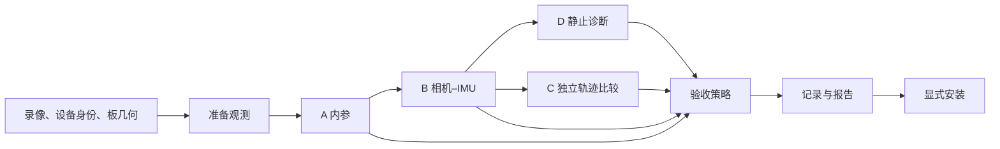

# 标定代码阅读指南

从 [`cli.py`](cli.py) → [`workflow.py`](workflow.py) 阅读。前、后镜头共用 A/B/D/C 的生命周期；后镜头只替换 C 的轨迹生成器。标定测量描述相机机身，不描述工作区地图、夹爪 TCP 或任务精度。

## 数据流与责任



- A：Basalt 求 KB4 内参，另外测量板覆盖和拟合质量。
- B：以 A 的原始 JSON 初始化，求相机–IMU 外参、零偏和时间差。使用固定 IMU 尺度、第二阶段开放时间差的补丁模式。
- D：原始 IMU 选择静止窗口，校准后加速度计算重力残差；仅诊断，不修改参数。
- C：候选标定生成独立轨迹，板 PnP 提供相机位置参考。两组位置先按视频时间匹配，再比较 SE(3) ATE 和 Sim(3) 尺度。

A/B 只求解和返回测量；验收策略决定是否可用；安装是独立操作。`verify` 只用已选标定跑 C，不生成新参数、不安装，也不要求 Basalt 或 rosbags。

| 模块 | 拥有的责任 |
|---|---|
| [`models.py`](models.py) | 请求、路径、结果类型、稳定 `Step`、`Decision`；执行选项含路径、资源与本轮计时 |
| [`pipeline/inputs.py`](pipeline/inputs.py) | 录像发现、同机身份、板几何、CLI 请求转换 |
| [`pipeline/recordings.py`](pipeline/recordings.py) | INSV → 时间戳、IMU、镜头图像；准备缓存 |
| [`pipeline/board_detection.py`](pipeline/board_detection.py) | 读图、并行检测、取消与原始角点缓存 |
| [`pipeline/steps.py`](pipeline/steps.py) | 步骤指纹、依赖失效、产物校验、计时、中断 |
| [`pipeline/runtime.py`](pipeline/runtime.py) | 子进程、锁、输出目录、依赖预检、CPU |
| [`solve/basalt.py`](solve/basalt.py) | A/B 适配：bag、板文件、B 初始化、命令、缓存、日志解析 |
| [`validation/gravity.py`](validation/gravity.py) | D 的独立工作目录、退出码/来源/参数校验、原始证据 |
| [`validation/trajectory.py`](validation/trajectory.py) | 前镜头轨迹子进程，以及两镜头共用的板参考比较 |
| [`validation/trajectory_diagnostics.py`](validation/trajectory_diagnostics.py) | 每轮重建的视觉板参考比较、初始化残差和融合尺度变化 |
| [`algorithms/aprilgrid_detect.py`](algorithms/aprilgrid_detect.py) | 单帧 AprilGrid 检测、上采样与原像素坐标还原 |
| [`algorithms/board_pnp.py`](algorithms/board_pnp.py) | KB4 PnP、覆盖度、带视频时间的板参考 |
| [`algorithms/trajectory_metrics.py`](algorithms/trajectory_metrics.py) | 一对一时间匹配、非有限位置过滤、退化检查、ATE/尺度 |
| [`acceptance.py`](acceptance.py) | 纯策略：测量 → 检查项 → 验收结论 |
| [`result_io.py`](result_io.py) | schema 3 记录、显式 JSON、来源校验、原子保存、候选发布 |
| [`reports.py`](reports.py) | 只展示，不读取 registry、不实例化执行器、不恢复工作目录 |
| [`devices.py`](devices.py) | 安装与设备命令；启用状态快照；调用现有 registry |
| [`scene/spatial/rear_calibration.py`](../scene/spatial/rear_calibration.py) | 后镜头 scene 数值后端，调用共享 workflow |

函数显式接收所需的板、IMU、重力或轨迹参数组。A/B 的两个公开入口共用一个内部执行函数，执行器统一记录异常所属步骤。

板几何由 `pipeline/inputs.load_board()` 将唯一布局 [`hardware/calibration_targets/aprilgrid.json`](../../hardware/calibration_targets/aprilgrid.json) 与本次 `--tag-size-mm` 实测边长合并。布局中的标签族和黑边需符合当前 Basalt/OpenCV 检测器；传给 Basalt 的板文件只含 `tagCols`、`tagRows`、`tagSpacing`、`tagSize`（米）。A4/A3 打印资产与自检记录放在 `prints/`，不作为求解配置；`umi-calib check` 核对这些记录与布局是否一致。详见 [标定板说明](../../hardware/calibration_targets/README.md)。

C 的轨迹配置在板几何解析后通过 `Configuration.load_trajectory_validation(tag_size_m=...)` 生成，将实测尺寸派生到 `orb.initial_tag_size_m`；run、verify、后镜头 Scene 与 recheck 使用同一规则，配置快照和检查点均记录派生后的值。时间匹配/退化的数值保护在 `trajectory_metrics.py`，覆盖归一化半径由相机规格推导，不再作为 YAML 调参项。

`workflow` 串联流程，`pipeline/steps` 管步骤执行与恢复，`pipeline/runtime` 管运行资源。`validation` 产生验证测量，`acceptance` 根据测量与门限给出验收结论；运行记录中的 `execution`、`evaluation` 字段名保持稳定。

终端为每个步骤打印 `[开始]` 和带耗时的 `[结束]`，复用已有结果显示 `[复用]`，异常显示 `[失败]` 或 `[中断]`。A/B 会显示数据准备与参数求解，A 另显示板检测，C 会显示轨迹重建与板参考计算；提前执行的板检测或 B 数据准备标注为后台并行，取消时显示 `[取消]`。`[结束]` 表示该项执行结束，是否通过以最终验收结论为准；后台子步骤可先于所属阶段开始，报告另列 A 等待检测、B 等待数据的时间，不能直接相加。

## 三种不同的状态

| 状态轴 | 值 | 含义 |
|---|---|---|
| 执行 | running / complete / failed / interrupted | 过程是否结束 |
| C 测量 | valid / insufficient / invalid | 位置比较是否有有效证据 |
| 验收 | accepted / accepted_with_warnings / rejected / incomplete | 可用 / 带提醒 / 拒绝 / 无法完整验收 |

`PASS`、`FAIL`、中文阶段名只用于展示。断点使用 `estimate_intrinsics`、`estimate_camera_imu`、`measure_gravity`、`validate_trajectory` 等稳定 ID。后镜头登记文件需要的 PASS 文案在发布边界转换。

必需步骤失败、中断，或 C 证据无效/不足 → `incomplete`；有完整证据但质量不合格 → `rejected`。二者都不自动安装。`install --force` 只允许覆盖完整结果的质量拒绝，不能覆盖缺证据、错误身份或已变化参数。

D 工具以 REPORT_ONLY 调用，重力残差超过默认 0.3 m/s² 给 WARN；无静止窗口也给诊断提醒。工具失败、缺输出、非法 JSON、输入哈希或参数不符都是执行错误。每次重算使用唯一工作目录，不回读旧成功文件。

C 默认在 1 μs 内匹配同一视频时钟的样本，不插值、不猜帧率；记录匹配数、未匹配数、剔除数和时间范围。有效共同样本少于 30、尺度非有限/非正、轨迹退化，或板参考范围小于 0.15 m，都不能完整验收。范围、ATE 和尺度门限由 `checks` 决定；时间匹配和退化下限由 `board` 决定。

前镜头 C 保存各轮诊断：每张地图独立做融合前 Sim(3) 比较，记录视觉–IMU 初始化残差、融合尺度变化及该轮是否采用。单目地图尺度任意，融合前不报告米制 SE(3) 误差或物理尺度偏差。诊断不替代最终 C 验收，也不用于挑选板误差最小的一轮。

内部轨迹引擎通过 `retry.maximum_scale_change_ratio` 检查每个有位置约束的分段相对自身初始化的尺度变化，默认上限 2 倍，双向对称。超限轮次重建且不能选中，全部轮次不合格则 C 不完整。该上限是大幅发散保护，尚需多录像验证；不是精度门限。C 子进程保留工作数据，由外层完成验收后统一清理，因此 C 拒绝时地图和定位现场仍在。

样例内参与外参仅用于前镜头健全性检查；可选 `--compare-sample` 的 C 轨迹仅作对照，失败不改变候选验收。内部名称为 sample，调用轨迹引擎时使用它的 `factory` 选择值。

## 持久化与恢复

```text
calibration_result/
├── calibration.json          最终参数唯一权威副本
├── manifest.json             身份、输入来源、参数哈希（资产 schema 3）
├── report.txt                人类可读报告
└── run/
    ├── record.json           运行 schema 3
    ├── logs/                 A/B/D/C 日志与异常
    └── work/                 可再生数据；成功后默认清理
```

`record.json` 分为 `subject`、`inputs`、`computation`、`measurements`、`execution`、`evaluation`、`evaluation_history`。测量存一次，检查点引用测量哈希和输入指纹，不重复保存 dataclass。A 的原始 JSON 保存为快照；B 参数只在最终文件；D 保存完整工具证据；C 保存未舍入的指标。读取接口是 `result_io.load_result()`，不会写文件或查询设备。

`--resume` 在输出锁内验证记录格式、输入内容、计算参数、代码/引擎和步骤产物。输入变化沿显式依赖失效；只改 C 抽帧参数不重算 A/B，只改 D 窗口不重算 A/B/C。工作目录被清理后，复用完整测量不需要重新解码；只有待重算步骤重新准备所需数据。损坏记录与不支持的 schema 明确拒绝。

`recheck` 校验现有证据与参数绑定，只允许改变验收门限，保留完整先前验收记录。不调用算法、不安装、不依赖当前 registry 默认参数。安装重新校验操作类型、设备/镜头、参数与清单、证据指纹和完成状态。run/recheck/install 共用输出旁的锁；安装在持有结果锁时再进入 registry 锁。

成功且可用的结果默认清理 work；失败、不完整和中断保留现场。中断保存状态后继续传播信号。`--force` 重算与 `--resume` 互斥；输入身份检查先于清理。前后镜头都支持 `--workers`、`--cores`、`--keep-work`、`--resume`。

A/C 的独立板角点分别缓存到 `work/{A,C}_board.npz`。缓存绑定录像准备身份、抽帧、上采样、检测代码与 OpenCV 版本，与相机参数无关；求解参数改变时可复用角点，PnP 仍使用本次参数重算。先查角点缓存，再按需准备图像；同轮已准备的数据不重复校验。要保留这些中间数据用于调参，运行时加 `--keep-work`，随后使用 `--resume`。

首次或尚未完成 A/B 求解时，可在后台提前检测 C 角点。限定到至少 8 个可用核心、至少 2 个检测线程才启用；后台最多使用可用核心的四分之一、上限 8 个线程，且降低调度优先级。`--cores` 生效后才计算线程预算。仅重跑 C 或执行 `verify` 时使用正常检测预算。后台只返回角点和耗时，主流程统一提交记录；失败、中断时取消剩余帧并等待线程退出，再释放输出锁。

A 需要重算且至少有 16 个可用核心、线程预算至少为 4 时，另启一条后台队列，依次完成 A 角点检测和 B 转 bag。A 检测最多用可用核心的四分之一、上限 8 个线程，并受 `--workers` 限制；随后 B 转换最多用 4 个解码线程。两项任务不同时执行，队列与 C 检测并行。A 求解后只等待角点并做覆盖评估，B 求解前取得已准备的 bag；B 仍使用本次 A 的完整参数初始化。A 复用时不启动这条队列，小核心数或小线程预算保持串行。失败或中断会取消排队任务、停止正在运行的转换子进程并等待回收；后台不写运行记录。

`execution.timings` 保存步骤状态与耗时，`execution.details` 保存本轮转 bag、求解、板检测、PnP、轨迹引擎与诊断耗时。C 检测总耗时和 C 阶段实际等待时间分别记录，避免把重叠工作重复计入总耗时。计时不参与测量和验收证据指纹。

运行记录只接受当前支持的 schema；不支持的结果需使用新输出目录重跑。已登记设备资产按 registry 的格式协议读取。

## 数值与验证约定

标定图像准备按 `camera/x3/frame.py` 的固定约定，每 2 个原始帧取 1 帧（约 30 Hz）；前镜头取右半、后镜头取左半，1440×1440 灰度直接取 Y 平面。`board.intrinsics_step` / `validation_step` 在准备后的序列上控制独立检测，`trajectory.video` 配置用于轨迹引擎，不改变 A/B 标定图像。准备时间含 1 秒平移，板参考转回视频时钟时减去该平移；不修改 IMU 提取或相机–IMU 时间差符号。

Basalt 保留 bag 输入、KB4、噪声先验和 `--fixed-scale-opt-offset`。转 bag 时最多使用 4 个 PNG 解码线程，并受 `--workers` 限制；预读队列最多保留线程数两倍的图像任务，主线程按时间顺序序列化与压缩写入。每次求解只清理自身工作目录；B 显式写入 A 初始化，不使用 A 角点缓存。mean 重投影用于验收，RMS 仅作参考。B 的额外板可见比例、距离检测已移除，保留求解器拟合与运动激励检查；`board.camera_imu_step` 随之移除，自定义配置也应删除此项。A 的视野覆盖检查和 C 的独立板参考保持执行。

```bash
./test.sh --all
./umi-calib run recordings/calibration/IAQEB2609JPAR3/20261102/front --dry-run
```

测试覆盖真实 D 工具、时间匹配、灰度像素、数值后镜头后端、恢复/中断、安装边界和只读报告。真实回归状态见 [架构与验证](../../docs/dev/标定架构与验证.md)，不能用模拟替代前后镜头整套实测。操作见 [标定指南](../../docs/标定.md)，配置见 [参数说明](../../config/README.md)。
